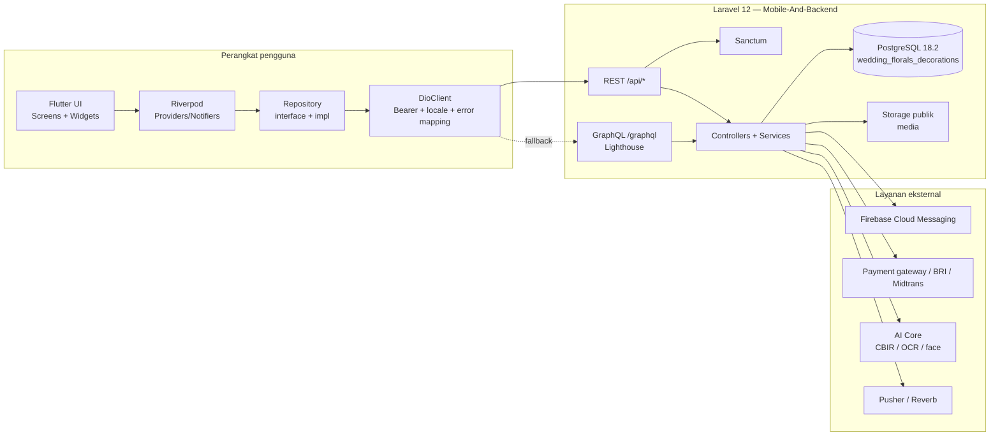
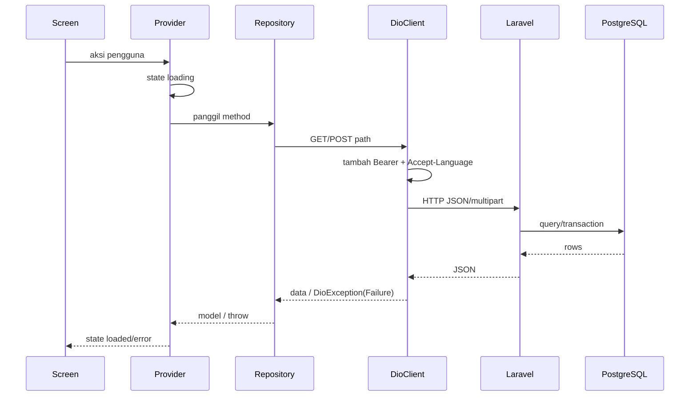

# Arsitektur Aplikasi

## 1. Gambaran sistem



## 2. Struktur folder Flutter

```text
lib/
├── main.dart                     # bootstrap, Firebase, theme, router
├── FirebaseOptions.dart
├── Core/
│   ├── Api/
│   │   ├── ApiEndpoints/         # konstanta path client
│   │   ├── DioClient/            # Dio tunggal + interceptor
│   │   ├── GraphqlClient/        # helper GraphQL (fallback)
│   │   └── GrpcClient/           # generated gRPC (tidak dipakai runtime)
│   ├── Config/AppConfig/         # base URL, storage host
│   ├── Constants/                # warna, ukuran, tipografi
│   ├── Errors/                   # AppErrorCodes, Failure, LocalizedError
│   ├── Providers/                # LocaleProvider, ThemeProvider
│   ├── Router/AppRouter/         # go_router + redirect + observer
│   ├── Services/                 # NotificationService, dll.
│   ├── Utils/                    # formatter, guest mode, kamera
│   └── Widgets/                  # komponen bersama
├── Features/<Feature>/
│   ├── Data/
│   │   ├── Models/
│   │   └── <X>RepositoryImpl/
│   ├── Domain/
│   │   └── <X>Repository/
│   └── Presentation/
│       ├── Providers/
│       ├── Screens/
│       └── Widgets/
├── L10n/                         # AppLocalizations id/en
├── DataConnectGenerated/         # generated Firebase Data Connect
└── FirebaseOptions.dart
```

## 3. Lapisan dan tanggung jawab

| Lapisan | Tanggung jawab | Aturan |
|---|---|---|
| Screen/Widget | Render UI, gesture, navigasi, dialog | Tidak memanggil Dio langsung kecuali layar legacy yang sudah ada; jangan menambah query DB |
| Provider/Notifier | State, orchestrasi use case, loading/error | Gunakan `AsyncValue`/state sealed; jangan menyimpan token di state |
| Repository | Kontrak domain, mapping response | Satu repository per domain; error dilempar sebagai `Failure`/exception yang dikenal |
| DioClient | Base URL, auth header, locale, timeout, error mapping | Satu instance; jangan membuat `Dio` baru per fitur |
| Backend controller | Validasi, otorisasi, transaksi, format response | Sumber kebenaran aturan bisnis |
| PostgreSQL | Integritas data, relasi, index | Perubahan skema lewat migration, bukan manual |

### 3.1 Pola state

- `Provider`/`NotifierProvider` untuk state yang dibaca lintas widget.
- `StateNotifier`/`Notifier` untuk state asinkron dengan status `loading`, `loaded`, `error`.
- `FutureProvider` untuk data read-only sederhana.
- `ref.watch` untuk render; `ref.read` untuk aksi.
- Jangan memanggil `ref.read` di dalam `build` untuk efek samping; gunakan `initState`/`Future.microtask`.

### 3.2 Dependency direction

```text
Presentation → Domain → Data (impl) → Core
```

- `Domain` tidak boleh mengimpor `Data` atau `Flutter`.
- `Data` boleh mengimpor `Core/Api`.
- `Presentation` boleh mengimpor `Domain`, `Data` (untuk provider), `Core`.
- Widget bersama tidak boleh bergantung pada satu feature.

## 4. Konfigurasi runtime

`AppConfig` membaca `dotenv`:

| Key | Contoh | Fungsi |
|---|---|---|
| `API_BASE_URL` | `http://192.168.100.2:8000/api` | Base REST; **sudah termasuk `/api`** |
| `GRPC_BASE_URL` | `http://192.168.100.2:50051` | Base gRPC (generated, tidak dipakai) |
| `STORAGE_BASE_URL` / host | origin backend | URL media |
| `GOOGLE_CLIENT_ID` | — | Google Sign-In |
| `PUSHER_APP_KEY` / `PUSHER_APP_CLUSTER` | — | Realtime chat |

`DioClient`:

- `BaseOptions(baseUrl: AppConfig.apiBaseUrl, connectTimeout: 30s, receiveTimeout: 30s)`.
- Interceptor auth menambahkan `Authorization: Bearer <auth_token>`.
- Interceptor locale menambahkan `Accept-Language` dari `SharedPreferences` key `app_locale`, default `id`.
- `ErrorInterceptor` memetakan status: `401 → AuthFailure`, `404 → NotFoundFailure`, `422 → ValidationFailure`, `500 → ServerFailure`, `null → NetworkFailure`.

## 5. Backend Laravel

- Route API utama: `routes/api/api.php` yang me-require file per controller.
- Prefix otomatis `api` dari `RouteServiceProvider`/bootstrap.
- Auth: `auth:sanctum` untuk endpoint privat; throttle untuk auth/chat guest.
- Response sukses umum: `{"status":"success","data":...,"message":...}`.
- Response error umum: `{"status":"error","message":...,"errors":...}`.
- Beberapa controller (mis. `CatalogController`) mendelegasikan REST ke query GraphQL internal, sehingga REST tetap menjadi kontrak mobile.
- Media disimpan di disk `public`; URL dihasilkan backend.

## 6. GraphQL, gRPC, Firebase, Data Connect

| Teknologi | Posisi | Status |
|---|---|---|
| REST | Transport utama mobile | Aktif |
| GraphQL | Fallback/hybrid; `GraphQLClientHelper` ke `/graphql` | Tersedia, belum dipakai layar produksi |
| gRPC | Generated `WeddingUserService` | Tidak dipakai runtime |
| Firebase FCM | Push notification | Aktif, non-blocking |
| Firebase Auth | Tidak dipakai; auth via Laravel Sanctum | Tidak aktif |
| Firebase Analytics/Crashlytics | Tidak diinisialisasi eksplisit | Tidak aktif |
| Firebase Data Connect | Generated `DataConnectGenerated` | Tidak dipakai |
| Firestore | `firestore.rules` menolak semua akses | Sengaja dinonaktifkan |

## 7. Alur request standar



## 8. Keputusan arsitektur

1. **REST sebagai kontrak mobile.** GraphQL hanya jalur internal/fallback; jangan menambah ketergantungan GraphQL baru tanpa persetujuan.
2. **Backend adalah otoritas.** Harga, stok, status, dan kepemilikan divalidasi di Laravel.
3. **Satu DioClient.** Menghindari token/locale yang tidak konsisten.
4. **Repository pattern.** Memudahkan pengujian dan penggantian transport.
5. **Feature-first folder.** Layar, provider, model, dan repository berdekatan.
6. **Firebase opsional.** Kegagalan inisialisasi Firebase tidak boleh menggagalkan aplikasi.
7. **Database PostgreSQL.** Dokumen lama yang menyebut MySQL sudah tidak berlaku.

## 9. Utang arsitektur

- Banyak layar memanggil `DioClient` langsung, melewati repository.
- `ApiEndpoints` memuat path yang tidak ada di backend dan konflik casing.
- `DioClient` tidak otomatis logout saat 401.
- Belum ada lapisan cache/offline yang konsisten.
- Model masih banyak `Map<String, dynamic>`; belum semua fitur punya typed model.
- `GraphqlClient`, `GrpcClient`, dan `DataConnectGenerated` adalah kode mati yang membingungkan.
