# ERD dan Relasi Database

## 1. ERD inti

```mermaid
erDiagram
  users ||--o{ carts : "memiliki"
  users ||--o{ orders : "membuat"
  users ||--o{ favorites : "menyimpan"
  users ||--o{ reviews : "menulis"
  users ||--o{ histories : "memiliki"
  users ||--o{ user_vouchers : "mengklaim"
  users ||--o{ user_sessions : "memiliki sesi"
  users ||--o{ trusted_devices : "mempercayai"
  users ||--o{ backup_codes : "memiliki"
  users ||--o{ identity_documents : "memiliki"
  users ||--o{ reports : "melaporkan"
  users ||--o{ security_emails : "menerima"
  users ||--o{ security_events : "menghasilkan"
  users ||--o{ device_tokens : "mendaftarkan"
  users ||--o{ search_logs : "mencari"
  users ||--o{ cbir_searches : "mencari gambar"
  users ||--o{ chat_calls : "memanggil"

  categories ||--o{ catalogs : "mengelompokkan"
  categories ||--o{ packages : "mengelompokkan"
  vendors ||--o{ catalogs : "menjual"
  vendors ||--o{ packages : "menjual"
  catalogs ||--o{ packages : "memiliki tier"
  catalogs ||--o{ carts : "ditambahkan"
  packages ||--o{ carts : "dipilih"
  catalogs ||--o{ favorites : "difavoritkan"
  packages ||--o{ favorites : "difavoritkan"
  catalogs ||--o{ orders : "dipesan"
  packages ||--o{ orders : "dipesan"
  catalogs ||--o{ reviews : "diulas"
  packages ||--o{ reviews : "diulas"

  orders ||--o{ order_payments : "memiliki pembayaran"
  orders ||--o{ order_timelines : "memiliki riwayat"
  orders ||--o{ transactions : "memiliki transaksi"
  orders ||--o{ payment_virtual_accounts : "memiliki VA"
  orders ||--o{ payment_qris : "memiliki QRIS"
  orders ||--o{ user_vouchers : "memakai voucher"
  orders ||--o{ reviews : "membeli"
  orders ||--o{ refund_requests : "mengajukan refund"
  payment_methods ||--o{ transactions : "dipakai"

  transactions ||--o{ payment_virtual_accounts : "menghasilkan"
  transactions ||--o{ payment_qris : "menghasilkan"

  reviews ||--o{ review_replies : "dibalas"
  reviews ||--o{ review_votes : "divote"
  reviews ||--o{ review_reports : "dilaporkan"

  vouchers ||--o{ user_vouchers : "diklaim"
  discounts ||--o{ vouchers : "mendefinisikan"

  fm_inboxes ||--o{ chat_calls : "memiliki panggilan"
  fm_inboxes ||--o{ fm_messages : "berisi (tanpa FK)"

  indonesia_provinces ||--o{ indonesia_cities : "memiliki"
  indonesia_cities ||--o{ indonesia_districts : "memiliki"
  indonesia_districts ||--o{ indonesia_villages : "memiliki"

  users {
    bigint id PK
    string full_name
    string email
    string username
    string password
    string whatsapp
    string ktp_number
    string kyc_status
    boolean two_factor_enabled
    boolean app_lock_pin_enabled
  }
  catalogs {
    bigint id PK
    bigint category_id FK
    bigint vendor_id FK
    string name
    decimal price
    decimal discount_price
    int stock
    boolean is_active
    boolean is_featured
    string theme
    string color
  }
  packages {
    bigint id PK
    bigint catalog_id FK
    bigint category_id FK
    bigint vendor_id FK
    string name
    decimal price
    decimal discount_price
    int stock
    int sort_order
  }
  carts {
    bigint id PK
    bigint user_id FK
    bigint catalog_id FK
    bigint package_id FK
    int quantity
    json meta
  }
  orders {
    bigint id PK
    bigint user_id FK
    bigint catalog_id FK
    bigint package_id FK
    string order_number
    decimal total_price
    string status
    string payment_status
    date booking_date
    time booking_time
    int quantity
  }
  transactions {
    bigint id PK
    bigint user_id FK
    bigint order_id FK
    bigint payment_method_id FK
    string reference_number
    decimal amount
    decimal admin_fee
    decimal total_amount
    string payment_gateway
    string payment_method
    string payment_url
    string status
  }
  reviews {
    bigint id PK
    bigint user_id FK
    bigint catalog_id FK
    bigint package_id FK
    bigint order_id FK
    int rating
    text comment
    boolean is_anonymous
  }
  vouchers {
    bigint id PK
    bigint discount_id FK
    string code
    boolean is_global
    int max_uses
    int uses_count
    datetime expires_at
  }
  fm_inboxes {
    bigint id PK
    string title
    json user_ids
    json meta
  }
  fm_messages {
    bigint id PK
    bigint inbox_id "tanpa FK"
    bigint user_id
    text message
    json read_by
    datetime read_at
    json meta
  }
```

## 2. Relasi foreign key aktual (74)

### 2.1 Pengguna dan keamanan

| Dari | Ke | On delete |
|---|---|---|
| `admins.user_id` | `users.id` | SET NULL |
| `backup_codes.user_id` | `users.id` | CASCADE |
| `device_tokens.user_id` | `users.id` | CASCADE |
| `trust_devices.user_id` | `users.id` | CASCADE |
| `trusted_devices.user_id` | `users.id` | CASCADE |
| `user_addresses.user_id` | `users.id` | CASCADE |
| `user_sessions.user_id` | `users.id` | CASCADE |
| `security_emails.user_id` | `users.id` | CASCADE |
| `security_events.user_id` | `users.id` | CASCADE |
| `identity_documents.user_id` | `users.id` | CASCADE |
| `users.kyc_reviewed_by` | `users.id` | SET NULL |
| `vendors.user_id` | `users.id` | CASCADE |

### 2.2 Katalog dan transaksi

| Dari | Ke | On delete |
|---|---|---|
| `catalogs.category_id` | `categories.id` | SET NULL |
| `catalogs.vendor_id` | `vendors.id` | SET NULL |
| `packages.catalog_id` | `catalogs.id` | CASCADE |
| `packages.category_id` | `categories.id` | SET NULL |
| `packages.vendor_id` | `vendors.id` | SET NULL |
| `carts.user_id` | `users.id` | CASCADE |
| `carts.catalog_id` | `catalogs.id` | SET NULL |
| `carts.package_id` | `packages.id` | SET NULL |
| `favorites.user_id` | `users.id` | CASCADE |
| `favorites.catalog_id` | `catalogs.id` | SET NULL |
| `favorites.package_id` | `packages.id` | CASCADE |
| `orders.user_id` | `users.id` | CASCADE |
| `orders.catalog_id` | `catalogs.id` | SET NULL |
| `orders.package_id` | `packages.id` | SET NULL |
| `order_payments.order_id` | `orders.id` | CASCADE |
| `order_timelines.order_id` | `orders.id` | CASCADE |
| `order_timelines.created_by` | `users.id` | SET NULL |
| `transactions.user_id` | `users.id` | CASCADE |
| `transactions.order_id` | `orders.id` | CASCADE |
| `transactions.payment_method_id` | `payment_methods.id` | SET NULL |
| `payment_virtual_accounts.user_id` | `users.id` | CASCADE |
| `payment_virtual_accounts.order_id` | `orders.id` | CASCADE |
| `payment_virtual_accounts.transaction_id` | `transactions.id` | CASCADE |
| `payment_qris.user_id` | `users.id` | CASCADE |
| `payment_qris.order_id` | `orders.id` | CASCADE |
| `payment_qris.transaction_id` | `transactions.id` | CASCADE |
| `refund_requests.order_id` | `orders.id` | CASCADE |
| `refund_requests.user_id` | `users.id` | CASCADE |

### 2.3 Ulasan, voucher, chat

| Dari | Ke | On delete |
|---|---|---|
| `reviews.user_id` | `users.id` | CASCADE |
| `reviews.catalog_id` | `catalogs.id` | CASCADE |
| `reviews.package_id` | `packages.id` | CASCADE |
| `reviews.order_id` | `orders.id` | SET NULL |
| `review_replies.review_id` | `reviews.id` | CASCADE |
| `review_replies.user_id` | `users.id` | CASCADE |
| `review_votes.review_id` | `reviews.id` | CASCADE |
| `review_votes.user_id` | `users.id` | CASCADE |
| `review_reports.review_id` | `reviews.id` | CASCADE |
| `review_reports.reporter_id` | `users.id` | CASCADE |
| `review_reports.reviewed_by` | `users.id` | SET NULL |
| `vouchers.discount_id` | `discounts.id` | SET NULL |
| `user_vouchers.user_id` | `users.id` | CASCADE |
| `user_vouchers.voucher_id` | `vouchers.id` | CASCADE |
| `user_vouchers.order_id` | `orders.id` | SET NULL |
| `chat_calls.inbox_id` | `fm_inboxes.id` | CASCADE |
| `chat_calls.caller_user_id` | `users.id` | CASCADE |
| `chat_calls.callee_user_id` | `users.id` | CASCADE |

### 2.4 CBIR, laporan, wilayah

| Dari | Ke | On delete |
|---|---|---|
| `cbir_searches.user_id` | `users.id` | CASCADE |
| `cbir_search_results.search_id` | `cbir_searches.id` | CASCADE |
| `cbir_feedback.search_id` | `cbir_searches.id` | CASCADE |
| `cbir_feedback.user_id` | `users.id` | CASCADE |
| `reports.user_id` | `users.id` | CASCADE |
| `reports.resolved_by` | `users.id` | SET NULL |
| `histories.user_id` | `users.id` | CASCADE |
| `search_logs.user_id` | `users.id` | CASCADE |
| `indonesia_cities.province_code` | `indonesia_provinces.code` | RESTRICT |
| `indonesia_districts.city_code` | `indonesia_cities.code` | RESTRICT |
| `indonesia_villages.district_code` | `indonesia_districts.code` | RESTRICT |

### 2.5 Framework

| Dari | Ke | On delete |
|---|---|---|
| `failed_import_rows.import_id` | `imports.id` | CASCADE |
| `model_has_permissions.permission_id` | `permissions.id` | CASCADE |
| `model_has_roles.role_id` | `roles.id` | CASCADE |
| `role_has_permissions.permission_id` | `permissions.id` | CASCADE |
| `role_has_permissions.role_id` | `roles.id` | CASCADE |

## 3. Relasi yang hilang / perlu diperbaiki

| Relasi | Status | Dampak |
|---|---|---|
| `fm_messages.inbox_id` → `fm_inboxes.id` | Tidak ada FK | Pesan orphan, hapus inbox tidak cascade |
| `fm_inboxes.user_ids` | JSON, bukan pivot | Query unread memakai `LIKE`, sulit di-index |
| `reviews` unik per user/resource | Tidak terlihat di skema | Potensi duplikasi ulasan |
| `review_votes` unik per user/review | Tidak terlihat di skema | Vote ganda |
| `favorites` unik per user/resource | Tidak terlihat di skema | Favorit ganda |
| `payment_*` konsistensi status | Tidak ada constraint | Status bisa berbeda antar tabel |

## 4. Aturan pemetaan API → tabel

| Endpoint | Tabel ditulis | Tabel dibaca |
|---|---|---|
| `POST /bookings` | `orders`, `order_payments`, `order_timelines`, `transactions`, `carts`, `user_vouchers` | `catalogs`, `packages`, `vouchers`, `payment_methods` |
| `POST /bookings/{id}/virtual-account` | `payment_virtual_accounts`, `transactions` | `orders`, `banks` |
| `POST /bookings/{id}/qris` | `payment_qris`, `transactions` | `orders` |
| `POST /bookings/{id}/upload-proof` | `order_payments`, `orders` | `orders` |
| `POST /reviews` | `reviews` | `orders`, `catalogs`, `packages` |
| `POST /messages/send` | `fm_messages` | `fm_inboxes`, `users` |
| `POST /favorite` | `favorites` | `catalogs`, `packages` |
| `POST /cart/add` | `carts` | `catalogs`, `packages` |
| `POST /notifications/fcm-token` | `device_tokens`/`user_fcm_devices` | `users` |
| `POST /security/two-factor/setup` | `users` | `users` |
| `POST /security/two-factor/backup-codes` | `backup_codes` | `users` |
