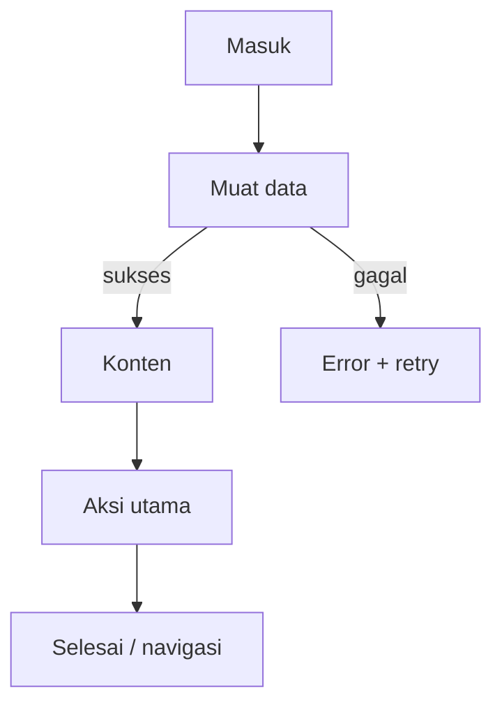

# <Judul Layar>

> Template ringkas untuk penulisan manual. PRD hasil generator memakai 23 bagian (0–22) dan menambahkan Copywriting, Inventaris Komponen, serta Handoff. Bagian bertanda **[Usulan]** adalah rekomendasi, bukan perilaku terverifikasi.

> **Fitur:** <fitur> · **Route:** `<path>` · **Akses:** <Guest/Sanctum/lokal> · **File:** `<lib/Features/.../XScreen.dart>` · **State:** <Riverpod/state lokal>

## 1. Ringkasan Eksekutif

| Aspek | Nilai |
|---|---|
| Tujuan | <satu kalimat: masalah pengguna yang diselesaikan> |
| Definisi sukses | <hasil yang terlihat pengguna> |
| Aktor | <Guest / user login / admin> |
| Titik masuk | <dari layar mana, notifikasi, deep link> |
| Keluar | <navigasi setelah aksi utama> |

## 2. Konteks

- **Persona:** <siapa dan kebutuhannya>
- **In scope:** <hal yang dikerjakan layar ini>
- **Out of scope:** <hal yang bukan tanggung jawab layar ini>
- **Dependensi produk:** <fitur lain yang harus selesai lebih dulu>

## 3. Navigasi & Entry

| Item | Nilai |
|---|---|
| Route | `<path>` |
| Parameter path | `<nama>` |
| Query/extra | `<key>` |
| Guard | <Guest/Sanctum/redirect> |
| Masuk dari | <daftar sumber> |
| Back behavior | <kembali ke mana; apa yang dipertahankan> |

## 4. Alur Pengguna

1. <langkah 1>
2. <langkah 2>
3. <langkah 3>



## 5. Arsitektur Layar

| Aspek | Nilai |
|---|---|
| Kelas | `XScreen` / `_XScreenState` |
| State management | <Riverpod + setState / ConsumerWidget> |
| Pola data | <sekali muat / polling / realtime> |
| Provider | `<provider>` |
| Repository | `<repository>` |
| Widget inti | `<AppBar/...>` |

### 5.1 State lokal

| Field | Tipe | Peran | Dispose |
|---|---|---|---|
| `_loading` | `bool` | Menandai proses muat | — |
| `_controller` | `TextEditingController` | Input | Ya |

### 5.2 Alur data

```text
Widget → Provider → Repository → DioClient → Controller Laravel → PostgreSQL
```

## 6. Blueprint UI

```text
┌──────────────────────────────┐
│ AppBar / judul               │
├──────────────────────────────┤
│ 1. <elemen>                  │
│ 2. <elemen>                  │
│ 3. <elemen>                  │
└──────────────────────────────┘
```

**Komponen:** `<WidgetA>`, `<WidgetB>`.

## 7. Design System

| Token | Nilai/Pemakaian |
|---|---|
| `AppColors.primary` | `#1E3A5F` |
| `AppColors.accent` | `#C9A94E` |
| Radius kartu/tombol | 16 / 14 |
| Spacing | 4/8/16/24/32 |
| Tipografi | Instrument Sans, `AppTextStyles` |

- Wajib aman di 320 px, landscape, text scale 200%, mode terang/gelap.
- Jangan hardcode warna, ukuran, atau string UI.

## 8. State Machine

| State | Pemicu | UI | Pemulihan |
|---|---|---|---|
| `initial` | Layar dibuka | Placeholder | Muat data |
| `loading` | Request berjalan | Skeleton; CTA disabled | Tunggu/retry |
| `content` | Data tersedia | Konten utama | — |
| `empty` | Data kosong | Empty state + CTA | Refresh |
| `error` | Request gagal | Pesan + retry | Retry |
| `unauthorized` | 401 | Arahkan login | Login ulang |
| `offline` | Koneksi putus | Banner offline | Coba saat online |
| `submitting` | Aksi utama | Tombol disabled + progress | Selesai/error |

## 9. Kontrak API

| # | Method | Path | Controller | Auth | Kegunaan |
|---|---|---|---|---|---|
| 1 | `<GET>` | `</api/...>` | `XController@method` | Sanctum | <kegunaan> |

### 9.1 Request/response per endpoint

- **Path params:** `<nama>` — <validasi backend>
- **Body:** `<field>` (`required|string|max:255`) — <arti>
- **Response sukses:** `{"status":"success","message":"...","data":{...}}`
- **Error terbaca:** 401/403/404/422/5xx — <pesan dan perilaku UI>

> Jangan mengarang endpoint/kolom. Cocokkan dengan `routes/api.php` dan controller.

## 10. Data & Database

| Tabel | Peran | Kolom kunci |
|---|---|---|
| `<table>` | <peran> | `id`, `<fk>`, `created_at` |

- Semua nominal/stok/status dari backend.
- Tidak ada query database langsung dari Flutter.

## 11. Aturan Bisnis & Validasi

- <aturan 1>
- <aturan 2>
- Disable submit selama request; satu tap = satu request.
- Guest hanya memakai alur guest yang didukung backend.

## 12. Error Handling

| HTTP | Failure | Perilaku UI |
|---|---|---|
| 401 | `AuthFailure` | Hapus token, arahkan login |
| 403 | Izin | Pesan akses ditolak, tanpa logout |
| 404 | `NotFoundFailure` | Resource tidak ditemukan |
| 422 | `ValidationFailure` | Error per field, input dipertahankan |
| 500 | `ServerFailure` | Pesan server + retry |
| null | `NetworkFailure` | Periksa koneksi + retry |

## 13. Security & Privacy

- Token hanya di `FlutterSecureStorage`; jangan di log/SharedPreferences.
- Jangan menampilkan stack trace, query, atau detail internal.
- Jangan mengirim PII ke analytics/crash report.
- Guest tidak mengirim Bearer token kosong.

## 14. Accessibility

- Label semantik untuk semua ikon/kontrol non-teks.
- Target sentuh ≥48×48 dp; kontras WCAG AA.
- Text scale 200% tidak memotong label utama.
- Error form diumumkan dan terhubung ke field.

## 15. Performance & Offline

- Jangan memuat seluruh data sekaligus; gunakan pagination/cursor.
- Dispose controller/timer/subscription di `dispose`.
- Hentikan polling saat background, lanjutkan saat resume.
- Gunakan cache gambar yang sudah ada.

## 16. Analytics [Usulan]

| Event | Pemicu | Properti | PII |
|---|---|---|---|
| `screen_view_<slug>` | Layar dibuka | screen, route, auth | Tidak |
| `<slug>_cta_tap` | Aksi utama | cta, state | Tidak |
| `<slug>_failure` | Aksi gagal | error_code, status | Tidak |

## 17. Acceptance Criteria

- [ ] <kriteria fungsional 1>
- [ ] <kriteria fungsional 2>
- [ ] Loading/empty/error/offline/unauthorized tertangani.
- [ ] 401 membersihkan token dan mengarahkan login.
- [ ] 422 menampilkan error per field dan mempertahankan input.
- [ ] Tidak ada overflow di 320 px/landscape/text scale 200%.
- [ ] `flutter analyze` bersih dan test happy path + satu error path lulus.

## 18. Test Plan

| ID | Jenis | Skenario | Hasil yang diharapkan |
|---|---|---|---|
| TC-01 | Widget | Happy path | Konten tampil, tidak ada error |
| TC-02 | Manual | Loading lambat | Skeleton; CTA disabled |
| TC-03 | Manual | Empty | Empty state + CTA |
| TC-04 | Manual | 500 | Pesan + retry, tidak crash |
| TC-05 | Manual | 401 | Token dibersihkan, redirect login |
| TC-06 | Manual | 403 | Pesan akses ditolak |
| TC-07 | Manual | Offline | Pesan offline + retry |
| TC-08 | Widget | Double submit | Hanya satu request |
| TC-09 | Manual | 320 px/landscape | Tidak overflow |
| TC-10 | Manual | Dark mode + text scale 200% | Tetap terbaca |

## 19. Gap, Risiko & Dependensi

| Jenis | Item | Catatan |
|---|---|---|
| Gap | <gap> | <dampak> |
| Risiko | <risiko> | <mitigasi> |
| Dependensi | `<endpoint>` | `<controller>` |

## 20. Peta Implementasi & Simbol

| Layer | File/Simbol |
|---|---|
| Screen | `<path.dart>` · `XScreen` |
| Provider | `<provider>` |
| Repository | `<repository>` |
| Test | `test/Features/<Fitur>/` |
| Dokumen | `.docs/screens/<fitur>/<slug>.md` |
| Skill | `.skills/screens/<fitur>/<slug>/SKILL.md` |

## 21. Referensi & Riwayat

- [Navigasi](../../02-architecture/NAVIGATION.md)
- [State & Error](../../02-architecture/STATE-AND-ERRORS.md)
- [REST API](../../03-api/REST-API.md)
- [Database](../../04-database/DATABASE.md)
- [Known Gaps](../../06-reference/KNOWN-GAPS.md)

| Tanggal | Perubahan | Sumber |
|---|---|---|
| <tanggal> | <perubahan> | <kode/route/skema> |
