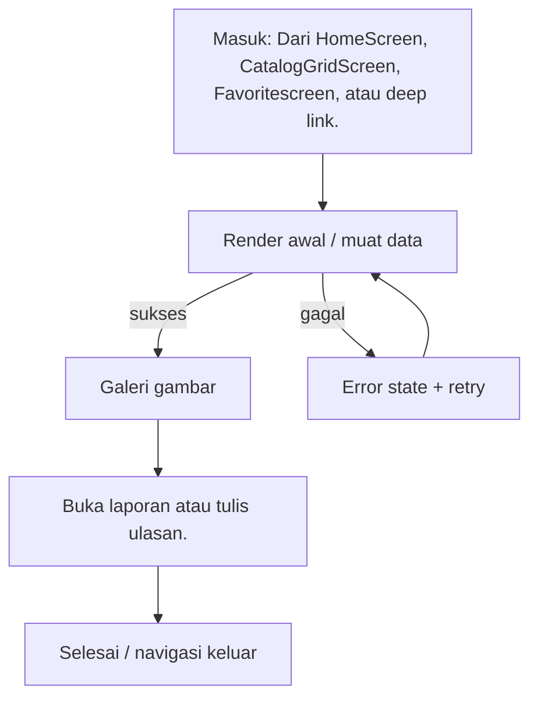

# Detail Katalog

> **Fitur:** Katalog · **Route:** `/catalog/:id` · **Akses:** Guest + Sanctum · **Tipe:** Formulir
> **Implementasi:** `lib/Features/Catalog/Presentation/Screens/CatalogDetail/CatalogDetailScreen.dart` — `CatalogDetailScreen` (827 baris) · **State:** Riverpod + state lokal (`setState`) · **Pola:** request-response
> **API:** 9 endpoint · **Tabel:** 11 · **Model:** 1
> Diverifikasi 6 November 2026 dari kode Flutter, route Laravel, dan skema PostgreSQL. Bagian bertanda **[Usulan]** adalah rekomendasi, bukan perilaku yang sudah diverifikasi.

## 0. Ringkasan Eksekutif

| Aspek | Ringkasan |
|---|---|
| Tujuan | Menampilkan detail katalog/paket, tier, harga, stok, ulasan, favorit, dan aksi tambah ke keranjang. |
| Aktor | Guest dan pelanggan terautentikasi |
| Nilai pengguna | Menampilkan detail katalog/paket, tier, harga, stok, ulasan, favorit, dan aksi tambah ke keranjang. |
| Definisi sukses | Data tersimpan dan validasi backend terpetakan ke field. |
| Risiko utama | Guest dapat melihat detail hanya jika endpoint katalog publik tersedia; saat ini `/catalog/{id}` privat. |
| Status dokumen | Kontrak terdokumentasi; ada gap yang harus ditangani |

## 1. Konteks Katalog

### 1.1 Persona & job-to-be-done

| Persona | Kebutuhan | Ukuran keberhasilan |
|---|---|---|
| Pelanggan dekorasi pernikahan | Menampilkan detail katalog/paket, tier, harga, stok, ulasan, favorit, dan aksi tambah ke keranjang. | Data tersimpan dan validasi backend terpetakan ke field. |
| Guest | Mencoba melihat konten tanpa akun; diarahkan login pada aksi privat | Konten publik tampil dan prompt login muncul tepat pada aksi privat |

### 1.2 In scope

- Muat detail katalog dan tier.
- Pilih tier dan kuantitas.
- Tambah ke keranjang atau favorit.
- Baca ulasan dan ringkasan rating.
- Buka laporan atau tulis ulasan.

### 1.3 Out of scope

- Tidak mengakses database secara langsung; semua data lewat REST/Laravel.
- Tidak menggantikan validasi backend untuk harga, stok, status, atau kepemilikan resource.
- Tidak menambahkan dependensi atau endpoint baru tanpa memperbarui dokumen ini dan peta endpoint.

## 2. Navigasi & Entry Point

| Arah | Detail |
|---|---|
| Masuk dari | Dari `HomeScreen`, `CatalogGridScreen`, `Favoritescreen`, atau deep link. |
| Route | `/catalog/:id` |
| Parameter/extra | Path parameter `id` wajib. Tidak ada `extra`. |
| Guard | Guest boleh membuka layar, tetapi aksi privat harus memunculkan `GuestAuthPrompt` dan tidak mengirim Bearer token kosong. |
| Keluar ke | `/chat/:id`, `/checkout` |
| Perilaku back | Jika ada perubahan belum disimpan, tampilkan konfirmasi sebelum keluar. [Usulan] |

### 2.1 Layar terkait dalam fitur yang sama

| Layar | Route | PRD |
|---|---|---|
| `CatalogGridScreen` | `/catalog` | [catalog-grid.md](../catalog/catalog-grid.md) |

## 3. Alur Pengguna

1. Muat detail katalog dan tier.
2. Pilih tier dan kuantitas.
3. Tambah ke keranjang atau favorit.
4. Baca ulasan dan ringkasan rating.
5. Buka laporan atau tulis ulasan.

**Decision points yang wajib diuji:**

- `tidak ditemukan` → Tampilkan halaman not found dengan tombol kembali.
- `review kosong` → Empty state dengan penjelasan dan CTA lanjutan.



## 4. Arsitektur Layar

| Aspek | Nilai |
|---|---|
| File | `lib/Features/Catalog/Presentation/Screens/CatalogDetail/CatalogDetailScreen.dart` |
| Kelas layar | `CatalogDetailScreen` |
| Base widget | `ConsumerStatefulWidget` |
| Kelas state | `_CatalogDetailPageState` |
| State management | Riverpod + state lokal (`setState`) |
| Pola data | request-response |
| Provider | `catalogRepositoryProvider`, `authProvider`, `chatProvider`, `reviewProvider` |
| Repository | Tidak terdeteksi |
| Service | Tidak terdeteksi |
| Widget inti | `AppShimmer`, `AppErrorState`, `AppButton`, `AppSnackbar`, `GuestAuthPrompt`, `AppBreadcrumbs` |
| Widget fitur | `CatalogRatingComments` |
| Model | `TierModel` |

### 4.1 State lokal yang terdeteksi

| Field | Tipe | Peran |
|---|---|---|
| `_pageController` | `PageController` | Controller input; wajib dispose. |
| `_reviewController` | `TextEditingController` | Controller input; wajib dispose. |
| `_currentPage` | `int` | Kontrol posisi/paginasi. |
| `_descExpanded` | `bool` | State lokal layar. |
| `_loading` | `bool` | Menandai proses muat/aksi. |
| `_cartLoading` | `bool` | Menandai proses muat/aksi. |
| `_favLoading` | `bool` | Menandai proses muat/aksi. |
| `_reviewSubmitting` | `bool` | Mencegah submit ganda. |
| `_reviewRating` | `int` | State lokal layar. |
| `_error` | `String?` | Menyimpan pesan kegagalan. |
| `_data` | `Map<String, dynamic>?` | Data yang ditampilkan. |
| `_selectedTier` | `TierModel?` | Filter/sortir lokal. |
| `_initialized` | `bool` | State lokal layar. |

### 4.2 Metode internal

`_fetchDetail`, `_selectTier`, `_addToCart`, `_toggleFavorite`, `_messageAdmin`, `_buyNow`, `_shareItem`, `_reportItem`, `_buildShimmer`, `_buildContent`, `_buildImageSlider`, `_buildRatingBadge`, `_buildPriceRow`, `_submitInlineReview`, `_buildInlineReviewComposer`, `_buildBottomBar`.

### 4.3 Alur data

```text
Widget / State
   ↓ baca/tulis
Provider Riverpod
   ↓
Repository / DioClient
   ↓ REST
Controller Laravel → PostgreSQL (11 tabel terkait)
```

## 5. Blueprint UI

Wireframe konseptual dari daftar elemen registry. Urutan final mengikuti file implementasi.

```text
┌────────────────────────────────────────────────────────────────────┐
│ Detail Katalog                                                    │
├────────────────────────────────────────────────────────────────────┤
│ 1. Galeri gambar                                                  │
│ 2. Nama & harga                                                   │
│ 3. Pemilih tier                                                   │
│ 4. Stok                                                           │
│ 5. Tombol favorit                                                 │
│ 6. Tombol tambah keranjang                                        │
│ 7. Daftar ulasan                                                  │
└────────────────────────────────────────────────────────────────────┘
```

**Komponen bersama yang terdeteksi:**

- Core: `AppShimmer`, `AppErrorState`, `AppButton`, `AppSnackbar`, `GuestAuthPrompt`, `AppBreadcrumbs`
- Fitur: `CatalogRatingComments`

## 6. Inventaris Komponen & Interaksi

| # | Elemen | Jenis | Aksi | Feedback |
|---|---|---|---|---|
| 1 | Galeri gambar | Lampiran | Pilih file; validasi tipe/ukuran sebelum upload. | Progress upload; error tipe/ukuran. |
| 2 | Nama & harga | Konten | Tampilkan informasi; tidak ada aksi tulis. | Loading/error state tetap wajib. |
| 3 | Pemilih tier | Konten | Tampilkan informasi; tidak ada aksi tulis. | Loading/error state tetap wajib. |
| 4 | Stok | Konten | Tampilkan informasi; tidak ada aksi tulis. | Loading/error state tetap wajib. |
| 5 | Tombol favorit | Aksi | Tap → jalankan aksi utama layar. | Disabled saat loading; error lewat SnackBar/inline. |
| 6 | Tombol tambah keranjang | Aksi | Tap → jalankan aksi utama layar. | Disabled saat loading; error lewat SnackBar/inline. |
| 7 | Daftar ulasan | Daftar | Tap item → buka detail; dukung refresh/pagination. | Skeleton saat muat; empty state; retry. |

### 6.1 Fakta teknis form & interaksi

| Fakta | Nilai |
|---|---|
| TextEditingController | 1 |
| Field teks/form | 1 |
| Dropdown | 0 |
| Switch/toggle | 0 |
| Validator client | 0 |
| Field password (`obscureText`) | 0 |
| maxLength | Tidak terdeteksi |
| Keyboard | Tidak terdeteksi |
| Input formatter | Tidak terdeteksi |
| Upload file | Tidak |
| Kamera | Tidak |
| WebView | Tidak |
| Timer/polling | Tidak |
| Pagination | Tidak |
| Pull to refresh | Tidak |

## 7. Copywriting & Microcopy

Semua teks di bawah ini adalah **usulan**. Implementasi wajib memakai `AppLocalizations` dan mengikuti gaya bahasa layar lain.

| Lokasi | Draft copy | Catatan |
|---|---|---|
| Judul/header | Detail Katalog | Samakan dengan label navigasi. |
| Subjudul | Menampilkan detail katalog/paket, tier, harga, stok, ulasan, favorit, dan aksi tambah ke… | Ringkas; jangan mengulang judul. |
| Tombol utama | Lihat Detail | [Usulan] Disabled saat proses. |
| Empty state | Belum ada detail Katalog. | [Usulan] Sertakan CTA lanjutan. |
| Error | Gagal memuat detail Katalog. Periksa koneksi lalu coba lagi. | [Usulan] Jangan tampilkan stack trace. |
| Retry | Coba lagi | [Usulan] Pertahankan data lama bila ada. |
| Guest | Masuk untuk melanjutkan. | [Usulan] Gunakan `GuestAuthPrompt`. |
| Offline | Anda sedang offline. Periksa koneksi internet. | [Usulan] Sediakan retry. |
| Validasi | Periksa kembali data yang Anda isi. | [Usulan] Fokus ke field pertama. |
| Validasi | Periksa kembali data yang Anda isi. | [Usulan] Fokus ke field pertama yang salah. |
| Sukses | Data berhasil disimpan. | [Usulan] Kembali ke layar sebelumnya. |

## 8. Design System & Responsif

### 8.1 Token yang wajib dipakai

| Token | Nilai |
|---|---|
| Font | Instrument Sans (W400/W600), aset lokal |
| Warna primer | `AppColors.primaryColor` = `#1E3A5F` |
| Aksen | `AppColors.accentColor` = `#C9A94E` |
| Background light | `AppColors.backgroundColor` = `#F8F6F7` |
| Surface light | `AppColors.surfaceColor` = `#FFFFFF` |
| Background dark | `AppColors.darkBackground` = `#121212` |
| Surface dark | `AppColors.darkSurface` = `#1E1E1E` |
| Teks primer light | `#1A1A2E`; dark `#E8E8E8` |
| Teks sekunder light | `#8E8E9A`; dark `#A0A0A0` |
| Sukses/error/warning/info | `#10B981` / `#EF4444` / `#F59E0B` / `#3B82F6` |
| Tipografi | `headTitle` 22/w600; `subHeadTitle` 16/w400; `h3` 14/w600; `h4` 12/w400; `description` 14/1.4 |
| Spacing | `AppSizes` 2, 4, 8, 16, 24, 32, 48, 64 |
| Radius | card 16, button 14, input 14, avatar 28, bottom nav 24 |
| Glass | `AppBlurBackdrop`; `blurSigma` 15; tint light `#32FFFFFF`, night `#32000000` |

### 8.2 Aturan responsif

- Lebar minimum yang wajib diuji: **320 px**; target umum 360/390/412 px.
- Tablet ≥ 600 px: gunakan padding lebih lebar dan grid multi-kolom bila layar berupa koleksi.
- Jangan mengunci tinggi konten; gunakan `SingleChildScrollView`/sliver agar tidak overflow.
- Hormati `SafeArea`, status bar, navigation bar, dan keyboard inset.
- Teks harus tetap terbaca pada text scale 200%; hindari `maxLines: 1` untuk label penting.
- Layout harus aman untuk locale dengan teks lebih panjang (±30%).

### 8.3 Mode gelap & glass

- Tema mengikuti sistem (light/dark) dan dapat di-override `ThemeProvider`.
- Jangan hardcode warna; gunakan `AppColors`/`AppTheme` agar mode gelap bekerja.
- Fallback tanpa blur harus tetap kontras dan terbaca.
- Hormati reduce-motion; animasi 3D/parallax tidak boleh menjadi satu-satunya pembeda state.

## 9. State Machine

| State | Pemicu | UI | Pemulihan |
|---|---|---|---|
| `initial` | Layar dibuka | Kerangka/placeholder awal | Muat data |
| `loading` | Request berjalan | Skeleton/spinner; aksi utama disabled | Tunggu atau retry saat timeout |
| `content` | Data tersedia | Render konten utama | — |
| `empty` | Data kosong | Empty state dengan penjelasan + CTA | Refresh atau aksi lanjutan |
| `error` | Request gagal | Pesan ramah + tombol coba lagi | Retry |
| `unauthorized` | HTTP 401 | Sesi berakhir; arahkan login/Landing | Login ulang |
| `offline` | Koneksi putus | Banner/empty offline | Coba lagi saat online |
| `submitting` | Pengguna menekan aksi utama | Tombol disabled + progress | Selesai atau tampilkan error |
| `guest` | Guest menekan aksi privat | `GuestAuthPrompt` | Login |
| `tidak ditemukan` | Kondisi domain | Tampilkan halaman not found dengan tombol kembali. | Ikuti aksi pemulihan pada pesan |
| `stok habis` | Kondisi domain | Tampilkan badge stok habis dan nonaktifkan aksi beli. | Ikuti aksi pemulihan pada pesan |
| `guest mencoba favorit` | Kondisi domain | Tampilkan `GuestAuthPrompt`; jangan panggil endpoint privat. | Ikuti aksi pemulihan pada pesan |
| `review kosong` | Kondisi domain | Empty state dengan penjelasan dan CTA lanjutan. | Ikuti aksi pemulihan pada pesan |

**Aturan umum:** setiap request harus melewati `idle → loading → success/empty/failure`; jangan merender hasil request langsung di `build()`.

## 10. Kontrak API

### 10.1 Ringkasan endpoint

| # | Method | Path | Controller | Auth | Kegunaan |
|---|---|---|---|---|---|
| 1 | `GET` | `/catalog/{id}` | `CatalogController@show` | Sanctum | Detail katalog |
| 2 | `GET` | `/catalog/{id}/tiers` | `CatalogController@tiers` | Publik | Tier/paket dari katalog |
| 3 | `POST` | `/Favorite/toggle` | `FavoriteController@toggle` | Sanctum | Menambah/menghapus favorit |
| 4 | `POST` | `/cart/add` | `CartController@store` | Sanctum | Menambah item ke keranjang |
| 5 | `GET` | `/reviews/catalog/{catalogId}` | `ReviewController@getCatalogReviews` | Sanctum | Ulasan sebuah katalog |
| 6 | `GET` | `/reviews/catalog/{id}/summary` | `ReviewController@getCatalogRatingSummary` | Sanctum | Ringkasan rating katalog |
| 7 | `POST` | `/reviews/{id}/vote` | `ReviewController@voteHelpful` | Sanctum | Vote ulasan membantu |
| 8 | `GET` | `/reviews` | `ReviewController@getAllReviews` | Sanctum | Membuat/membaca ulasan |
| 9 | `POST` | `/reviews` | `ReviewController@store` | Sanctum | Membuat/membaca ulasan |

### 10.2 Detail per endpoint

#### 10.2.1 `GET /catalog/{id}`

- **Controller:** `CatalogController@show`
- **Auth:** Sanctum
- **Kegunaan:** Detail katalog
- **Sumber aturan:** `../Mobile-And-Backend/app/Http/Controllers/Api/User/CatalogController/CatalogController.php`
- **Field request:** tidak ada aturan validasi field yang terdeteksi otomatis (GET, validasi di service, atau `FormRequest` lain). Periksa controller sebelum menulis kode.

#### 10.2.2 `GET /catalog/{id}/tiers`

- **Controller:** `CatalogController@tiers`
- **Auth:** Publik
- **Kegunaan:** Tier/paket dari katalog
- **Sumber aturan:** `../Mobile-And-Backend/app/Http/Controllers/Api/User/CatalogController/CatalogController.php`
- **Field request:** tidak ada aturan validasi field yang terdeteksi otomatis (GET, validasi di service, atau `FormRequest` lain). Periksa controller sebelum menulis kode.

#### 10.2.3 `POST /Favorite/toggle`

- **Controller:** `FavoriteController@toggle`
- **Auth:** Sanctum
- **Kegunaan:** Menambah/menghapus favorit
- **Sumber aturan:** `../Mobile-And-Backend/app/Http/Controllers/Api/User/FavoriteController/FavoriteController.php`
- **Catatan:** Casing backend `/Favorite/toggle`.

| Field request | Aturan | Wajib |
|---|---|---|
| `package_id` | `nullable|exists:packages,id` | Tidak |
| `catalog_id` | `nullable|exists:catalogs,id` | Tidak |

- **Response top-level:** `status`, `message`, `in_Favorite`, `data`, `error`
- **Pesan error terbaca:** “Tier tidak termasuk dalam katalog yang dipilih”; “Gagal memperbarui Favorite”

#### 10.2.4 `POST /cart/add`

- **Controller:** `CartController@store`
- **Auth:** Sanctum
- **Kegunaan:** Menambah item ke keranjang
- **Sumber aturan:** `../Mobile-And-Backend/app/Http/Controllers/Api/User/CartController/CartController.php`
- **Catatan:** Butuh `catalog_id` dan `package_id`.

| Field request | Aturan | Wajib |
|---|---|---|
| `catalog_id` | `required|exists:catalogs,id` | Ya |
| `package_id` | `required|exists:packages,id` | Ya |
| `quantity` | `required|integer|min:1` | Ya |

- **Response top-level:** `status`, `message`
- **Pesan error terbaca:** “Paket tidak termasuk dalam katalog yang dipilih”

#### 10.2.5 `GET /reviews/catalog/{catalogId}`

- **Controller:** `ReviewController@getCatalogReviews`
- **Auth:** Sanctum
- **Kegunaan:** Ulasan sebuah katalog
- **Sumber aturan:** `../Mobile-And-Backend/app/Http/Controllers/Api/User/ReviewController/ReviewController.php`
- **Field request:** tidak ada aturan validasi field yang terdeteksi otomatis (GET, validasi di service, atau `FormRequest` lain). Periksa controller sebelum menulis kode.
- **Response top-level:** `status`, `data`, `summary`, `pagination`, `message`, `error`
- **Pesan error terbaca:** “Gagal mengambil ulasan”

#### 10.2.6 `GET /reviews/catalog/{id}/summary`

- **Controller:** `ReviewController@getCatalogRatingSummary`
- **Auth:** Sanctum
- **Kegunaan:** Ringkasan rating katalog
- **Sumber aturan:** `../Mobile-And-Backend/app/Http/Controllers/Api/User/ReviewController/ReviewController.php`
- **Field request:** tidak ada aturan validasi field yang terdeteksi otomatis (GET, validasi di service, atau `FormRequest` lain). Periksa controller sebelum menulis kode.

#### 10.2.7 `POST /reviews/{id}/vote`

- **Controller:** `ReviewController@voteHelpful`
- **Auth:** Sanctum
- **Kegunaan:** Vote ulasan membantu
- **Sumber aturan:** `../Mobile-And-Backend/app/Http/Controllers/Api/User/ReviewController/ReviewController.php`
- **Field request:** tidak ada aturan validasi field yang terdeteksi otomatis (GET, validasi di service, atau `FormRequest` lain). Periksa controller sebelum menulis kode.
- **Response top-level:** `status`, `data`, `message`, `error`
- **Pesan error terbaca:** “Ulasan tidak ditemukan”; “Gagal memproses vote”

#### 10.2.8 `GET /reviews`

- **Controller:** `ReviewController@getAllReviews`
- **Auth:** Sanctum
- **Kegunaan:** Membuat/membaca ulasan
- **Sumber aturan:** `../Mobile-And-Backend/app/Http/Controllers/Api/User/ReviewController/ReviewController.php`
- **Field request:** tidak ada aturan validasi field yang terdeteksi otomatis (GET, validasi di service, atau `FormRequest` lain). Periksa controller sebelum menulis kode.
- **Response top-level:** `status`, `data`, `summary`, `pagination`, `message`, `error`
- **Pesan error terbaca:** “Gagal mengambil ulasan pengguna”

#### 10.2.9 `POST /reviews`

- **Controller:** `ReviewController@store`
- **Auth:** Sanctum
- **Kegunaan:** Membuat/membaca ulasan
- **Sumber aturan:** `../Mobile-And-Backend/app/Http/Controllers/Api/User/ReviewController/ReviewController.php`

| Field request | Aturan | Wajib |
|---|---|---|
| `package_id` | `nullable|exists:packages,id` | Tidak |
| `catalog_id` | `nullable|exists:catalogs,id` | Tidak |
| `order_id` | `nullable|exists:orders,id` | Tidak |
| `variation` | `nullable|string|max:255` | Tidak |
| `specifications` | `nullable|array` | Tidak |
| `is_anonymous` | `nullable|boolean` | Tidak |
| `rating` | `required|integer|min:1|max:5` | Ya |
| `comment` | `nullable|string|max:1000` | Tidak |
| `title` | `nullable|string|max:255` | Tidak |
| `photo` | `nullable|file|mimes:jpeg,png,jpg,webp,mp4,mov,m4v,webm,3gp|max:51200` | Tidak |
| `photos` | `nullable|array|max:6` | Tidak |
| `photos.*` | `file|mimes:jpeg,png,jpg,webp,mp4,mov,m4v,webm,3gp|max:51200` | Tidak |

- **Response top-level:** `status`, `message`, `data`, `errors`, `error`
- **Pesan error terbaca:** “Anda sudah memberikan ulasan untuk paket ini”; “Ulasan berhasil dikirim”; “Validasi gagal”; “Gagal mengirim ulasan”

**Envelope acuan** (periksa controller untuk variasi):

```json
{"status":"success","message":"...","data":{}}
```

### 10.3 Pemetaan error HTTP

| HTTP | Failure | Perilaku UI |
|---|---|---|
| 401 | `AuthFailure` | Hapus token, arahkan ke Landing/login, tampilkan sesi berakhir. |
| 403 | `UnknownFailure` / izin | Pesan akses ditolak; jangan logout otomatis. |
| 404 | `NotFoundFailure` | Tampilkan resource tidak ditemukan + kembali. |
| 409 | `ConflictFailure` / server | Tampilkan konflik status (stok, duplikasi, pembayaran). |
| 422 | `ValidationFailure(errors)` | Tampilkan error per field; pertahankan input. |
| 429 | `UnknownFailure` / rate limit | Minta pengguna menunggu; jangan spam retry. |
| 5xx | `ServerFailure` | Pesan error server + tombol coba lagi. |
| null | `NetworkFailure` | Periksa koneksi + retry; pertahankan data lama. |

### 10.4 Model yang dipakai

| Model | File | Field kunci |
|---|---|---|
| `TierModel` | `lib/Features/Catalog/Data/Models/TierModel/TierModel.dart` | `id`, `catalogId`, `name`, `description`, `price`, `discountPrice`, `finalPrice`, `stock`, `features`, `sortOrder` |

## 11. Data & Database

| Tabel | Peran | Akses | Kolom kunci |
|---|---|---|---|
| `catalogs` | Item katalog. | Baca/tulis (indikasi) | `id`, `category_id`, `name`, `slug`, `description`, `price`, `discount_price`, `stock`, `is_active`, `created_at` … |
| `categories` | Kategori katalog. | Baca/tulis (indikasi) | `id`, `name`, `slug`, `icon`, `color`, `description`, `created_at`, `updated_at`, `name_translations`, `description_translations` … |
| `packages` | Tier/paket dari katalog. | Baca/tulis (indikasi) | `id`, `category_id`, `name`, `slug`, `description`, `price`, `stock`, `discount_price`, `is_featured`, `features` … |
| `reviews` | Ulasan katalog/paket. | Baca/tulis (indikasi) | `id`, `user_id`, `package_id`, `catalog_id`, `rating`, `comment`, `created_at`, `updated_at`, `title`, `photo` … |
| `media` | File polymorphic (avatar, dokumen, lampiran). | Baca/tulis (indikasi) | `id`, `model_type`, `model_id`, `uuid`, `collection_name`, `name`, `file_name`, `mime_type`, `disk`, `conversions_disk` … |
| `favorites` | Favorit paket/katalog. | Baca/tulis (indikasi) | `id`, `user_id`, `package_id`, `catalog_id`, `created_at`, `updated_at` |
| `carts` | Item keranjang. | Baca/tulis (indikasi) | `id`, `user_id`, `catalog_id`, `package_id`, `quantity`, `meta`, `created_at`, `updated_at` |
| `review_replies` | Balasan ulasan. | Baca/tulis (indikasi) | `id`, `review_id`, `user_id`, `comment`, `created_at`, `updated_at` |
| `review_votes` | Vote ulasan. | Baca/tulis (indikasi) | `id`, `user_id`, `review_id`, `created_at`, `updated_at` |
| `users` | Akun, profil, KYC, preferensi, dan pengaturan keamanan. | Baca/tulis (indikasi) | `id`, `full_name`, `first_name`, `mid_name`, `last_name`, `username`, `email`, `balance`, `email_verified_at`, `password` … |
| `orders` | Pesanan dan statusnya. | Baca/tulis (indikasi) | `id`, `user_id`, `package_id`, `catalog_id`, `order_number`, `total_price`, `status`, `payment_status`, `booking_date`, `notes` … |

Akses tabel di atas adalah **indikasi dari endpoint**; verifikasi controller/service untuk memastikan operasi baca/tulis yang sebenarnya.

### 11.1 Aturan data

- Jangan menampilkan data dari cache setelah logout.
- Nominal, stok, status pesanan, dan kepemilikan resource **wajib** divalidasi backend.
- Jangan mengakses PostgreSQL dari Flutter; gunakan endpoint Laravel.
- Filter data milik pengguna dilakukan server-side (`user_id` dari token), bukan di client.
- Jangan menyimpulkan status pembayaran dari `orders.status`; gunakan data pembayaran/transaksi.

## 12. Aturan Bisnis & Validasi

### 12.1 Acceptance dari registry

- Tier wajib dipilih sebelum menambah keranjang.
- Harga yang ditampilkan mengikuti tier aktif.
- Favorit memperbarui ikon tanpa reload penuh.

### 12.2 Validasi server yang terbaca dari controller

| Field | Aturan | Endpoint |
|---|---|---|
| `package_id` | `nullable|exists:packages,id` | `/Favorite/toggle` |
| `catalog_id` | `nullable|exists:catalogs,id` | `/Favorite/toggle` |
| `catalog_id` | `required|exists:catalogs,id` | `/cart/add` |
| `package_id` | `required|exists:packages,id` | `/cart/add` |
| `quantity` | `required|integer|min:1` | `/cart/add` |
| `package_id` | `nullable|exists:packages,id` | `/reviews` |
| `catalog_id` | `nullable|exists:catalogs,id` | `/reviews` |
| `order_id` | `nullable|exists:orders,id` | `/reviews` |
| `variation` | `nullable|string|max:255` | `/reviews` |
| `specifications` | `nullable|array` | `/reviews` |
| `is_anonymous` | `nullable|boolean` | `/reviews` |
| `rating` | `required|integer|min:1|max:5` | `/reviews` |
| `comment` | `nullable|string|max:1000` | `/reviews` |
| `title` | `nullable|string|max:255` | `/reviews` |
| `photo` | `nullable|file|mimes:jpeg,png,jpg,webp,mp4,mov,m4v,webm,3gp|max:51200` | `/reviews` |
| `photos` | `nullable|array|max:6` | `/reviews` |
| `photos.*` | `file|mimes:jpeg,png,jpg,webp,mp4,mov,m4v,webm,3gp|max:51200` | `/reviews` |

### 12.3 Validasi client yang terdeteksi

- Form memiliki **1 field** dan **0 validator** client.
- Validasi client hanya untuk UX; hasil final tetap dari backend (`422`).

### 12.4 Aturan bisnis wajib

- Disable tombol submit selama request berjalan untuk mencegah duplikasi.
- Terapkan `Accept-Language` dari `localeProvider` pada setiap request.
- Gunakan `DioClient`/repository yang sudah ada; jangan membuat instance Dio baru.
- Guest tidak boleh memanggil endpoint privat; tampilkan `GuestAuthPrompt`.
- Validasi client untuk UX; validasi final di backend.
- Pertahankan input saat 422/network error.

## 13. Error Handling

Pemetaan status HTTP mengikuti `.docs/02-architecture/STATE-AND-ERRORS.md` (lihat §10.3).

### 13.1 Kegagalan spesifik layar

- Timeout jaringan → tampilkan pesan koneksi dan tombol coba lagi.
- Respons tidak sesuai envelope → tampilkan error umum, catat status code.
- 401 → bersihkan token dan arahkan ke Landing/login.
- 403 → tampilkan akses ditolak tanpa logout otomatis.
- 5xx → error server + retry; jangan menampilkan stack trace.
- 422 → petakan `errors` ke field; fokus ke field pertama.
- Gap: Guest dapat melihat detail hanya jika endpoint katalog publik tersedia; saat ini `/catalog/{id}` privat.
- Gap: Laporan memakai `openReportChat`, bukan `ReportSubmitScreen`.

## 14. Keamanan & Privasi

- Token hanya di `FlutterSecureStorage`; jangan di `SharedPreferences` atau log.
- Jangan menampilkan stack trace, query database, atau detail internal pada pengguna.
- Jangan mengirim PII ke analytics/crash report.
- Validasi kepemilikan resource di backend; client tidak boleh menentukan `user_id`.
- Data identitas (nama, email, telepon, alamat, KTP, selfie) adalah PII; batasi tampilan dan log.
- Guest tidak boleh mengirim Bearer token kosong atau mengakses resource privat.

## 15. Aksesibilitas

- Semua ikon/tombol non-teks memiliki label semantik.
- Target sentuh minimal 48×48 dp; jangan hanya mengandalkan ikon kecil.
- Kontras teks memenuhi WCAG AA pada mode terang dan gelap.
- Urutan fokus screen reader mengikuti urutan visual.
- Text scale 200% tidak memotong label atau tombol utama.
- Error form diumumkan dan terhubung ke field terkait.
- Hormati reduce-motion; animasi tidak boleh menghalangi interaksi.

## 16. Performa & Offline

- Gunakan `CachedNetworkImage`/cache yang ada untuk gambar jaringan.
- Hindari pekerjaan berat di `build()`; pindahkan parsing/format ke provider/util.
- Dispose controller, timer, dan subscription di `dispose`.
- Tidak ada cache lokal terdeteksi; jangan menambah cache tanpa kebijakan kedaluwarsa.

## 17. Analytics & Observability [Usulan]

Belum diverifikasi apakah event berikut sudah diimplementasikan. Jangan mengirim PII.

| Event | Pemicu | Properti | PII |
|---|---|---|---|
| `screen_view_catalog_detail` | Layar dibuka | screen, route, auth | Tidak |
| `catalog_detail_cta_tap` | Aksi utama ditekan | cta, state | Tidak |
| `catalog_detail_success` | Aksi utama berhasil | duration_ms | Tidak |
| `catalog_detail_failure` | Request/aksi gagal | error_code, status | Tidak |
| `catalog_detail_validation_failed` | Validasi gagal | field_count | Tidak |

- Catat `request_id`/status code pada log debug, bukan payload sensitif.
- Crashlytics tidak boleh memuat token, password, dokumen identitas, atau isi chat.

## 18. Acceptance Criteria

### 18.1 Fungsional

- [ ] Tier wajib dipilih sebelum menambah keranjang.
- [ ] Harga yang ditampilkan mengikuti tier aktif.
- [ ] Favorit memperbarui ikon tanpa reload penuh.
- [ ] Tombol utama menjalankan aksi: Lihat Detail.

### 18.2 Navigasi

- [ ] Jalur masuk berfungsi: Dari `HomeScreen`, `CatalogGridScreen`, `Favoritescreen`, atau deep link.
- [ ] Route/parameter sesuai: `/catalog/:id`.
- [ ] Back tidak meninggalkan state ganda atau mengulang submit.

### 18.3 State & error

- [ ] Loading, content, empty, error, offline, dan unauthorized tertangani.
- [ ] 401 membersihkan token dan mengarahkan ke Landing/login.
- [ ] 422 menampilkan error per field dan mempertahankan input.
- [ ] Tombol tidak dapat ditekan ganda saat request berjalan.

### 18.4 Data & keamanan

- [ ] Semua endpoint yang dipakai terdaftar di backend; tidak ada endpoint karangan.
- [ ] Nominal/stok/status berasal dari respons backend, bukan hitungan lokal.
- [ ] Tidak ada PII/token di log, analytics, atau pesan error.
- [ ] Guest tidak memanggil endpoint privat.

### 18.5 Responsif & aksesibilitas

- [ ] Tidak ada overflow pada lebar 320 px dan orientasi landscape.
- [ ] Mode terang dan gelap terbaca.
- [ ] Text scale 200% tidak memotong label penting.
- [ ] Target sentuh minimal 48×48 dp dan label semantik tersedia.

### 18.6 Kualitas

- [ ] `flutter analyze` bersih untuk file yang diubah.
- [ ] Test happy path dan minimal satu error path ditambahkan/diperbarui.
- [ ] PRD/SKILL diperbarui bila route, endpoint, atau tabel berubah.

## 19. Test Plan

| ID | Jenis | Skenario | Langkah | Hasil yang diharapkan |
|---|---|---|---|---|
| TC-01 | Widget | Happy path | Buka layar melalui: Dari `HomeScreen`, `CatalogGridScreen`, `Favoritescreen`, atau deep link. | Elemen utama tampil; request sukses; tidak ada error. |
| TC-02 | Manual | Route/parameter | Buka /catalog/:id dengan parameter sesuai | Parameter terbaca; layar menampilkan data yang benar. |
| TC-03 | Manual | Loading | Buka layar dengan jaringan lambat | Skeleton/spinner tampil; aksi utama disabled. |
| TC-04 | Manual | Empty | Gunakan akun/data tanpa item | Empty state tampil dengan CTA yang sesuai. |
| TC-05 | Manual | Error server | Mock respons 500 | Pesan error + tombol coba lagi; aplikasi tidak crash. |
| TC-06 | Manual | Sesi habis | Gunakan token kedaluwarsa/401 | Token dibersihkan; diarahkan ke Landing/login. |
| TC-07 | Manual | Akses ditolak | Mock respons 403 | Pesan akses ditolak; tidak logout otomatis. |
| TC-08 | Manual | Offline | Matikan jaringan lalu muat/aksi | Pesan offline + retry; data lama (bila ada) tidak hilang. |
| TC-09 | Widget | Double submit | Tekan aksi utama cepat dua kali | Hanya satu request; tombol disabled saat proses. |
| TC-10 | Manual | Layar kecil | Uji lebar 320 px dan landscape | Tidak ada overflow; tombol tetap terjangkau. |
| TC-11 | Manual | Mode gelap | Aktifkan dark mode sistem | Semua teks/komponen terbaca; tidak ada warna hardcode yang pecah. |
| TC-12 | Manual | Aksesibilitas | Aktifkan screen reader dan text scale 200% | Label terbaca; tidak ada teks terpotong. |
| TC-13 | Widget | Validasi kosong | Submit form kosong | Error inline per field; fokus ke field pertama. |
| TC-14 | Manual | Validasi 422 | Mock 422 dengan errors | Error dipetakan ke field; input dipertahankan. |
| TC-15 | Manual | Regresi fitur terkait | Buka layar terkait setelah aksi | Navigasi/state tidak rusak dan data konsisten. |

**Otomasi yang disarankan:** widget test untuk state utama, unit test untuk parsing/validasi, dan golden test untuk layar dengan layout kompleks.

## 20. Gap, Risiko & Dependensi

### 20.1 Gap terdokumentasi

- Guest dapat melihat detail hanya jika endpoint katalog publik tersedia; saat ini `/catalog/{id}` privat.
- Laporan memakai `openReportChat`, bukan `ReportSubmitScreen`.

### 20.2 Risiko

| Risiko | Peluang | Dampak | Mitigasi |
|---|---|---|---|
| Guest dapat melihat detail hanya jika endpoint katalog publik tersedia; saat ini `/catalog/{id}` privat. | Sedang | Tinggi | Tangani gap sebelum menganggap layar selesai. |
| Panggilan API tersebar di widget | Sedang | Sedang | Refactor bertahap ke repository/provider. |
| Guest memanggil endpoint privat | Sedang | Tinggi | Guard di UI dan interceptor; uji 401/403. |

### 20.3 Dependensi

| Jenis | Item | Catatan |
|---|---|---|
| Endpoint | GET /catalog/{id} | CatalogController@show |
| Endpoint | GET /catalog/{id}/tiers | CatalogController@tiers |
| Endpoint | POST /Favorite/toggle | FavoriteController@toggle |
| Endpoint | POST /cart/add | CartController@store |
| Endpoint | GET /reviews/catalog/{catalogId} | ReviewController@getCatalogReviews |
| Endpoint | GET /reviews/catalog/{id}/summary | ReviewController@getCatalogRatingSummary |
| Endpoint | POST /reviews/{id}/vote | ReviewController@voteHelpful |
| Endpoint | GET /reviews | ReviewController@getAllReviews |
| Endpoint | POST /reviews | ReviewController@store |
| Database | catalogs | Jangan query langsung dari Flutter. |
| Database | categories | Jangan query langsung dari Flutter. |
| Database | packages | Jangan query langsung dari Flutter. |
| Database | reviews | Jangan query langsung dari Flutter. |
| Database | media | Jangan query langsung dari Flutter. |
| Database | favorites | Jangan query langsung dari Flutter. |
| Database | carts | Jangan query langsung dari Flutter. |
| Database | review_replies | Jangan query langsung dari Flutter. |
| Database | review_votes | Jangan query langsung dari Flutter. |
| Database | users | Jangan query langsung dari Flutter. |
| Database | orders | Jangan query langsung dari Flutter. |

Rujukan global: [Known Gaps](../../06-reference/KNOWN-GAPS.md).

## 21. Peta Implementasi & Simbol

| Layer | File/Simbol | Catatan |
|---|---|---|
| Screen | `lib/Features/Catalog/Presentation/Screens/CatalogDetail/CatalogDetailScreen.dart` · `CatalogDetailScreen` | 827 baris |
| Provider | `catalogRepositoryProvider` | `lib/Features/Catalog/Presentation/Providers/CatalogProvider.dart` |
| Provider | `authProvider` | `lib/Features/Auth/Presentation/Providers/AuthProvider/AuthProvider.dart` |
| Provider | `chatProvider` | `lib/Features/Chat/Presentation/Providers/ChatProvider.dart` |
| Provider | `reviewProvider` | `lib/Features/Review/Presentation/Providers/ReviewProvider/ReviewProvider.dart` |
| Model | `TierModel` | `lib/Features/Catalog/Data/Models/TierModel/TierModel.dart` |
| Widget inti | `AppShimmer` | `lib/Core/Widgets/AppShimmer/` |
| Widget inti | `AppErrorState` | `lib/Core/Widgets/AppErrorState/` |
| Widget inti | `AppButton` | `lib/Core/Widgets/AppButton/` |
| Widget inti | `AppSnackbar` | `lib/Core/Widgets/AppSnackbar/` |
| Widget inti | `GuestAuthPrompt` | `lib/Core/Widgets/GuestAuthPrompt/` |
| Widget inti | `AppBreadcrumbs` | `lib/Core/Widgets/AppBreadcrumbs/` |
| Widget fitur | `CatalogRatingComments` | Berada di `Presentation/Widgets/` fitur terkait |
| Test | `test/Features/Katalog/` | Tambahkan test sesuai §19 |
| Dokumen | `.docs/screens/catalog/catalog-detail.md` | PRD ini |
| Prompt | `.skills/screens/catalog/catalog-detail/SKILL.md` | Skill layar |

**Metode internal terdeteksi:** `_fetchDetail`, `_selectTier`, `_addToCart`, `_toggleFavorite`, `_messageAdmin`, `_buyNow`, `_shareItem`, `_reportItem`, `_buildShimmer`, `_buildContent`, `_buildImageSlider`, `_buildRatingBadge`, `_buildPriceRow`, `_submitInlineReview`, `_buildInlineReviewComposer`, `_buildBottomBar`.

> **Catatan arsitektur:** layar memakai `DioClient.instance` langsung. Saat refactor, pindahkan ke repository/provider tanpa mengubah kontrak.

## 22. Referensi & Riwayat

- [REST API](../../03-api/REST-API.md)
- [State & Error](../../02-architecture/STATE-AND-ERRORS.md)
- [Peta Endpoint](../../06-reference/API-ENDPOINT-MAP.md)
- [Database](../../04-database/DATABASE.md)
- [Arsitektur](../../02-architecture/ARCHITECTURE.md)
- [Skill layar](../../../.skills/screens/catalog/catalog-detail/SKILL.md)

| Tanggal | Perubahan | Sumber |
|---|---|---|
| 6 November 2026 | Regenerasi detail: arsitektur, state machine, kontrak API, validasi, a11y, test plan | Kode Flutter, route Laravel, skema PostgreSQL |
