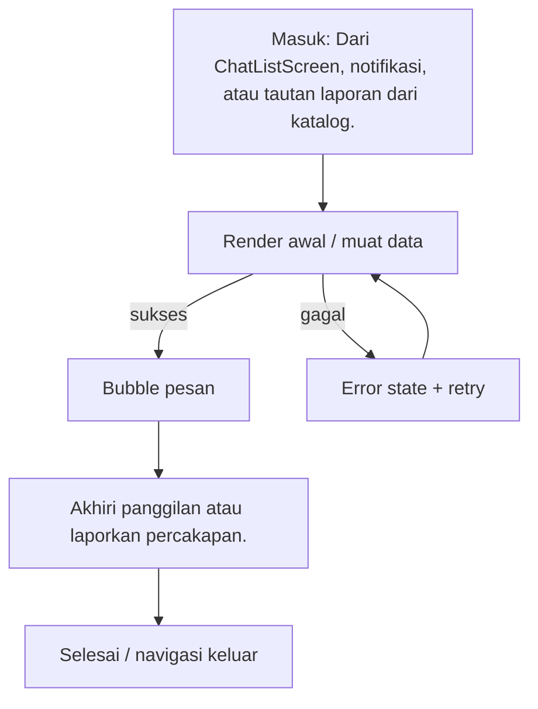

# Detail Chat & Panggilan

> **Fitur:** Chat & Panggilan · **Route:** `/chat/:id` · **Akses:** Guest + Sanctum · **Tipe:** Chat / real-time
> **Implementasi:** `lib/Features/Chat/Presentation/Screens/ChatDetail/ChatDetailScreen.dart` — `ChatDetailScreen` (3169 baris) · **State:** Riverpod + state lokal (`setState`) · **Pola:** polling periodik
> **API:** 25 endpoint · **Tabel:** 14 · **Model:** 0
> Diverifikasi 6 November 2026 dari kode Flutter, route Laravel, dan skema PostgreSQL. Bagian bertanda **[Usulan]** adalah rekomendasi, bukan perilaku yang sudah diverifikasi.

## 0. Ringkasan Eksekutif

| Aspek | Ringkasan |
|---|---|
| Tujuan | Percakapan real-time dengan teks, lampiran, balasan, reaksi, laporan, dan panggilan audio/video WebRTC. |
| Aktor | Guest dan pelanggan terautentikasi |
| Nilai pengguna | Percakapan real-time dengan teks, lampiran, balasan, reaksi, laporan, dan panggilan audio/video WebRTC. |
| Definisi sukses | Pesan terkirim/diterima dan state panggilan pulih setelah reconnect. |
| Risiko utama | Layar sangat besar (3170 baris); pisahkan logika panggilan dan composer. |
| Status dokumen | Kontrak terdokumentasi; ada gap yang harus ditangani |

## 1. Konteks Fitur

### 1.1 Persona & job-to-be-done

| Persona | Kebutuhan | Ukuran keberhasilan |
|---|---|---|
| Pelanggan dekorasi pernikahan | Percakapan real-time dengan teks, lampiran, balasan, reaksi, laporan, dan panggilan audio/video WebRTC. | Pesan terkirim/diterima dan state panggilan pulih setelah reconnect. |
| Guest | Mencoba melihat konten tanpa akun; diarahkan login pada aksi privat | Konten publik tampil dan prompt login muncul tepat pada aksi privat |

### 1.2 In scope

- Muat pesan berdasarkan `inboxId`.
- Kirim teks/lampiran dan tandai sudah dibaca.
- Balas, teruskan, beri reaksi, atau hapus pesan.
- Mulai/terima panggilan WebRTC dan relay SDP/ICE.
- Akhiri panggilan atau laporkan percakapan.

### 1.3 Out of scope

- Tidak mengakses database secara langsung; semua data lewat REST/Laravel.
- Tidak menggantikan validasi backend untuk harga, stok, status, atau kepemilikan resource.
- Tidak menyimpan riwayat pesan permanen di perangkat di luar cache yang sudah ada.
- Tidak menambahkan dependensi atau endpoint baru tanpa memperbarui dokumen ini dan peta endpoint.

## 2. Navigasi & Entry Point

| Arah | Detail |
|---|---|
| Masuk dari | Dari `ChatListScreen`, notifikasi, atau tautan laporan dari katalog. |
| Route | `/chat/:id` |
| Parameter/extra | Path `id` = inboxId. `extra: {cs_category, guestId/guest_id}`. |
| Guard | Guest boleh membuka layar, tetapi aksi privat harus memunculkan `GuestAuthPrompt` dan tidak mengirim Bearer token kosong. |
| Keluar ke | Tidak ada navigasi keluar langsung yang terdeteksi. |
| Perilaku back | Gunakan tombol back bawaan `go_router`; jangan membuat navigasi manual yang menduplikasi route. |

### 2.1 Layar terkait dalam fitur yang sama

| Layar | Route | PRD |
|---|---|---|
| `ChatListScreen` | `/chat-list` | [chat-list.md](../chat/chat-list.md) |

## 3. Alur Pengguna

1. Muat pesan berdasarkan `inboxId`.
2. Kirim teks/lampiran dan tandai sudah dibaca.
3. Balas, teruskan, beri reaksi, atau hapus pesan.
4. Mulai/terima panggilan WebRTC dan relay SDP/ICE.
5. Akhiri panggilan atau laporkan percakapan.

**Decision points yang wajib diuji:**

- `kosong` → Empty state dengan penjelasan dan CTA lanjutan.
- `gagal kirim` → Pesan ramah + retry; pertahankan input pengguna.
- `izin mikrofon ditolak` → Tampilkan penjelasan izin dan tombol buka pengaturan.



## 4. Arsitektur Layar

| Aspek | Nilai |
|---|---|
| File | `lib/Features/Chat/Presentation/Screens/ChatDetail/ChatDetailScreen.dart` |
| Kelas layar | `ChatDetailScreen` |
| Base widget | `ConsumerStatefulWidget` |
| Kelas state | `_ChatDetailPageState` |
| State management | Riverpod + state lokal (`setState`) |
| Pola data | polling periodik |
| Provider | `guestModeProvider`, `authProvider`, `chatProvider` |
| Repository | Tidak terdeteksi |
| Service | Tidak terdeteksi |
| Widget inti | `MediaViewer`, `AppActionSheet`, `AppBreadcrumbs` |
| Widget fitur | Tidak terdeteksi |
| Model | Tidak terdeteksi |

### 4.1 State lokal yang terdeteksi

| Field | Tipe | Peran |
|---|---|---|
| `_messageController` | `TextEditingController` | Controller input; wajib dispose. |
| `_messageFocusNode` | `FocusNode` | State lokal layar. |
| `_scrollController` | `ScrollController` | Controller input; wajib dispose. |
| `_searchController` | `TextEditingController` | Controller input; wajib dispose. |
| `_pollTimer` | `Timer?` | Resource native; wajib dibersihkan di `dispose`. |
| `_categorySent` | `bool` | Filter/sortir lokal. |
| `_guestId` | `String?` | State lokal layar. |
| `_guestName` | `String?` | State lokal layar. |
| `_callService` | `ChatCallService` | State lokal layar. |
| `_callActive` | `bool` | Status panggilan; sinkronkan dengan sinyal server. |
| `_replyToMessage` | `Map<String, dynamic>?` | State lokal layar. |
| `_isTranslating` | `bool` | State lokal layar. |
| `_isSearching` | `bool` | State lokal layar. |
| `_searchQuery` | `String` | Filter/sortir lokal. |
| `_accountRecoveryActive` | `bool` | State lokal layar. |
| `_recoveryEmail` | `String?` | State lokal layar. |
| `_csReportSubmitted` | `bool` | State lokal layar. |

### 4.2 Metode internal

`_callOtherUser`, `_downloadReportPdf`, `_openCsReportForm`, `_startPolling`, `_senderName`, `_scrollToBottom`, `_cancelReply`, `_setReplyTo`, `_detectIntentAndRespond`, `_openAccountRecoveryForm`, `_buildAccountFormMessage`, `_detectFormAndProcess`, `_triggerForgotPassword`, `_sendAutoMessage`, `_resetRecoveryState`, `_showOtpAndPasswordSheet`, `_formatDateHeader`, `_sendCsCategoryMessage`, `_sendMessage`, `_showAttachmentOptions`.

### 4.3 Alur data

```text
Widget / State
   ↓ baca/tulis
Provider Riverpod
   ↓
Repository / DioClient
   ↓ REST
Controller Laravel → PostgreSQL (14 tabel terkait)
```

## 5. Blueprint UI

Wireframe konseptual dari daftar elemen registry. Urutan final mengikuti file implementasi.

```text
┌────────────────────────────────────────────────────────────────────┐
│ Detail Chat & Panggilan                                           │
├────────────────────────────────────────────────────────────────────┤
│ 1. Bubble pesan                                                   │
│ 2. Composer                                                       │
│ 3. Lampiran                                                       │
│ 4. Menu konteks pesan                                             │
│ 5. Panel panggilan                                                │
│ 6. Indikator koneksi                                              │
└────────────────────────────────────────────────────────────────────┘
```

**Komponen bersama yang terdeteksi:**

- Core: `MediaViewer`, `AppActionSheet`, `AppBreadcrumbs`

## 6. Inventaris Komponen & Interaksi

| # | Elemen | Jenis | Aksi | Feedback |
|---|---|---|---|---|
| 1 | Bubble pesan | Pesan | Tampilkan/balas pesan; long-press untuk menu konteks. | Status kirim/terbaca/gagal tampil jelas. |
| 2 | Composer | Input | Isi/ubah nilai; validasi client sebelum kirim. | Error inline; 422 dipetakan per field. |
| 3 | Lampiran | Lampiran | Pilih file; validasi tipe/ukuran sebelum upload. | Progress upload; error tipe/ukuran. |
| 4 | Menu konteks pesan | Pesan | Tampilkan/balas pesan; long-press untuk menu konteks. | Status kirim/terbaca/gagal tampil jelas. |
| 5 | Panel panggilan | Panel | Mulai/terima/akhiri panggilan atau buka panel terkait. | Status panggilan dan izin mikrofon/kamera jelas. |
| 6 | Indikator koneksi | Status | Tampilkan kondisi koneksi/status; beri aksi retry bila perlu. | Perubahan status diumumkan; retry tersedia. |

### 6.1 Fakta teknis form & interaksi

| Fakta | Nilai |
|---|---|
| TextEditingController | 9 |
| Field teks/form | 9 |
| Dropdown | 0 |
| Switch/toggle | 0 |
| Validator client | 0 |
| Field password (`obscureText`) | 0 |
| maxLength | 2000, 1 |
| Keyboard | number |
| Input formatter | FilteringTextInputFormatter |
| Upload file | Ya |
| Kamera | Tidak |
| WebView | Tidak |
| Timer/polling | Ya |
| Pagination | Tidak |
| Pull to refresh | Tidak |

## 7. Copywriting & Microcopy

Semua teks di bawah ini adalah **usulan**. Implementasi wajib memakai `AppLocalizations` dan mengikuti gaya bahasa layar lain.

| Lokasi | Draft copy | Catatan |
|---|---|---|
| Judul/header | Detail Chat & Panggilan | Samakan dengan label navigasi. |
| Subjudul | Percakapan real-time dengan teks, lampiran, balasan, reaksi, laporan, dan panggilan audio… | Ringkas; jangan mengulang judul. |
| Tombol utama | Kirim | [Usulan] Disabled saat proses. |
| Empty state | Belum ada detail Chat & Panggilan. | [Usulan] Sertakan CTA lanjutan. |
| Error | Gagal memuat detail Chat & Panggilan. Periksa koneksi lalu coba lagi. | [Usulan] Jangan tampilkan stack trace. |
| Retry | Coba lagi | [Usulan] Pertahankan data lama bila ada. |
| Guest | Masuk untuk melanjutkan. | [Usulan] Gunakan `GuestAuthPrompt`. |
| Offline | Anda sedang offline. Periksa koneksi internet. | [Usulan] Sediakan retry. |
| Validasi | Periksa kembali data yang Anda isi. | [Usulan] Fokus ke field pertama. |
| Placeholder input | Ketik pesan... | [Usulan] Gunakan AppLocalizations. |
| Empty list | Belum ada percakapan. | [Usulan] Sertakan CTA mulai chat. |

## 8. Design System & Responsif

### 8.1 Token yang wajib dipakai

| Token | Nilai |
|---|---|
| Font | Instrument Sans (W400/W600), aset lokal |
| Warna primer | `AppColors.primaryColor` = `#1E3A5F` |
| Aksen | `AppColors.accentColor` = `#C9A94E` |
| Background light | `AppColors.backgroundColor` = `#F8F6F7` |
| Surface light | `AppColors.surfaceColor` = `#FFFFFF` |
| Background dark | `AppColors.darkBackground` = `#121212` |
| Surface dark | `AppColors.darkSurface` = `#1E1E1E` |
| Teks primer light | `#1A1A2E`; dark `#E8E8E8` |
| Teks sekunder light | `#8E8E9A`; dark `#A0A0A0` |
| Sukses/error/warning/info | `#10B981` / `#EF4444` / `#F59E0B` / `#3B82F6` |
| Tipografi | `headTitle` 22/w600; `subHeadTitle` 16/w400; `h3` 14/w600; `h4` 12/w400; `description` 14/1.4 |
| Spacing | `AppSizes` 2, 4, 8, 16, 24, 32, 48, 64 |
| Radius | card 16, button 14, input 14, avatar 28, bottom nav 24 |
| Glass | `AppBlurBackdrop`; `blurSigma` 15; tint light `#32FFFFFF`, night `#32000000` |

### 8.2 Aturan responsif

- Lebar minimum yang wajib diuji: **320 px**; target umum 360/390/412 px.
- Tablet ≥ 600 px: gunakan padding lebih lebar dan grid multi-kolom bila layar berupa koleksi.
- Jangan mengunci tinggi konten; gunakan `SingleChildScrollView`/sliver agar tidak overflow.
- Hormati `SafeArea`, status bar, navigation bar, dan keyboard inset.
- Teks harus tetap terbaca pada text scale 200%; hindari `maxLines: 1` untuk label penting.
- Layout harus aman untuk locale dengan teks lebih panjang (±30%).

### 8.3 Mode gelap & glass

- Tema mengikuti sistem (light/dark) dan dapat di-override `ThemeProvider`.
- Jangan hardcode warna; gunakan `AppColors`/`AppTheme` agar mode gelap bekerja.
- Fallback tanpa blur harus tetap kontras dan terbaca.
- Hormati reduce-motion; animasi 3D/parallax tidak boleh menjadi satu-satunya pembeda state.

## 9. State Machine

| State | Pemicu | UI | Pemulihan |
|---|---|---|---|
| `initial` | Layar dibuka | Kerangka/placeholder awal | Muat data |
| `loading` | Request berjalan | Skeleton/spinner; aksi utama disabled | Tunggu atau retry saat timeout |
| `content` | Data tersedia | Render konten utama | — |
| `empty` | Data kosong | Empty state dengan penjelasan + CTA | Refresh atau aksi lanjutan |
| `error` | Request gagal | Pesan ramah + tombol coba lagi | Retry |
| `unauthorized` | HTTP 401 | Sesi berakhir; arahkan login/Landing | Login ulang |
| `offline` | Koneksi putus | Banner/empty offline | Coba lagi saat online |
| `submitting` | Pengguna menekan aksi utama | Tombol disabled + progress | Selesai atau tampilkan error |
| `guest` | Guest menekan aksi privat | `GuestAuthPrompt` | Login |
| `kosong` | Kondisi domain | Empty state dengan penjelasan dan CTA lanjutan. | Ikuti aksi pemulihan pada pesan |
| `gagal kirim` | Kondisi domain | Pesan ramah + retry; pertahankan input pengguna. | Ikuti aksi pemulihan pada pesan |
| `reconnect` | Kondisi domain | Tampilkan status yang jelas dan aksi pemulihan. | Ikuti aksi pemulihan pada pesan |
| `izin mikrofon ditolak` | Kondisi domain | Tampilkan penjelasan izin dan tombol buka pengaturan. | Ikuti aksi pemulihan pada pesan |
| `panggilan berakhir` | Kondisi domain | Tampilkan status yang jelas dan aksi pemulihan. | Ikuti aksi pemulihan pada pesan |

**Aturan umum:** setiap request harus melewati `idle → loading → success/empty/failure`; jangan merender hasil request langsung di `build()`.

## 10. Kontrak API

### 10.1 Ringkasan endpoint

| # | Method | Path | Controller | Auth | Kegunaan |
|---|---|---|---|---|---|
| 1 | `GET` | `/messages/conversations/{inboxId}` | `ChatController@getMessages` | Sanctum | Pesan dalam percakapan |
| 2 | `POST` | `/messages/send` | `ChatController@sendMessage` | Sanctum | Mengirim pesan |
| 3 | `POST` | `/messages/{id}/star` | `ChatController@starMessage` | Sanctum | Menandai pesan |
| 4 | `DELETE` | `/messages/{id}/delete` | `ChatController@deleteMessage` | Sanctum | Menghapus pesan |
| 5 | `POST` | `/messages/{id}/forward` | `ChatController@forwardMessage` | Sanctum | Meneruskan pesan |
| 6 | `POST` | `/messages/{id}/react` | `ChatController@addReaction` | Sanctum | Reaksi pesan |
| 7 | `POST` | `/messages/{inboxId}/read` | `ChatController@markInboxAsRead` | Sanctum | Menandai pesan dibaca |
| 8 | `POST` | `/messages/{inboxId}/rate` | `ChatController@rateInbox` | Sanctum | Menilai percakapan |
| 9 | `POST` | `/messages/calls` | `ChatCallController@start` | Sanctum | Memulai panggilan WebRTC |
| 10 | `GET` | `/messages/calls/{token}` | `ChatCallController@state` | Sanctum | Status panggilan |
| 11 | `POST` | `/messages/calls/{token}/signal` | `ChatCallController@signal` | Sanctum | Signaling SDP/ICE |
| 12 | `POST` | `/messages/calls/{token}/accept` | `ChatCallController@accept` | Sanctum | Menerima panggilan |
| 13 | `POST` | `/messages/calls/{token}/end` | `ChatCallController@end` | Sanctum | Mengakhiri panggilan |
| 14 | `GET` | `/messages/guest/{inboxId}` | `ChatController@guestMessages` | Publik (guest-chat) | Pesan percakapan guest |
| 15 | `POST` | `/messages/guest/send` | `ChatController@guestSend` | Publik (guest-chat) | Mengirim pesan guest |
| 16 | `POST` | `/messages/guest/calls` | `ChatCallController@start` | Publik (guest-chat) | Memulai panggilan guest |
| 17 | `GET` | `/messages/guest/calls/{token}` | `ChatCallController@state` | Publik (guest-chat) | Status panggilan guest |
| 18 | `POST` | `/messages/guest/calls/{token}/signal` | `ChatCallController@signal` | Publik (guest-chat) | Signaling SDP/ICE guest |
| 19 | `POST` | `/messages/guest/calls/{token}/end` | `ChatCallController@end` | Publik (guest-chat) | Mengakhiri panggilan guest |
| 20 | `GET` | `/catalog` | `CatalogController@index` | Sanctum | Daftar katalog dengan filter/paginasi |
| 21 | `GET` | `/bookings` | `OrderController@getOrders` | Sanctum | Membuat/membaca pesanan |
| 22 | `POST` | `/bookings` | `OrderController@createOrder` | Sanctum | Membuat/membaca pesanan |
| 23 | `GET` | `/reports` | `ReportController@index` | Sanctum | Membuat/membaca laporan |
| 24 | `POST` | `/reports` | `ReportController@store` | Sanctum | Membuat/membaca laporan |
| 25 | `GET` | `/reports/{report}/pdf` | `ReportController@downloadPdf` | Sanctum | Mengunduh PDF laporan |

### 10.2 Detail per endpoint

#### 10.2.1 `GET /messages/conversations/{inboxId}`

- **Controller:** `ChatController@getMessages`
- **Auth:** Sanctum
- **Kegunaan:** Pesan dalam percakapan
- **Sumber aturan:** `../Mobile-And-Backend/app/Http/Controllers/Api/User/ChatController/ChatController.php`
- **Field request:** tidak ada aturan validasi field yang terdeteksi otomatis (GET, validasi di service, atau `FormRequest` lain). Periksa controller sebelum menulis kode.
- **Response top-level:** `success`, `data`, `other_user`
- **Pesan error terbaca:** “Tidak terautentikasi”

#### 10.2.2 `POST /messages/send`

- **Controller:** `ChatController@sendMessage`
- **Auth:** Sanctum
- **Kegunaan:** Mengirim pesan
- **Sumber aturan:** `../Mobile-And-Backend/app/Http/Controllers/Api/User/ChatController/ChatController.php`

| Field request | Aturan | Wajib |
|---|---|---|
| `inbox_id` | `required` | Ya |
| `message` | `required_without_all:attachment,type,order_id|nullable|string` | Bersyarat |
| `attachment` | `nullable|file|mimes:jpg,jpeg,png,gif,webp,mp4,mov,m4v,webm,3gp|max:51200` | Tidak |
| `type` | `nullable|string` | Tidak |
| `item_id` | `nullable|integer` | Tidak |
| `item_name` | `nullable|string` | Tidak |
| `item_price` | `nullable|numeric` | Tidak |
| `item_image` | `nullable|string` | Tidak |
| `order_id` | `nullable|integer` | Tidak |
| `cs_category` | `nullable|string|max:50` | Tidak |
| `reply_to_id` | `nullable|integer` | Tidak |

- **Response top-level:** `success`, `data`
- **Pesan error terbaca:** “Kotak pesan tidak ditemukan”; “Tidak terautentikasi”

#### 10.2.3 `POST /messages/{id}/star`

- **Controller:** `ChatController@starMessage`
- **Auth:** Sanctum
- **Kegunaan:** Menandai pesan
- **Sumber aturan:** `../Mobile-And-Backend/app/Http/Controllers/Api/User/ChatController/ChatController.php`
- **Field request:** tidak ada aturan validasi field yang terdeteksi otomatis (GET, validasi di service, atau `FormRequest` lain). Periksa controller sebelum menulis kode.
- **Response top-level:** `success`, `data`
- **Pesan error terbaca:** “Pesan tidak ditemukan”; “Kotak pesan tidak ditemukan”; “Tidak terautentikasi”

#### 10.2.4 `DELETE /messages/{id}/delete`

- **Controller:** `ChatController@deleteMessage`
- **Auth:** Sanctum
- **Kegunaan:** Menghapus pesan
- **Sumber aturan:** `../Mobile-And-Backend/app/Http/Controllers/Api/User/ChatController/ChatController.php`
- **Field request:** tidak ada aturan validasi field yang terdeteksi otomatis (GET, validasi di service, atau `FormRequest` lain). Periksa controller sebelum menulis kode.
- **Response top-level:** `success`, `message`
- **Pesan error terbaca:** “Pesan tidak ditemukan”; “Kotak pesan tidak ditemukan”; “Tidak terautentikasi”; “Tidak diizinkan”

#### 10.2.5 `POST /messages/{id}/forward`

- **Controller:** `ChatController@forwardMessage`
- **Auth:** Sanctum
- **Kegunaan:** Meneruskan pesan
- **Sumber aturan:** `../Mobile-And-Backend/app/Http/Controllers/Api/User/ChatController/ChatController.php`

| Field request | Aturan | Wajib |
|---|---|---|
| `target_inbox_id` | `required|integer` | Ya |

- **Response top-level:** `success`, `data`
- **Pesan error terbaca:** “Pesan tidak ditemukan”; “Kotak pesan tidak ditemukan”; “Tidak terautentikasi”; “Kotak pesan target tidak ditemukan”

#### 10.2.6 `POST /messages/{id}/react`

- **Controller:** `ChatController@addReaction`
- **Auth:** Sanctum
- **Kegunaan:** Reaksi pesan
- **Sumber aturan:** `../Mobile-And-Backend/app/Http/Controllers/Api/User/ChatController/ChatController.php`

| Field request | Aturan | Wajib |
|---|---|---|
| `emoji` | `required|string|max:10` | Ya |

- **Response top-level:** `success`, `data`
- **Pesan error terbaca:** “Pesan tidak ditemukan”; “Kotak pesan tidak ditemukan”; “Tidak terautentikasi”

#### 10.2.7 `POST /messages/{inboxId}/read`

- **Controller:** `ChatController@markInboxAsRead`
- **Auth:** Sanctum
- **Kegunaan:** Menandai pesan dibaca
- **Sumber aturan:** `../Mobile-And-Backend/app/Http/Controllers/Api/User/ChatController/ChatController.php`
- **Field request:** tidak ada aturan validasi field yang terdeteksi otomatis (GET, validasi di service, atau `FormRequest` lain). Periksa controller sebelum menulis kode.
- **Response top-level:** `success`, `data`
- **Pesan error terbaca:** “Kotak pesan tidak ditemukan”; “Tidak terautentikasi”

#### 10.2.8 `POST /messages/{inboxId}/rate`

- **Controller:** `ChatController@rateInbox`
- **Auth:** Sanctum
- **Kegunaan:** Menilai percakapan
- **Sumber aturan:** `../Mobile-And-Backend/app/Http/Controllers/Api/User/ChatController/ChatController.php`

| Field request | Aturan | Wajib |
|---|---|---|
| `rating` | `required|integer|min:1|max:5` | Ya |
| `comment` | `nullable|string|max:500` | Tidak |

- **Response top-level:** `success`, `data`
- **Pesan error terbaca:** “Kotak pesan tidak ditemukan”; “Tidak terautentikasi”

#### 10.2.9 `POST /messages/calls`

- **Controller:** `ChatCallController@start`
- **Auth:** Sanctum
- **Kegunaan:** Memulai panggilan WebRTC
- **Sumber aturan:** `../Mobile-And-Backend/app/Http/Controllers/ChatCall/ChatCallController.php`

| Field request | Aturan | Wajib |
|---|---|---|
| `inbox_id` | `required|integer` | Ya |
| `guest_id` | `nullable|string|max:190` | Tidak |


#### 10.2.10 `GET /messages/calls/{token}`

- **Controller:** `ChatCallController@state`
- **Auth:** Sanctum
- **Kegunaan:** Status panggilan
- **Sumber aturan:** `../Mobile-And-Backend/app/Http/Controllers/ChatCall/ChatCallController.php`
- **Field request:** tidak ada aturan validasi field yang terdeteksi otomatis (GET, validasi di service, atau `FormRequest` lain). Periksa controller sebelum menulis kode.

#### 10.2.11 `POST /messages/calls/{token}/signal`

- **Controller:** `ChatCallController@signal`
- **Auth:** Sanctum
- **Kegunaan:** Signaling SDP/ICE
- **Sumber aturan:** `../Mobile-And-Backend/app/Http/Controllers/ChatCall/ChatCallController.php`

| Field request | Aturan | Wajib |
|---|---|---|
| `type` | `required|in:offer,answer,ice` | Ya |
| `value` | `required|array` | Ya |


#### 10.2.12 `POST /messages/calls/{token}/accept`

- **Controller:** `ChatCallController@accept`
- **Auth:** Sanctum
- **Kegunaan:** Menerima panggilan
- **Sumber aturan:** `../Mobile-And-Backend/app/Http/Controllers/ChatCall/ChatCallController.php`
- **Field request:** tidak ada aturan validasi field yang terdeteksi otomatis (GET, validasi di service, atau `FormRequest` lain). Periksa controller sebelum menulis kode.

#### 10.2.13 `POST /messages/calls/{token}/end`

- **Controller:** `ChatCallController@end`
- **Auth:** Sanctum
- **Kegunaan:** Mengakhiri panggilan
- **Sumber aturan:** `../Mobile-And-Backend/app/Http/Controllers/ChatCall/ChatCallController.php`
- **Field request:** tidak ada aturan validasi field yang terdeteksi otomatis (GET, validasi di service, atau `FormRequest` lain). Periksa controller sebelum menulis kode.
- **Response top-level:** `success`

#### 10.2.14 `GET /messages/guest/{inboxId}`

- **Controller:** `ChatController@guestMessages`
- **Auth:** Publik (guest-chat)
- **Kegunaan:** Pesan percakapan guest
- **Sumber aturan:** `../Mobile-And-Backend/app/Http/Controllers/Api/User/ChatController/ChatController.php`
- **Catatan:** Throttle guest-chat.

| Field request | Aturan | Wajib |
|---|---|---|
| `guest_id` | `required|string|max:190` | Ya |

- **Response top-level:** `success`, `data`, `other_user`
- **Pesan error terbaca:** “Kotak pesan tidak ditemukan”; “Tidak terautentikasi”

#### 10.2.15 `POST /messages/guest/send`

- **Controller:** `ChatController@guestSend`
- **Auth:** Publik (guest-chat)
- **Kegunaan:** Mengirim pesan guest
- **Sumber aturan:** `../Mobile-And-Backend/app/Http/Controllers/Api/User/ChatController/ChatController.php`
- **Catatan:** Throttle guest-chat.

| Field request | Aturan | Wajib |
|---|---|---|
| `guest_id` | `required|string|max:190` | Ya |
| `inbox_id` | `required` | Ya |
| `message` | `required|string` | Ya |
| `cs_category` | `nullable|string|max:50` | Tidak |
| `name` | `nullable|string|max:100` | Tidak |

- **Response top-level:** `success`, `data`
- **Pesan error terbaca:** “Kotak pesan tidak ditemukan”; “Tidak terautentikasi”

#### 10.2.16 `POST /messages/guest/calls`

- **Controller:** `ChatCallController@start`
- **Auth:** Publik (guest-chat)
- **Kegunaan:** Memulai panggilan guest
- **Sumber aturan:** `../Mobile-And-Backend/app/Http/Controllers/ChatCall/ChatCallController.php`
- **Catatan:** Throttle guest-chat.

| Field request | Aturan | Wajib |
|---|---|---|
| `inbox_id` | `required|integer` | Ya |
| `guest_id` | `nullable|string|max:190` | Tidak |


#### 10.2.17 `GET /messages/guest/calls/{token}`

- **Controller:** `ChatCallController@state`
- **Auth:** Publik (guest-chat)
- **Kegunaan:** Status panggilan guest
- **Sumber aturan:** `../Mobile-And-Backend/app/Http/Controllers/ChatCall/ChatCallController.php`
- **Catatan:** Throttle guest-chat.
- **Field request:** tidak ada aturan validasi field yang terdeteksi otomatis (GET, validasi di service, atau `FormRequest` lain). Periksa controller sebelum menulis kode.

#### 10.2.18 `POST /messages/guest/calls/{token}/signal`

- **Controller:** `ChatCallController@signal`
- **Auth:** Publik (guest-chat)
- **Kegunaan:** Signaling SDP/ICE guest
- **Sumber aturan:** `../Mobile-And-Backend/app/Http/Controllers/ChatCall/ChatCallController.php`
- **Catatan:** Throttle guest-chat.

| Field request | Aturan | Wajib |
|---|---|---|
| `type` | `required|in:offer,answer,ice` | Ya |
| `value` | `required|array` | Ya |


#### 10.2.19 `POST /messages/guest/calls/{token}/end`

- **Controller:** `ChatCallController@end`
- **Auth:** Publik (guest-chat)
- **Kegunaan:** Mengakhiri panggilan guest
- **Sumber aturan:** `../Mobile-And-Backend/app/Http/Controllers/ChatCall/ChatCallController.php`
- **Catatan:** Throttle guest-chat.
- **Field request:** tidak ada aturan validasi field yang terdeteksi otomatis (GET, validasi di service, atau `FormRequest` lain). Periksa controller sebelum menulis kode.
- **Response top-level:** `success`

#### 10.2.20 `GET /catalog`

- **Controller:** `CatalogController@index`
- **Auth:** Sanctum
- **Kegunaan:** Daftar katalog dengan filter/paginasi
- **Sumber aturan:** `../Mobile-And-Backend/app/Http/Controllers/Api/User/CatalogController/CatalogController.php`
- **Field request:** tidak ada aturan validasi field yang terdeteksi otomatis (GET, validasi di service, atau `FormRequest` lain). Periksa controller sebelum menulis kode.

#### 10.2.21 `GET /bookings`

- **Controller:** `OrderController@getOrders`
- **Auth:** Sanctum
- **Kegunaan:** Membuat/membaca pesanan
- **Sumber aturan:** `../Mobile-And-Backend/app/Http/Controllers/Api/User/OrderController/OrderController.php`
- **Field request:** tidak ada aturan validasi field yang terdeteksi otomatis (GET, validasi di service, atau `FormRequest` lain). Periksa controller sebelum menulis kode.
- **Response top-level:** `status`, `data`, `pagination`, `message`, `error`
- **Pesan error terbaca:** “Gagal memuat pesanan”

#### 10.2.22 `POST /bookings`

- **Controller:** `OrderController@createOrder`
- **Auth:** Sanctum
- **Kegunaan:** Membuat/membaca pesanan
- **Sumber aturan:** `../Mobile-And-Backend/app/Http/Controllers/Api/User/OrderController/OrderController.php`

| Field request | Aturan | Wajib |
|---|---|---|
| `package_id` | `required|integer` | Ya |
| `catalog_id` | `required|integer` | Ya |
| `event_date` | `required|date|after_or_equal:today` | Ya |
| `event_time` | `nullable|string` | Tidak |
| `quantity` | `nullable|integer|min:1` | Tidak |
| `notes` | `nullable|string|max:1000` | Tidak |
| `customer_name` | `required|string|max:255` | Ya |
| `whatsapp` | `required|string|max:20` | Ya |
| `voucher_code` | `nullable|string|max:50` | Tidak |

- **Response top-level:** `status`, `message`, `data`, `errors`, `error`
- **Pesan error terbaca:** “Paket tidak termasuk dalam katalog yang dipilih”; “Stok tidak mencukupi”; “Pesanan berhasil dibuat”; “Validasi gagal”

#### 10.2.23 `GET /reports`

- **Controller:** `ReportController@index`
- **Auth:** Sanctum
- **Kegunaan:** Membuat/membaca laporan
- **Sumber aturan:** `../Mobile-And-Backend/app/Http/Controllers/Api/User/ReportController/ReportController.php`
- **Field request:** tidak ada aturan validasi field yang terdeteksi otomatis (GET, validasi di service, atau `FormRequest` lain). Periksa controller sebelum menulis kode.
- **Response top-level:** `status`, `data`

#### 10.2.24 `POST /reports`

- **Controller:** `ReportController@store`
- **Auth:** Sanctum
- **Kegunaan:** Membuat/membaca laporan
- **Sumber aturan:** `../Mobile-And-Backend/app/Http/Controllers/Api/User/ReportController/ReportController.php`
- **Field request:** tidak ada aturan validasi field yang terdeteksi otomatis (GET, validasi di service, atau `FormRequest` lain). Periksa controller sebelum menulis kode.
- **Response top-level:** `status`, `message`, `data`, `error`
- **Pesan error terbaca:** “Tipe target laporan tidak valid”; “Laporan berhasil dikirim”; “Gagal mengirim laporan”

#### 10.2.25 `GET /reports/{report}/pdf`

- **Controller:** `ReportController@downloadPdf`
- **Auth:** Sanctum
- **Kegunaan:** Mengunduh PDF laporan
- **Sumber aturan:** `../Mobile-And-Backend/app/Http/Controllers/Api/User/ReportController/ReportController.php`
- **Field request:** tidak ada aturan validasi field yang terdeteksi otomatis (GET, validasi di service, atau `FormRequest` lain). Periksa controller sebelum menulis kode.

**Envelope acuan** (periksa controller untuk variasi):

```json
{"status":"success","message":"...","data":{}}
```

### 10.3 Pemetaan error HTTP

| HTTP | Failure | Perilaku UI |
|---|---|---|
| 401 | `AuthFailure` | Hapus token, arahkan ke Landing/login, tampilkan sesi berakhir. |
| 403 | `UnknownFailure` / izin | Pesan akses ditolak; jangan logout otomatis. |
| 404 | `NotFoundFailure` | Tampilkan resource tidak ditemukan + kembali. |
| 409 | `ConflictFailure` / server | Tampilkan konflik status (stok, duplikasi, pembayaran). |
| 422 | `ValidationFailure(errors)` | Tampilkan error per field; pertahankan input. |
| 429 | `UnknownFailure` / rate limit | Minta pengguna menunggu; jangan spam retry. |
| 5xx | `ServerFailure` | Pesan error server + tombol coba lagi. |
| null | `NetworkFailure` | Periksa koneksi + retry; pertahankan data lama. |

## 11. Data & Database

| Tabel | Peran | Akses | Kolom kunci |
|---|---|---|---|
| `fm_messages` | Pesan chat. | Baca/tulis (indikasi) | `id`, `inbox_id`, `message`, `user_id`, `read_by`, `read_at`, `notified`, `created_at`, `updated_at`, `deleted_at` … |
| `fm_inboxes` | Percakapan chat. | Baca/tulis (indikasi) | `id`, `title`, `user_ids`, `created_at`, `updated_at`, `deleted_at`, `meta` |
| `chat_calls` | State signaling panggilan WebRTC. | Baca/tulis (indikasi) | `id`, `token`, `inbox_id`, `caller_user_id`, `callee_user_id`, `status`, `offer`, `answer`, `ice_candidates`, `expires_at` … |
| `users` | Akun, profil, KYC, preferensi, dan pengaturan keamanan. | Baca/tulis (indikasi) | `id`, `full_name`, `first_name`, `mid_name`, `last_name`, `username`, `email`, `balance`, `email_verified_at`, `password` … |
| `catalogs` | Item katalog. | Baca/tulis (indikasi) | `id`, `category_id`, `name`, `slug`, `description`, `price`, `discount_price`, `stock`, `is_active`, `created_at` … |
| `categories` | Kategori katalog. | Baca/tulis (indikasi) | `id`, `name`, `slug`, `icon`, `color`, `description`, `created_at`, `updated_at`, `name_translations`, `description_translations` … |
| `packages` | Tier/paket dari katalog. | Baca/tulis (indikasi) | `id`, `category_id`, `name`, `slug`, `description`, `price`, `stock`, `discount_price`, `is_featured`, `features` … |
| `media` | File polymorphic (avatar, dokumen, lampiran). | Baca/tulis (indikasi) | `id`, `model_type`, `model_id`, `uuid`, `collection_name`, `name`, `file_name`, `mime_type`, `disk`, `conversions_disk` … |
| `orders` | Pesanan dan statusnya. | Baca/tulis (indikasi) | `id`, `user_id`, `package_id`, `catalog_id`, `order_number`, `total_price`, `status`, `payment_status`, `booking_date`, `notes` … |
| `transactions` | Transaksi pembayaran/dompet. | Baca/tulis (indikasi) | `id`, `user_id`, `order_id`, `type`, `reference_number`, `amount`, `admin_fee`, `total_amount`, `payment_gateway`, `payment_method` … |
| `order_timelines` | Riwayat status pesanan. | Baca/tulis (indikasi) | `id`, `order_id`, `status`, `description`, `metadata`, `created_by`, `created_at`, `updated_at` |
| `vouchers` | Voucher dan masa berlaku. | Baca/tulis (indikasi) | `id`, `code`, `description`, `expires_at`, `is_active`, `is_global`, `max_uses`, `uses_count`, `created_at`, `updated_at` … |
| `user_vouchers` | Voucher yang diklaim pengguna. | Baca/tulis (indikasi) | `id`, `user_id`, `voucher_id`, `claimed_at`, `used_at`, `order_id`, `created_at`, `updated_at` |
| `reports` | Laporan konten/pengguna. | Baca/tulis (indikasi) | `id`, `user_id`, `reportable_type`, `reportable_id`, `category`, `reason`, `description`, `status`, `resolved_at`, `resolved_by` … |

Akses tabel di atas adalah **indikasi dari endpoint**; verifikasi controller/service untuk memastikan operasi baca/tulis yang sebenarnya.

### 11.1 Aturan data

- Jangan menampilkan data dari cache setelah logout.
- Nominal, stok, status pesanan, dan kepemilikan resource **wajib** divalidasi backend.
- Jangan mengakses PostgreSQL dari Flutter; gunakan endpoint Laravel.
- Filter data milik pengguna dilakukan server-side (`user_id` dari token), bukan di client.
- Jangan menyimpulkan status pembayaran dari `orders.status`; gunakan data pembayaran/transaksi.

## 12. Aturan Bisnis & Validasi

### 12.1 Acceptance dari registry

- Pesan optimistis berubah status setelah server merespons.
- Panggilan dapat diterima/ditolak dan state dipulihkan setelah reconnect.
- Guest tidak dapat mengakses inbox pengguna lain.

### 12.2 Validasi server yang terbaca dari controller

| Field | Aturan | Endpoint |
|---|---|---|
| `inbox_id` | `required` | `/messages/send` |
| `message` | `required_without_all:attachment,type,order_id|nullable|string` | `/messages/send` |
| `attachment` | `nullable|file|mimes:jpg,jpeg,png,gif,webp,mp4,mov,m4v,webm,3gp|max:51200` | `/messages/send` |
| `type` | `nullable|string` | `/messages/send` |
| `item_id` | `nullable|integer` | `/messages/send` |
| `item_name` | `nullable|string` | `/messages/send` |
| `item_price` | `nullable|numeric` | `/messages/send` |
| `item_image` | `nullable|string` | `/messages/send` |
| `order_id` | `nullable|integer` | `/messages/send` |
| `cs_category` | `nullable|string|max:50` | `/messages/send` |
| `reply_to_id` | `nullable|integer` | `/messages/send` |
| `target_inbox_id` | `required|integer` | `/messages/{id}/forward` |
| `emoji` | `required|string|max:10` | `/messages/{id}/react` |
| `rating` | `required|integer|min:1|max:5` | `/messages/{inboxId}/rate` |
| `comment` | `nullable|string|max:500` | `/messages/{inboxId}/rate` |
| `inbox_id` | `required|integer` | `/messages/calls` |
| `guest_id` | `nullable|string|max:190` | `/messages/calls` |
| `type` | `required|in:offer,answer,ice` | `/messages/calls/{token}/signal` |
| `value` | `required|array` | `/messages/calls/{token}/signal` |
| `guest_id` | `required|string|max:190` | `/messages/guest/{inboxId}` |
| `guest_id` | `required|string|max:190` | `/messages/guest/send` |
| `inbox_id` | `required` | `/messages/guest/send` |
| `message` | `required|string` | `/messages/guest/send` |
| `cs_category` | `nullable|string|max:50` | `/messages/guest/send` |
| `name` | `nullable|string|max:100` | `/messages/guest/send` |
| `inbox_id` | `required|integer` | `/messages/guest/calls` |
| `guest_id` | `nullable|string|max:190` | `/messages/guest/calls` |
| `type` | `required|in:offer,answer,ice` | `/messages/guest/calls/{token}/signal` |
| `value` | `required|array` | `/messages/guest/calls/{token}/signal` |
| `package_id` | `required|integer` | `/bookings` |

> Menampilkan 30 dari 38 aturan. Lihat controller untuk sisanya.

### 12.3 Validasi client yang terdeteksi

- Form memiliki **9 field** dan **0 validator** client.
- Batas panjang input: 2000, 1.
- Keyboard: number.
- Validasi client hanya untuk UX; hasil final tetap dari backend (`422`).

### 12.4 Aturan bisnis wajib

- Disable tombol submit selama request berjalan untuk mencegah duplikasi.
- Terapkan `Accept-Language` dari `localeProvider` pada setiap request.
- Gunakan `DioClient`/repository yang sudah ada; jangan membuat instance Dio baru.
- Guest tidak boleh memanggil endpoint privat; tampilkan `GuestAuthPrompt`.
- Pesan gagal kirim harus dapat dicoba ulang tanpa menduplikasi pesan.
- Lampiran divalidasi tipe/ukuran; jangan unggah file tak dikenal.
- Guest hanya boleh memakai alur guest yang didukung backend.

## 13. Error Handling

Pemetaan status HTTP mengikuti `.docs/02-architecture/STATE-AND-ERRORS.md` (lihat §10.3).

### 13.1 Kegagalan spesifik layar

- Timeout jaringan → tampilkan pesan koneksi dan tombol coba lagi.
- Respons tidak sesuai envelope → tampilkan error umum, catat status code.
- 401 → bersihkan token dan arahkan ke Landing/login.
- 403 → tampilkan akses ditolak tanpa logout otomatis.
- 5xx → error server + retry; jangan menampilkan stack trace.
- Koneksi real-time putus → tampilkan status reconnect dan coba lagi.
- Kirim pesan gagal → tandai pesan gagal dan sediakan retry.
- Gap: Layar sangat besar (3170 baris); pisahkan logika panggilan dan composer.
- Gap: `fm_messages.inbox_id` tidak memiliki FK (GAP-11).
- Gap: Laporan dibuat lewat `openReportChat`, bukan form laporan terpisah.

## 14. Keamanan & Privasi

- Token hanya di `FlutterSecureStorage`; jangan di `SharedPreferences` atau log.
- Jangan menampilkan stack trace, query database, atau detail internal pada pengguna.
- Jangan mengirim PII ke analytics/crash report.
- Validasi kepemilikan resource di backend; client tidak boleh menentukan `user_id`.
- Isi pesan dan lampiran bersifat privat; jangan log isi pesan.
- Validasi tipe/ukuran lampiran sebelum upload.
- Guest tidak boleh mengirim Bearer token kosong atau mengakses resource privat.

## 15. Aksesibilitas

- Semua ikon/tombol non-teks memiliki label semantik.
- Target sentuh minimal 48×48 dp; jangan hanya mengandalkan ikon kecil.
- Kontras teks memenuhi WCAG AA pada mode terang dan gelap.
- Urutan fokus screen reader mengikuti urutan visual.
- Text scale 200% tidak memotong label atau tombol utama.
- Error form diumumkan dan terhubung ke field terkait.
- Hormati reduce-motion; animasi tidak boleh menghalangi interaksi.
- Bubble pesan menyertakan pengirim/waktu pada semantics.
- Status terkirim/gagal terbaca oleh screen reader.

## 16. Performa & Offline

- Gunakan `CachedNetworkImage`/cache yang ada untuk gambar jaringan.
- Hindari pekerjaan berat di `build()`; pindahkan parsing/format ke provider/util.
- Dispose controller, timer, dan subscription di `dispose`.
- Hentikan polling/timer saat app background; mulai lagi saat resume.
- Jangan memuat seluruh riwayat sekaligus; gunakan pagination/cursor.
- Tidak ada cache lokal terdeteksi; jangan menambah cache tanpa kebijakan kedaluwarsa.

## 17. Analytics & Observability [Usulan]

Belum diverifikasi apakah event berikut sudah diimplementasikan. Jangan mengirim PII.

| Event | Pemicu | Properti | PII |
|---|---|---|---|
| `screen_view_chat_detail` | Layar dibuka | screen, route, auth | Tidak |
| `chat_detail_cta_tap` | Aksi utama ditekan | cta, state | Tidak |
| `chat_detail_success` | Aksi utama berhasil | duration_ms | Tidak |
| `chat_detail_failure` | Request/aksi gagal | error_code, status | Tidak |
| `chat_detail_message_sent` | Pesan terkirim | type, has_attachment | Tidak |
| `chat_detail_reconnect` | Koneksi real-time dipulihkan | duration_ms | Tidak |

- Catat `request_id`/status code pada log debug, bukan payload sensitif.
- Crashlytics tidak boleh memuat token, password, dokumen identitas, atau isi chat.

## 18. Acceptance Criteria

### 18.1 Fungsional

- [ ] Pesan optimistis berubah status setelah server merespons.
- [ ] Panggilan dapat diterima/ditolak dan state dipulihkan setelah reconnect.
- [ ] Guest tidak dapat mengakses inbox pengguna lain.
- [ ] Tombol utama menjalankan aksi: Kirim.

### 18.2 Navigasi

- [ ] Jalur masuk berfungsi: Dari `ChatListScreen`, notifikasi, atau tautan laporan dari katalog.
- [ ] Route/parameter sesuai: `/chat/:id`.
- [ ] Back tidak meninggalkan state ganda atau mengulang submit.

### 18.3 State & error

- [ ] Loading, content, empty, error, offline, dan unauthorized tertangani.
- [ ] 401 membersihkan token dan mengarahkan ke Landing/login.
- [ ] 422 menampilkan error per field dan mempertahankan input.
- [ ] Tombol tidak dapat ditekan ganda saat request berjalan.

### 18.4 Data & keamanan

- [ ] Semua endpoint yang dipakai terdaftar di backend; tidak ada endpoint karangan.
- [ ] Nominal/stok/status berasal dari respons backend, bukan hitungan lokal.
- [ ] Tidak ada PII/token di log, analytics, atau pesan error.
- [ ] Guest tidak memanggil endpoint privat.

### 18.5 Responsif & aksesibilitas

- [ ] Tidak ada overflow pada lebar 320 px dan orientasi landscape.
- [ ] Mode terang dan gelap terbaca.
- [ ] Text scale 200% tidak memotong label penting.
- [ ] Target sentuh minimal 48×48 dp dan label semantik tersedia.

### 18.6 Kualitas

- [ ] `flutter analyze` bersih untuk file yang diubah.
- [ ] Test happy path dan minimal satu error path ditambahkan/diperbarui.
- [ ] PRD/SKILL diperbarui bila route, endpoint, atau tabel berubah.

## 19. Test Plan

| ID | Jenis | Skenario | Langkah | Hasil yang diharapkan |
|---|---|---|---|---|
| TC-01 | Widget | Happy path | Buka layar melalui: Dari `ChatListScreen`, notifikasi, atau tautan laporan dari katalog. | Elemen utama tampil; request sukses; tidak ada error. |
| TC-02 | Manual | Route/parameter | Buka /chat/:id dengan parameter sesuai | Parameter terbaca; layar menampilkan data yang benar. |
| TC-03 | Manual | Loading | Buka layar dengan jaringan lambat | Skeleton/spinner tampil; aksi utama disabled. |
| TC-04 | Manual | Empty | Gunakan akun/data tanpa item | Empty state tampil dengan CTA yang sesuai. |
| TC-05 | Manual | Error server | Mock respons 500 | Pesan error + tombol coba lagi; aplikasi tidak crash. |
| TC-06 | Manual | Sesi habis | Gunakan token kedaluwarsa/401 | Token dibersihkan; diarahkan ke Landing/login. |
| TC-07 | Manual | Akses ditolak | Mock respons 403 | Pesan akses ditolak; tidak logout otomatis. |
| TC-08 | Manual | Offline | Matikan jaringan lalu muat/aksi | Pesan offline + retry; data lama (bila ada) tidak hilang. |
| TC-09 | Widget | Double submit | Tekan aksi utama cepat dua kali | Hanya satu request; tombol disabled saat proses. |
| TC-10 | Manual | Layar kecil | Uji lebar 320 px dan landscape | Tidak ada overflow; tombol tetap terjangkau. |
| TC-11 | Manual | Mode gelap | Aktifkan dark mode sistem | Semua teks/komponen terbaca; tidak ada warna hardcode yang pecah. |
| TC-12 | Manual | Aksesibilitas | Aktifkan screen reader dan text scale 200% | Label terbaca; tidak ada teks terpotong. |
| TC-13 | Manual | Reconnect | Putuskan jaringan saat chat terbuka | Status reconnect tampil; pesan dapat dikirim ulang. |
| TC-14 | Manual | Lampiran | Kirim file tipe/ukuran tidak valid | Ditolak dengan pesan jelas; tidak crash. |
| TC-15 | Manual | Regresi fitur terkait | Buka layar terkait setelah aksi | Navigasi/state tidak rusak dan data konsisten. |

**Otomasi yang disarankan:** widget test untuk state utama, unit test untuk parsing/validasi, dan golden test untuk layar dengan layout kompleks.

## 20. Gap, Risiko & Dependensi

### 20.1 Gap terdokumentasi

- Layar sangat besar (3170 baris); pisahkan logika panggilan dan composer.
- `fm_messages.inbox_id` tidak memiliki FK (GAP-11).
- Laporan dibuat lewat `openReportChat`, bukan form laporan terpisah.

### 20.2 Risiko

| Risiko | Peluang | Dampak | Mitigasi |
|---|---|---|---|
| Layar sangat besar (3170 baris); pisahkan logika panggilan dan composer. | Sedang | Tinggi | Tangani gap sebelum menganggap layar selesai. |
| Panggilan API tersebar di widget | Sedang | Sedang | Refactor bertahap ke repository/provider. |
| Guest memanggil endpoint privat | Sedang | Tinggi | Guard di UI dan interceptor; uji 401/403. |
| Pesan duplikat/gagal saat reconnect | Sedang | Sedang | Idempotensi/retry dan tandai pesan gagal. |

### 20.3 Dependensi

| Jenis | Item | Catatan |
|---|---|---|
| Endpoint | GET /messages/conversations/{inboxId} | ChatController@getMessages |
| Endpoint | POST /messages/send | ChatController@sendMessage |
| Endpoint | POST /messages/{id}/star | ChatController@starMessage |
| Endpoint | DELETE /messages/{id}/delete | ChatController@deleteMessage |
| Endpoint | POST /messages/{id}/forward | ChatController@forwardMessage |
| Endpoint | POST /messages/{id}/react | ChatController@addReaction |
| Endpoint | POST /messages/{inboxId}/read | ChatController@markInboxAsRead |
| Endpoint | POST /messages/{inboxId}/rate | ChatController@rateInbox |
| Endpoint | POST /messages/calls | ChatCallController@start |
| Endpoint | GET /messages/calls/{token} | ChatCallController@state |
| Endpoint | POST /messages/calls/{token}/signal | ChatCallController@signal |
| Endpoint | POST /messages/calls/{token}/accept | ChatCallController@accept |
| Endpoint | POST /messages/calls/{token}/end | ChatCallController@end |
| Endpoint | GET /messages/guest/{inboxId} | ChatController@guestMessages |
| Endpoint | POST /messages/guest/send | ChatController@guestSend |
| Endpoint | POST /messages/guest/calls | ChatCallController@start |
| Endpoint | GET /messages/guest/calls/{token} | ChatCallController@state |
| Endpoint | POST /messages/guest/calls/{token}/signal | ChatCallController@signal |
| Endpoint | POST /messages/guest/calls/{token}/end | ChatCallController@end |
| Endpoint | GET /catalog | CatalogController@index |

Rujukan global: [Known Gaps](../../06-reference/KNOWN-GAPS.md).

## 21. Peta Implementasi & Simbol

| Layer | File/Simbol | Catatan |
|---|---|---|
| Screen | `lib/Features/Chat/Presentation/Screens/ChatDetail/ChatDetailScreen.dart` · `ChatDetailScreen` | 3169 baris |
| Provider | `guestModeProvider` | `lib/Core/Utils/GuestMode/GuestMode.dart` |
| Provider | `authProvider` | `lib/Features/Auth/Presentation/Providers/AuthProvider/AuthProvider.dart` |
| Provider | `chatProvider` | `lib/Features/Chat/Presentation/Providers/ChatProvider.dart` |
| Widget inti | `MediaViewer` | `lib/Core/Widgets/MediaViewer/` |
| Widget inti | `AppActionSheet` | `lib/Core/Widgets/AppActionSheet/` |
| Widget inti | `AppBreadcrumbs` | `lib/Core/Widgets/AppBreadcrumbs/` |
| Test | `test/Features/Chat/` | Tambahkan test sesuai §19 |
| Dokumen | `.docs/screens/chat/chat-detail.md` | PRD ini |
| Prompt | `.skills/screens/chat/chat-detail/SKILL.md` | Skill layar |

**Metode internal terdeteksi:** `_callOtherUser`, `_downloadReportPdf`, `_openCsReportForm`, `_startPolling`, `_senderName`, `_scrollToBottom`, `_cancelReply`, `_setReplyTo`, `_detectIntentAndRespond`, `_openAccountRecoveryForm`, `_buildAccountFormMessage`, `_detectFormAndProcess`, `_triggerForgotPassword`, `_sendAutoMessage`, `_resetRecoveryState`, `_showOtpAndPasswordSheet`, `_formatDateHeader`, `_sendCsCategoryMessage`, `_sendMessage`, `_showAttachmentOptions`.

> **Catatan arsitektur:** layar memakai `DioClient.instance` langsung. Saat refactor, pindahkan ke repository/provider tanpa mengubah kontrak.

## 22. Referensi & Riwayat

- [REST API](../../03-api/REST-API.md)
- [State & Error](../../02-architecture/STATE-AND-ERRORS.md)
- [Peta Endpoint](../../06-reference/API-ENDPOINT-MAP.md)
- [Database](../../04-database/DATABASE.md)
- [Arsitektur](../../02-architecture/ARCHITECTURE.md)
- [Skill layar](../../../.skills/screens/chat/chat-detail/SKILL.md)

| Tanggal | Perubahan | Sumber |
|---|---|---|
| 6 November 2026 | Regenerasi detail: arsitektur, state machine, kontrak API, validasi, a11y, test plan | Kode Flutter, route Laravel, skema PostgreSQL |
