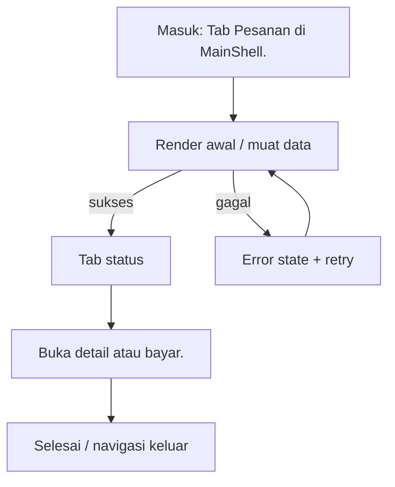

# Riwayat Pesanan

> **Fitur:** Pesanan · **Route:** `/orders` · **Akses:** Sanctum · **Tipe:** Pesanan / checkout
> **Implementasi:** `lib/Features/Order/Presentation/Screens/OrderHistory/OrderHistoryScreen.dart` — `OrderHistoryScreen` (656 baris) · **State:** Riverpod + state lokal (`setState`) · **Pola:** request-response
> **API:** 6 endpoint · **Tabel:** 8 · **Model:** 0
> Diverifikasi 6 November 2026 dari kode Flutter, route Laravel, dan skema PostgreSQL. Bagian bertanda **[Usulan]** adalah rekomendasi, bukan perilaku yang sudah diverifikasi.

## 0. Ringkasan Eksekutif

| Aspek | Ringkasan |
|---|---|
| Tujuan | Menampilkan pesanan pengguna dengan tab status dan aksi cepat. |
| Aktor | Pelanggan terautentikasi (Sanctum) |
| Nilai pengguna | Menampilkan pesanan pengguna dengan tab status dan aksi cepat. |
| Definisi sukses | Pesanan dibuat/ditampilkan dengan status dan total yang benar. |
| Risiko utama | Guest diarahkan ke prompt login. |
| Status dokumen | Kontrak terdokumentasi; ada gap yang harus ditangani |

## 1. Konteks Fitur

### 1.1 Persona & job-to-be-done

| Persona | Kebutuhan | Ukuran keberhasilan |
|---|---|---|
| Pelanggan dekorasi pernikahan | Menampilkan pesanan pengguna dengan tab status dan aksi cepat. | Pesanan dibuat/ditampilkan dengan status dan total yang benar. |

### 1.2 In scope

- Muat halaman pesanan.
- Filter berdasarkan status.
- Muat lebih banyak saat scroll.
- Buka detail atau bayar.

### 1.3 Out of scope

- Tidak mengakses database secara langsung; semua data lewat REST/Laravel.
- Tidak menggantikan validasi backend untuk harga, stok, status, atau kepemilikan resource.
- Tidak menambahkan dependensi atau endpoint baru tanpa memperbarui dokumen ini dan peta endpoint.

## 2. Navigasi & Entry Point

| Arah | Detail |
|---|---|
| Masuk dari | Tab Pesanan di `MainShell`. |
| Route | `/orders` |
| Parameter/extra | Tidak ada parameter khusus. |
| Guard | Butuh Bearer token valid. 401 harus membersihkan token dan mengarahkan pengguna ke Landing/login. |
| Keluar ke | `/payment/:id`, `/order/:id`, `/write-review` |
| Perilaku back | State tab dipertahankan oleh `StatefulShellRoute.indexedStack`; kembali tidak boleh mereset cabang lain. [Usulan] |

### 2.1 Layar terkait dalam fitur yang sama

| Layar | Route | PRD |
|---|---|---|
| `CheckoutScreen` | `/checkout` | [checkout.md](../order/checkout.md) |
| `OrderDetailScreen` | `/order/:id` | [order-detail.md](../order/order-detail.md) |

## 3. Alur Pengguna

1. Muat halaman pesanan.
2. Filter berdasarkan status.
3. Muat lebih banyak saat scroll.
4. Buka detail atau bayar.

**Decision points yang wajib diuji:**

- `kosong` → Empty state dengan penjelasan dan CTA lanjutan.



## 4. Arsitektur Layar

| Aspek | Nilai |
|---|---|
| File | `lib/Features/Order/Presentation/Screens/OrderHistory/OrderHistoryScreen.dart` |
| Kelas layar | `OrderHistoryScreen` |
| Base widget | `ConsumerStatefulWidget` |
| Kelas state | `_OrderHistoryPageState` |
| State management | Riverpod + state lokal (`setState`) |
| Pola data | request-response |
| Provider | `authProvider`, `orderProvider` |
| Repository | Tidak terdeteksi |
| Service | Tidak terdeteksi |
| Widget inti | `AppBlurBackdrop`, `AppActionSheet`, `AppBreadcrumbs`, `AppBottomSheet`, `AppButton`, `AppEmptyState`, `AppShimmer`, `AppSnackbar`, `GuestAuthPrompt` |
| Widget fitur | `UploadPaymentProof` |
| Model | Tidak terdeteksi |

### 4.1 State lokal yang terdeteksi

| Field | Tipe | Peran |
|---|---|---|
| `_activeStatus` | `String?` | State lokal layar. |
| `_activePaymentType` | `String?` | State lokal layar. |
| `_tabStatuses` | `List<dynamic>` | State lokal layar. |
| `_paymentTypes` | `List<String?>` | State lokal layar. |

### 4.2 Metode internal

`_statusLabel`, `_parsePrice`, `_refresh`, `_payableAmount`, `_isExpired`, `_editOrder`, `_confirm`, `_deleteOrder`, `_openOrderActions`, `_uploadPaymentProof`, `_buildChipRow`, `_buildPaymentStrip`.

### 4.3 Alur data

```text
Widget / State
   ↓ baca/tulis
Provider Riverpod
   ↓
Repository / DioClient
   ↓ REST
Controller Laravel → PostgreSQL (8 tabel terkait)
```

## 5. Blueprint UI

Wireframe konseptual dari daftar elemen registry. Urutan final mengikuti file implementasi.

```text
┌────────────────────────────────────────────────────────────────────┐
│ Riwayat Pesanan                                                   │
├────────────────────────────────────────────────────────────────────┤
│ 1. Tab status                                                     │
│ 2. Kartu pesanan                                                  │
│ 3. Badge status                                                   │
│ 4. Tombol bayar                                                   │
│ 5. Empty state                                                    │
└────────────────────────────────────────────────────────────────────┘
```

**Komponen bersama yang terdeteksi:**

- Core: `AppBlurBackdrop`, `AppActionSheet`, `AppBreadcrumbs`, `AppBottomSheet`, `AppButton`, `AppEmptyState`, `AppShimmer`, `AppSnackbar`, `GuestAuthPrompt`
- Fitur: `UploadPaymentProof`

## 6. Inventaris Komponen & Interaksi

| # | Elemen | Jenis | Aksi | Feedback |
|---|---|---|---|---|
| 1 | Tab status | Status | Tampilkan kondisi koneksi/status; beri aksi retry bila perlu. | Perubahan status diumumkan; retry tersedia. |
| 2 | Kartu pesanan | Pesan | Tampilkan/balas pesan; long-press untuk menu konteks. | Status kirim/terbaca/gagal tampil jelas. |
| 3 | Badge status | Status | Tampilkan kondisi koneksi/status; beri aksi retry bila perlu. | Perubahan status diumumkan; retry tersedia. |
| 4 | Tombol bayar | Aksi | Tap → jalankan aksi utama layar. | Disabled saat loading; error lewat SnackBar/inline. |
| 5 | Empty state | Konten | Tampilkan informasi; tidak ada aksi tulis. | Loading/error state tetap wajib. |

### 6.1 Fakta teknis form & interaksi

| Fakta | Nilai |
|---|---|
| TextEditingController | 0 |
| Field teks/form | 0 |
| Dropdown | 0 |
| Switch/toggle | 0 |
| Validator client | 0 |
| Field password (`obscureText`) | 0 |
| maxLength | Tidak terdeteksi |
| Keyboard | Tidak terdeteksi |
| Input formatter | Tidak terdeteksi |
| Upload file | Tidak |
| Kamera | Tidak |
| WebView | Tidak |
| Timer/polling | Tidak |
| Pagination | Ya |
| Pull to refresh | Ya |

## 7. Copywriting & Microcopy

Semua teks di bawah ini adalah **usulan**. Implementasi wajib memakai `AppLocalizations` dan mengikuti gaya bahasa layar lain.

| Lokasi | Draft copy | Catatan |
|---|---|---|
| Judul/header | Riwayat Pesanan | Samakan dengan label navigasi. |
| Subjudul | Menampilkan pesanan pengguna dengan tab status dan aksi cepat. | Ringkas; jangan mengulang judul. |
| Tombol utama | Lihat Pesanan | [Usulan] Disabled saat proses. |
| Empty state | Belum ada riwayat Pesanan. | [Usulan] Sertakan CTA lanjutan. |
| Error | Gagal memuat riwayat Pesanan. Periksa koneksi lalu coba lagi. | [Usulan] Jangan tampilkan stack trace. |
| Retry | Coba lagi | [Usulan] Pertahankan data lama bila ada. |
| Offline | Anda sedang offline. Periksa koneksi internet. | [Usulan] Sediakan retry. |
| Validasi | Periksa kembali data yang Anda isi. | [Usulan] Fokus ke field pertama. |
| Ringkasan | Ringkasan pesanan | [Usulan] Total final selalu dari backend. |
| Konfirmasi | Pastikan data acara sudah benar. | [Usulan] Cek sebelum submit. |

## 8. Design System & Responsif

### 8.1 Token yang wajib dipakai

| Token | Nilai |
|---|---|
| Font | Instrument Sans (W400/W600), aset lokal |
| Warna primer | `AppColors.primaryColor` = `#1E3A5F` |
| Aksen | `AppColors.accentColor` = `#C9A94E` |
| Background light | `AppColors.backgroundColor` = `#F8F6F7` |
| Surface light | `AppColors.surfaceColor` = `#FFFFFF` |
| Background dark | `AppColors.darkBackground` = `#121212` |
| Surface dark | `AppColors.darkSurface` = `#1E1E1E` |
| Teks primer light | `#1A1A2E`; dark `#E8E8E8` |
| Teks sekunder light | `#8E8E9A`; dark `#A0A0A0` |
| Sukses/error/warning/info | `#10B981` / `#EF4444` / `#F59E0B` / `#3B82F6` |
| Tipografi | `headTitle` 22/w600; `subHeadTitle` 16/w400; `h3` 14/w600; `h4` 12/w400; `description` 14/1.4 |
| Spacing | `AppSizes` 2, 4, 8, 16, 24, 32, 48, 64 |
| Radius | card 16, button 14, input 14, avatar 28, bottom nav 24 |
| Glass | `AppBlurBackdrop`; `blurSigma` 15; tint light `#32FFFFFF`, night `#32000000` |

### 8.2 Aturan responsif

- Lebar minimum yang wajib diuji: **320 px**; target umum 360/390/412 px.
- Tablet ≥ 600 px: gunakan padding lebih lebar dan grid multi-kolom bila layar berupa koleksi.
- Jangan mengunci tinggi konten; gunakan `SingleChildScrollView`/sliver agar tidak overflow.
- Hormati `SafeArea`, status bar, navigation bar, dan keyboard inset.
- Teks harus tetap terbaca pada text scale 200%; hindari `maxLines: 1` untuk label penting.
- Layout harus aman untuk locale dengan teks lebih panjang (±30%).

### 8.3 Mode gelap & glass

- Tema mengikuti sistem (light/dark) dan dapat di-override `ThemeProvider`.
- Jangan hardcode warna; gunakan `AppColors`/`AppTheme` agar mode gelap bekerja.
- Fallback tanpa blur harus tetap kontras dan terbaca.
- Hormati reduce-motion; animasi 3D/parallax tidak boleh menjadi satu-satunya pembeda state.

## 9. State Machine

| State | Pemicu | UI | Pemulihan |
|---|---|---|---|
| `initial` | Layar dibuka | Kerangka/placeholder awal | Muat data |
| `loading` | Request berjalan | Skeleton/spinner; aksi utama disabled | Tunggu atau retry saat timeout |
| `content` | Data tersedia | Render konten utama | — |
| `empty` | Data kosong | Empty state dengan penjelasan + CTA | Refresh atau aksi lanjutan |
| `error` | Request gagal | Pesan ramah + tombol coba lagi | Retry |
| `unauthorized` | HTTP 401 | Sesi berakhir; arahkan login/Landing | Login ulang |
| `offline` | Koneksi putus | Banner/empty offline | Coba lagi saat online |
| `submitting` | Pengguna menekan aksi utama | Tombol disabled + progress | Selesai atau tampilkan error |
| `refreshing` | Pull to refresh | Spinner di atas konten | Selesai; reset halaman |
| `pagination` | Scroll mendekati akhir | Loader footer | Muat halaman berikutnya |
| `kosong` | Kondisi domain | Empty state dengan penjelasan dan CTA lanjutan. | Ikuti aksi pemulihan pada pesan |
| `load more` | Kondisi domain | Tampilkan status yang jelas dan aksi pemulihan. | Ikuti aksi pemulihan pada pesan |
| `guest` | Kondisi domain | Tampilkan `GuestAuthPrompt`; jangan panggil endpoint privat. | Ikuti aksi pemulihan pada pesan |

**Aturan umum:** setiap request harus melewati `idle → loading → success/empty/failure`; jangan merender hasil request langsung di `build()`.

## 10. Kontrak API

### 10.1 Ringkasan endpoint

| # | Method | Path | Controller | Auth | Kegunaan |
|---|---|---|---|---|---|
| 1 | `GET` | `/bookings` | `OrderController@getOrders` | Sanctum | Membuat/membaca pesanan |
| 2 | `POST` | `/bookings` | `OrderController@createOrder` | Sanctum | Membuat/membaca pesanan |
| 3 | `POST` | `/bookings/{id}/cancel` | `OrderController@cancelOrder` | Sanctum | Membatalkan pesanan |
| 4 | `GET` | `/bookings/{id}` | `OrderController@show` | Sanctum | Detail/mengubah/menghapus pesanan |
| 5 | `PUT` | `/bookings/{id}` | `OrderController@updateOrder` | Sanctum | Detail/mengubah/menghapus pesanan |
| 6 | `DELETE` | `/bookings/{id}` | `OrderController@deleteOrder` | Sanctum | Detail/mengubah/menghapus pesanan |

### 10.2 Detail per endpoint

#### 10.2.1 `GET /bookings`

- **Controller:** `OrderController@getOrders`
- **Auth:** Sanctum
- **Kegunaan:** Membuat/membaca pesanan
- **Sumber aturan:** `../Mobile-And-Backend/app/Http/Controllers/Api/User/OrderController/OrderController.php`
- **Field request:** tidak ada aturan validasi field yang terdeteksi otomatis (GET, validasi di service, atau `FormRequest` lain). Periksa controller sebelum menulis kode.
- **Response top-level:** `status`, `data`, `pagination`, `message`, `error`
- **Pesan error terbaca:** “Gagal memuat pesanan”

#### 10.2.2 `POST /bookings`

- **Controller:** `OrderController@createOrder`
- **Auth:** Sanctum
- **Kegunaan:** Membuat/membaca pesanan
- **Sumber aturan:** `../Mobile-And-Backend/app/Http/Controllers/Api/User/OrderController/OrderController.php`

| Field request | Aturan | Wajib |
|---|---|---|
| `package_id` | `required|integer` | Ya |
| `catalog_id` | `required|integer` | Ya |
| `event_date` | `required|date|after_or_equal:today` | Ya |
| `event_time` | `nullable|string` | Tidak |
| `quantity` | `nullable|integer|min:1` | Tidak |
| `notes` | `nullable|string|max:1000` | Tidak |
| `customer_name` | `required|string|max:255` | Ya |
| `whatsapp` | `required|string|max:20` | Ya |
| `voucher_code` | `nullable|string|max:50` | Tidak |

- **Response top-level:** `status`, `message`, `data`, `errors`, `error`
- **Pesan error terbaca:** “Paket tidak termasuk dalam katalog yang dipilih”; “Stok tidak mencukupi”; “Pesanan berhasil dibuat”; “Validasi gagal”

#### 10.2.3 `POST /bookings/{id}/cancel`

- **Controller:** `OrderController@cancelOrder`
- **Auth:** Sanctum
- **Kegunaan:** Membatalkan pesanan
- **Sumber aturan:** `../Mobile-And-Backend/app/Http/Controllers/Api/User/OrderController/OrderController.php`
- **Field request:** tidak ada aturan validasi field yang terdeteksi otomatis (GET, validasi di service, atau `FormRequest` lain). Periksa controller sebelum menulis kode.
- **Response top-level:** `status`, `message`, `data`
- **Pesan error terbaca:** “Pesanan sudah dalam status:”; “Pesanan berhasil dibatalkan”; “Pesanan tidak ditemukan atau bukan milik Anda”; “Gagal membatalkan pesanan”

#### 10.2.4 `GET /bookings/{id}`

- **Controller:** `OrderController@show`
- **Auth:** Sanctum
- **Kegunaan:** Detail/mengubah/menghapus pesanan
- **Sumber aturan:** `../Mobile-And-Backend/app/Http/Controllers/Api/User/OrderController/OrderController.php`
- **Field request:** tidak ada aturan validasi field yang terdeteksi otomatis (GET, validasi di service, atau `FormRequest` lain). Periksa controller sebelum menulis kode.
- **Response top-level:** `status`, `data`, `message`
- **Pesan error terbaca:** “Pesanan tidak ditemukan atau bukan milik Anda”; “Gagal mengambil detail pesanan”

#### 10.2.5 `PUT /bookings/{id}`

- **Controller:** `OrderController@updateOrder`
- **Auth:** Sanctum
- **Kegunaan:** Detail/mengubah/menghapus pesanan
- **Sumber aturan:** `../Mobile-And-Backend/app/Http/Controllers/Api/User/OrderController/OrderController.php`

| Field request | Aturan | Wajib |
|---|---|---|
| `event_date` | `nullable|date|after_or_equal:today` | Tidak |
| `event_time` | `nullable|string|max:255` | Tidak |
| `quantity` | `nullable|integer|min:1` | Tidak |
| `notes` | `nullable|string|max:1000` | Tidak |
| `whatsapp` | `nullable|string|max:20` | Tidak |
| `voucher_code` | `nullable|string|max:50` | Tidak |
| `payment_type` | `nullable|string|in:virtual_account,qris` | Tidak |

- **Response top-level:** `status`, `message`, `data`, `errors`, `error`
- **Pesan error terbaca:** “Pesanan sudah dibayar atau sedang diproses dan tidak dapat diubah lagi”; “Virtual Account BRI belum diaktifkan. Hubungi admin.”; “QRIS BRI belum diaktifkan. Hubungi admin.”; “Stok tidak mencukupi”

#### 10.2.6 `DELETE /bookings/{id}`

- **Controller:** `OrderController@deleteOrder`
- **Auth:** Sanctum
- **Kegunaan:** Detail/mengubah/menghapus pesanan
- **Sumber aturan:** `../Mobile-And-Backend/app/Http/Controllers/Api/User/OrderController/OrderController.php`
- **Field request:** tidak ada aturan validasi field yang terdeteksi otomatis (GET, validasi di service, atau `FormRequest` lain). Periksa controller sebelum menulis kode.
- **Response top-level:** `status`, `message`, `data`, `error`
- **Pesan error terbaca:** “Pesanan yang sudah dibayar tidak dapat dihapus. Hubungi admin untuk refund.”; “Pesanan yang sedang diproses tidak dapat dihapus”; “Pesanan berhasil dihapus dari riwayat”; “Pesanan tidak ditemukan”

**Envelope acuan** (periksa controller untuk variasi):

```json
{"status":"success","message":"...","data":{}}
```

### 10.3 Pemetaan error HTTP

| HTTP | Failure | Perilaku UI |
|---|---|---|
| 401 | `AuthFailure` | Hapus token, arahkan ke Landing/login, tampilkan sesi berakhir. |
| 403 | `UnknownFailure` / izin | Pesan akses ditolak; jangan logout otomatis. |
| 404 | `NotFoundFailure` | Tampilkan resource tidak ditemukan + kembali. |
| 409 | `ConflictFailure` / server | Tampilkan konflik status (stok, duplikasi, pembayaran). |
| 422 | `ValidationFailure(errors)` | Tampilkan error per field; pertahankan input. |
| 429 | `UnknownFailure` / rate limit | Minta pengguna menunggu; jangan spam retry. |
| 5xx | `ServerFailure` | Pesan error server + tombol coba lagi. |
| null | `NetworkFailure` | Periksa koneksi + retry; pertahankan data lama. |

## 11. Data & Database

| Tabel | Peran | Akses | Kolom kunci |
|---|---|---|---|
| `orders` | Pesanan dan statusnya. | Baca/tulis (indikasi) | `id`, `user_id`, `package_id`, `catalog_id`, `order_number`, `total_price`, `status`, `payment_status`, `booking_date`, `notes` … |
| `transactions` | Transaksi pembayaran/dompet. | Baca/tulis (indikasi) | `id`, `user_id`, `order_id`, `type`, `reference_number`, `amount`, `admin_fee`, `total_amount`, `payment_gateway`, `payment_method` … |
| `order_timelines` | Riwayat status pesanan. | Baca/tulis (indikasi) | `id`, `order_id`, `status`, `description`, `metadata`, `created_by`, `created_at`, `updated_at` |
| `packages` | Tier/paket dari katalog. | Baca/tulis (indikasi) | `id`, `category_id`, `name`, `slug`, `description`, `price`, `stock`, `discount_price`, `is_featured`, `features` … |
| `catalogs` | Item katalog. | Baca/tulis (indikasi) | `id`, `category_id`, `name`, `slug`, `description`, `price`, `discount_price`, `stock`, `is_active`, `created_at` … |
| `vouchers` | Voucher dan masa berlaku. | Baca/tulis (indikasi) | `id`, `code`, `description`, `expires_at`, `is_active`, `is_global`, `max_uses`, `uses_count`, `created_at`, `updated_at` … |
| `user_vouchers` | Voucher yang diklaim pengguna. | Baca/tulis (indikasi) | `id`, `user_id`, `voucher_id`, `claimed_at`, `used_at`, `order_id`, `created_at`, `updated_at` |
| `order_payments` | Pembayaran dan bukti bayar. | Baca/tulis (indikasi) | `id`, `order_id`, `method`, `status`, `amount`, `paid_at`, `transaction_id`, `proof_url`, `created_at`, `updated_at` |

Akses tabel di atas adalah **indikasi dari endpoint**; verifikasi controller/service untuk memastikan operasi baca/tulis yang sebenarnya.

### 11.1 Aturan data

- Jangan menampilkan data dari cache setelah logout.
- Nominal, stok, status pesanan, dan kepemilikan resource **wajib** divalidasi backend.
- Jangan mengakses PostgreSQL dari Flutter; gunakan endpoint Laravel.
- Filter data milik pengguna dilakukan server-side (`user_id` dari token), bukan di client.
- Jangan menyimpulkan status pembayaran dari `orders.status`; gunakan data pembayaran/transaksi.

## 12. Aturan Bisnis & Validasi

### 12.1 Acceptance dari registry

- Tab tidak mengubah data, hanya filter.
- Pesanan baru muncul setelah kembali dari checkout.

### 12.2 Validasi server yang terbaca dari controller

| Field | Aturan | Endpoint |
|---|---|---|
| `package_id` | `required|integer` | `/bookings` |
| `catalog_id` | `required|integer` | `/bookings` |
| `event_date` | `required|date|after_or_equal:today` | `/bookings` |
| `event_time` | `nullable|string` | `/bookings` |
| `quantity` | `nullable|integer|min:1` | `/bookings` |
| `notes` | `nullable|string|max:1000` | `/bookings` |
| `customer_name` | `required|string|max:255` | `/bookings` |
| `whatsapp` | `required|string|max:20` | `/bookings` |
| `voucher_code` | `nullable|string|max:50` | `/bookings` |
| `event_date` | `nullable|date|after_or_equal:today` | `/bookings/{id}` |
| `event_time` | `nullable|string|max:255` | `/bookings/{id}` |
| `quantity` | `nullable|integer|min:1` | `/bookings/{id}` |
| `notes` | `nullable|string|max:1000` | `/bookings/{id}` |
| `whatsapp` | `nullable|string|max:20` | `/bookings/{id}` |
| `voucher_code` | `nullable|string|max:50` | `/bookings/{id}` |
| `payment_type` | `nullable|string|in:virtual_account,qris` | `/bookings/{id}` |

### 12.3 Validasi client yang terdeteksi

- Tidak ada form input yang terdeteksi pada layar ini.

### 12.4 Aturan bisnis wajib

- Disable tombol submit selama request berjalan untuk mencegah duplikasi.
- Terapkan `Accept-Language` dari `localeProvider` pada setiap request.
- Gunakan `DioClient`/repository yang sudah ada; jangan membuat instance Dio baru.
- Guest tidak boleh memanggil endpoint privat; tampilkan `GuestAuthPrompt`.
- Stok, harga, dan ketersediaan paket divalidasi backend saat membuat pesanan.
- Cegah submit ganda; satu tap menghasilkan satu pesanan.
- Jangan mengirim total/harga final dari client sebagai sumber kebenaran.

## 13. Error Handling

Pemetaan status HTTP mengikuti `.docs/02-architecture/STATE-AND-ERRORS.md` (lihat §10.3).

### 13.1 Kegagalan spesifik layar

- Timeout jaringan → tampilkan pesan koneksi dan tombol coba lagi.
- Respons tidak sesuai envelope → tampilkan error umum, catat status code.
- 401 → bersihkan token dan arahkan ke Landing/login.
- 403 → tampilkan akses ditolak tanpa logout otomatis.
- 5xx → error server + retry; jangan menampilkan stack trace.
- Gap: Guest diarahkan ke prompt login.

## 14. Keamanan & Privasi

- Token hanya di `FlutterSecureStorage`; jangan di `SharedPreferences` atau log.
- Jangan menampilkan stack trace, query database, atau detail internal pada pengguna.
- Jangan mengirim PII ke analytics/crash report.
- Validasi kepemilikan resource di backend; client tidak boleh menentukan `user_id`.
- Guest tidak boleh mengirim Bearer token kosong atau mengakses resource privat.

## 15. Aksesibilitas

- Semua ikon/tombol non-teks memiliki label semantik.
- Target sentuh minimal 48×48 dp; jangan hanya mengandalkan ikon kecil.
- Kontras teks memenuhi WCAG AA pada mode terang dan gelap.
- Urutan fokus screen reader mengikuti urutan visual.
- Text scale 200% tidak memotong label atau tombol utama.
- Error form diumumkan dan terhubung ke field terkait.
- Hormati reduce-motion; animasi tidak boleh menghalangi interaksi.

## 16. Performa & Offline

- Gunakan `CachedNetworkImage`/cache yang ada untuk gambar jaringan.
- Hindari pekerjaan berat di `build()`; pindahkan parsing/format ke provider/util.
- Dispose controller, timer, dan subscription di `dispose`.
- Muat halaman berikutnya hanya saat mendekati akhir; cegah request paralel.
- Pull-to-refresh mereset halaman dan tidak menumpuk request.
- Tidak ada cache lokal terdeteksi; jangan menambah cache tanpa kebijakan kedaluwarsa.

## 17. Analytics & Observability [Usulan]

Belum diverifikasi apakah event berikut sudah diimplementasikan. Jangan mengirim PII.

| Event | Pemicu | Properti | PII |
|---|---|---|---|
| `screen_view_order_history` | Layar dibuka | screen, route, auth | Tidak |
| `order_history_cta_tap` | Aksi utama ditekan | cta, state | Tidak |
| `order_history_success` | Aksi utama berhasil | duration_ms | Tidak |
| `order_history_failure` | Request/aksi gagal | error_code, status | Tidak |

- Catat `request_id`/status code pada log debug, bukan payload sensitif.
- Crashlytics tidak boleh memuat token, password, dokumen identitas, atau isi chat.

## 18. Acceptance Criteria

### 18.1 Fungsional

- [ ] Tab tidak mengubah data, hanya filter.
- [ ] Pesanan baru muncul setelah kembali dari checkout.
- [ ] Tombol utama menjalankan aksi: Lihat Pesanan.

### 18.2 Navigasi

- [ ] Jalur masuk berfungsi: Tab Pesanan di `MainShell`.
- [ ] Route/parameter sesuai: `/orders`.
- [ ] Back tidak meninggalkan state ganda atau mengulang submit.

### 18.3 State & error

- [ ] Loading, content, empty, error, offline, dan unauthorized tertangani.
- [ ] 401 membersihkan token dan mengarahkan ke Landing/login.
- [ ] 422 menampilkan error per field dan mempertahankan input.
- [ ] Tombol tidak dapat ditekan ganda saat request berjalan.

### 18.4 Data & keamanan

- [ ] Semua endpoint yang dipakai terdaftar di backend; tidak ada endpoint karangan.
- [ ] Nominal/stok/status berasal dari respons backend, bukan hitungan lokal.
- [ ] Tidak ada PII/token di log, analytics, atau pesan error.
- [ ] Guest tidak memanggil endpoint privat.

### 18.5 Responsif & aksesibilitas

- [ ] Tidak ada overflow pada lebar 320 px dan orientasi landscape.
- [ ] Mode terang dan gelap terbaca.
- [ ] Text scale 200% tidak memotong label penting.
- [ ] Target sentuh minimal 48×48 dp dan label semantik tersedia.

### 18.6 Kualitas

- [ ] `flutter analyze` bersih untuk file yang diubah.
- [ ] Test happy path dan minimal satu error path ditambahkan/diperbarui.
- [ ] PRD/SKILL diperbarui bila route, endpoint, atau tabel berubah.

## 19. Test Plan

| ID | Jenis | Skenario | Langkah | Hasil yang diharapkan |
|---|---|---|---|---|
| TC-01 | Widget | Happy path | Buka layar melalui: Tab Pesanan di `MainShell`. | Elemen utama tampil; request sukses; tidak ada error. |
| TC-02 | Manual | Route/parameter | Buka /orders dengan parameter sesuai | Parameter terbaca; layar menampilkan data yang benar. |
| TC-03 | Manual | Loading | Buka layar dengan jaringan lambat | Skeleton/spinner tampil; aksi utama disabled. |
| TC-04 | Manual | Empty | Gunakan akun/data tanpa item | Empty state tampil dengan CTA yang sesuai. |
| TC-05 | Manual | Error server | Mock respons 500 | Pesan error + tombol coba lagi; aplikasi tidak crash. |
| TC-06 | Manual | Sesi habis | Gunakan token kedaluwarsa/401 | Token dibersihkan; diarahkan ke Landing/login. |
| TC-07 | Manual | Akses ditolak | Mock respons 403 | Pesan akses ditolak; tidak logout otomatis. |
| TC-08 | Manual | Offline | Matikan jaringan lalu muat/aksi | Pesan offline + retry; data lama (bila ada) tidak hilang. |
| TC-09 | Widget | Double submit | Tekan aksi utama cepat dua kali | Hanya satu request; tombol disabled saat proses. |
| TC-10 | Manual | Layar kecil | Uji lebar 320 px dan landscape | Tidak ada overflow; tombol tetap terjangkau. |
| TC-11 | Manual | Mode gelap | Aktifkan dark mode sistem | Semua teks/komponen terbaca; tidak ada warna hardcode yang pecah. |
| TC-12 | Manual | Aksesibilitas | Aktifkan screen reader dan text scale 200% | Label terbaca; tidak ada teks terpotong. |
| TC-13 | Manual | 404 | Buka resource yang tidak ada | Halaman not found + tombol kembali. |
| TC-14 | Manual | Pagination | Scroll sampai akhir daftar | Halaman berikutnya dimuat sekali; tidak ada duplikasi. |
| TC-15 | Manual | Refresh | Tarik untuk refresh | Daftar/halaman direset dan data terbaru tampil. |
| TC-16 | Manual | Regresi fitur terkait | Buka layar terkait setelah aksi | Navigasi/state tidak rusak dan data konsisten. |

**Otomasi yang disarankan:** widget test untuk state utama, unit test untuk parsing/validasi, dan golden test untuk layar dengan layout kompleks.

## 20. Gap, Risiko & Dependensi

### 20.1 Gap terdokumentasi

- Guest diarahkan ke prompt login.

### 20.2 Risiko

| Risiko | Peluang | Dampak | Mitigasi |
|---|---|---|---|
| Guest diarahkan ke prompt login. | Sedang | Tinggi | Tangani gap sebelum menganggap layar selesai. |

### 20.3 Dependensi

| Jenis | Item | Catatan |
|---|---|---|
| Endpoint | GET /bookings | OrderController@getOrders |
| Endpoint | POST /bookings | OrderController@createOrder |
| Endpoint | POST /bookings/{id}/cancel | OrderController@cancelOrder |
| Endpoint | GET /bookings/{id} | OrderController@show |
| Endpoint | PUT /bookings/{id} | OrderController@updateOrder |
| Endpoint | DELETE /bookings/{id} | OrderController@deleteOrder |
| Database | orders | Jangan query langsung dari Flutter. |
| Database | transactions | Jangan query langsung dari Flutter. |
| Database | order_timelines | Jangan query langsung dari Flutter. |
| Database | packages | Jangan query langsung dari Flutter. |
| Database | catalogs | Jangan query langsung dari Flutter. |
| Database | vouchers | Jangan query langsung dari Flutter. |
| Database | user_vouchers | Jangan query langsung dari Flutter. |
| Database | order_payments | Jangan query langsung dari Flutter. |
| Provider | authProvider | lib/Features/Auth/Presentation/Providers/AuthProvider/AuthProvider.dart |
| Provider | orderProvider | lib/Features/Order/Presentation/Providers/OrderProvider/OrderProvider.dart |
| Route | /orders | Terdaftar di `AppRouter`. |

Rujukan global: [Known Gaps](../../06-reference/KNOWN-GAPS.md).

## 21. Peta Implementasi & Simbol

| Layer | File/Simbol | Catatan |
|---|---|---|
| Screen | `lib/Features/Order/Presentation/Screens/OrderHistory/OrderHistoryScreen.dart` · `OrderHistoryScreen` | 656 baris |
| Provider | `authProvider` | `lib/Features/Auth/Presentation/Providers/AuthProvider/AuthProvider.dart` |
| Provider | `orderProvider` | `lib/Features/Order/Presentation/Providers/OrderProvider/OrderProvider.dart` |
| Widget inti | `AppBlurBackdrop` | `lib/Core/Widgets/AppBlurBackdrop/` |
| Widget inti | `AppActionSheet` | `lib/Core/Widgets/AppActionSheet/` |
| Widget inti | `AppBreadcrumbs` | `lib/Core/Widgets/AppBreadcrumbs/` |
| Widget inti | `AppBottomSheet` | `lib/Core/Widgets/AppBottomSheet/` |
| Widget inti | `AppButton` | `lib/Core/Widgets/AppButton/` |
| Widget inti | `AppEmptyState` | `lib/Core/Widgets/AppEmptyState/` |
| Widget inti | `AppShimmer` | `lib/Core/Widgets/AppShimmer/` |
| Widget inti | `AppSnackbar` | `lib/Core/Widgets/AppSnackbar/` |
| Widget inti | `GuestAuthPrompt` | `lib/Core/Widgets/GuestAuthPrompt/` |
| Widget fitur | `UploadPaymentProof` | Berada di `Presentation/Widgets/` fitur terkait |
| Test | `test/Features/Pesanan/` | Tambahkan test sesuai §19 |
| Dokumen | `.docs/screens/order/order-history.md` | PRD ini |
| Prompt | `.skills/screens/order/order-history/SKILL.md` | Skill layar |

**Metode internal terdeteksi:** `_statusLabel`, `_parsePrice`, `_refresh`, `_payableAmount`, `_isExpired`, `_editOrder`, `_confirm`, `_deleteOrder`, `_openOrderActions`, `_uploadPaymentProof`, `_buildChipRow`, `_buildPaymentStrip`.

## 22. Referensi & Riwayat

- [REST API](../../03-api/REST-API.md)
- [State & Error](../../02-architecture/STATE-AND-ERRORS.md)
- [Peta Endpoint](../../06-reference/API-ENDPOINT-MAP.md)
- [Database](../../04-database/DATABASE.md)
- [Arsitektur](../../02-architecture/ARCHITECTURE.md)
- [Skill layar](../../../.skills/screens/order/order-history/SKILL.md)

| Tanggal | Perubahan | Sumber |
|---|---|---|
| 6 November 2026 | Regenerasi detail: arsitektur, state machine, kontrak API, validasi, a11y, test plan | Kode Flutter, route Laravel, skema PostgreSQL |
