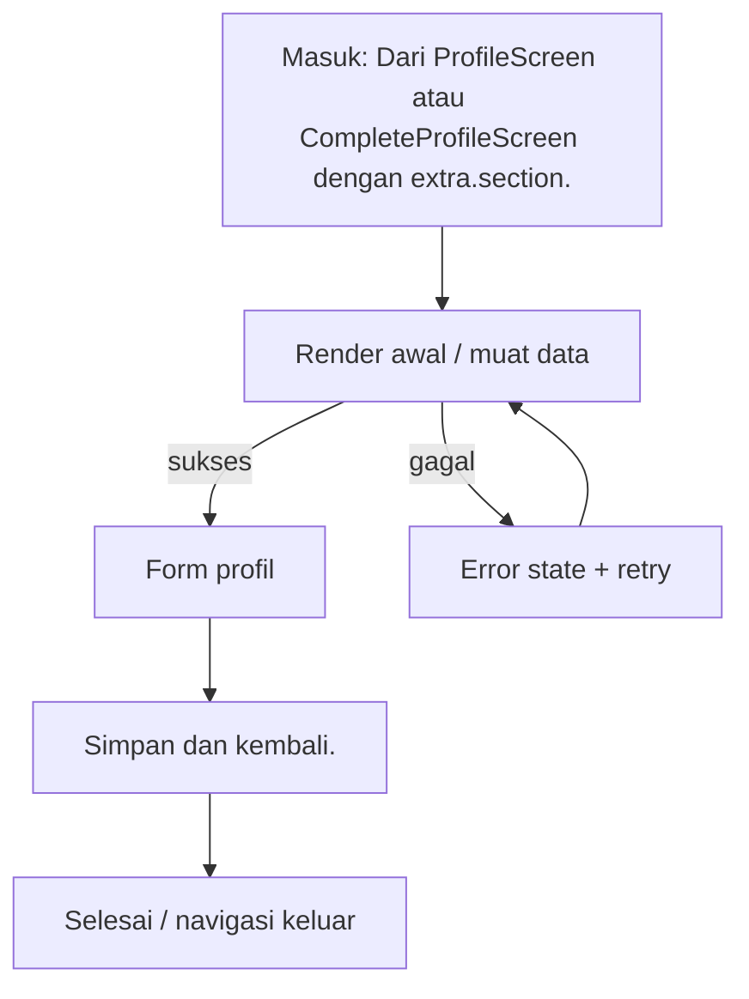

# Edit Profil

> **Fitur:** Profil & Pengaturan · **Route:** `/edit-profile` · **Akses:** Sanctum · **Tipe:** Formulir
> **Implementasi:** `lib/Features/Profile/Presentation/Screens/Profile/EditProfile/EditProfileScreen.dart` — `EditProfileScreen` (509 baris) · **State:** Riverpod + state lokal (`setState`) · **Pola:** request-response
> **API:** 10 endpoint · **Tabel:** 9 · **Model:** 0
> Diverifikasi 6 November 2026 dari kode Flutter, route Laravel, dan skema PostgreSQL. Bagian bertanda **[Usulan]** adalah rekomendasi, bukan perilaku yang sudah diverifikasi.

## 0. Ringkasan Eksekutif

| Aspek | Ringkasan |
|---|---|
| Tujuan | Mengubah data profil, avatar, dan bagian tertentu dari formulir lengkap. |
| Aktor | Pelanggan terautentikasi (Sanctum) |
| Nilai pengguna | Mengubah data profil, avatar, dan bagian tertentu dari formulir lengkap. |
| Definisi sukses | Data tersimpan dan validasi backend terpetakan ke field. |
| Risiko utama | Alamat di sini tidak dipakai checkout (GAP-06). |
| Status dokumen | Kontrak terdokumentasi; ada gap yang harus ditangani |

## 1. Konteks Fitur

### 1.1 Persona & job-to-be-done

| Persona | Kebutuhan | Ukuran keberhasilan |
|---|---|---|
| Pelanggan dekorasi pernikahan | Mengubah data profil, avatar, dan bagian tertentu dari formulir lengkap. | Data tersimpan dan validasi backend terpetakan ke field. |

### 1.2 In scope

- Muat profil.
- Edit field yang dipilih.
- Unggah avatar bila berubah.
- Simpan dan kembali.

### 1.3 Out of scope

- Tidak mengakses database secara langsung; semua data lewat REST/Laravel.
- Tidak menggantikan validasi backend untuk harga, stok, status, atau kepemilikan resource.
- Tidak menambahkan dependensi atau endpoint baru tanpa memperbarui dokumen ini dan peta endpoint.

## 2. Navigasi & Entry Point

| Arah | Detail |
|---|---|
| Masuk dari | Dari `ProfileScreen` atau `CompleteProfileScreen` dengan `extra.section`. |
| Route | `/edit-profile` |
| Parameter/extra | `extra: {section}` opsional untuk scroll ke bagian. |
| Guard | Butuh Bearer token valid. 401 harus membersihkan token dan mengarahkan pengguna ke Landing/login. |
| Keluar ke | Tidak ada navigasi keluar langsung yang terdeteksi. |
| Perilaku back | Jika ada perubahan belum disimpan, tampilkan konfirmasi sebelum keluar. [Usulan] |

### 2.1 Layar terkait dalam fitur yang sama

| Layar | Route | PRD |
|---|---|---|
| `ProfileScreen` | `/profile` | [profile.md](../profile/profile.md) |
| `ProfileFieldScreen` | `/profile-field` | [profile-field.md](../profile/profile-field.md) |
| `DocumentScannerScreen` | `/document-scanner` | [document-scanner.md](../profile/document-scanner.md) |
| `FaceScannerScreen` | `/face-scanner` | [face-scanner.md](../profile/face-scanner.md) |

## 3. Alur Pengguna

1. Muat profil.
2. Edit field yang dipilih.
3. Unggah avatar bila berubah.
4. Simpan dan kembali.

**Decision points yang wajib diuji:**

- `validasi gagal` → Pesan ramah + retry; pertahankan input pengguna.
- `upload gagal` → Pesan ramah + retry; pertahankan input pengguna.



## 4. Arsitektur Layar

| Aspek | Nilai |
|---|---|
| File | `lib/Features/Profile/Presentation/Screens/Profile/EditProfile/EditProfileScreen.dart` |
| Kelas layar | `EditProfileScreen` |
| Base widget | `ConsumerStatefulWidget` |
| Kelas state | `_EditProfilePageState` |
| State management | Riverpod + state lokal (`setState`) |
| Pola data | request-response |
| Provider | `authProvider`, `profileProvider` |
| Repository | Tidak terdeteksi |
| Service | Tidak terdeteksi |
| Widget inti | `AppButton`, `AppTextField`, `AppSnackbar`, `MediaViewer`, `WhatsappOtpVerifier`, `GuestAuthPrompt`, `AppBreadcrumbs` |
| Widget fitur | Tidak terdeteksi |
| Model | Tidak terdeteksi |

### 4.1 State lokal yang terdeteksi

| Field | Tipe | Peran |
|---|---|---|
| `_formKey` | `GlobalKey<FormState>` | State lokal layar. |
| `_scrollController` | `ScrollController` | Controller input; wajib dispose. |
| `_firstNameController` | `TextEditingController` | Controller input; wajib dispose. |
| `_midNameController` | `TextEditingController` | Controller input; wajib dispose. |
| `_lastNameController` | `TextEditingController` | Controller input; wajib dispose. |
| `_usernameController` | `TextEditingController` | Controller input; wajib dispose. |
| `_whatsappController` | `TextEditingController` | Controller input; wajib dispose. |
| `_countryCode` | `String` | State lokal layar. |
| `_editing` | `bool` | State lokal layar. |
| `_saving` | `bool` | Mencegah submit ganda. |
| `_whatsappVerified` | `bool` | State lokal layar. |
| `_initialWhatsapp` | `String` | State lokal layar. |
| `_avatarFile` | `File?` | State lokal layar. |

### 4.2 Metode internal

`_loadFromProfile`, `_pickAvatar`, `_save`, `_buildReadOnlySection`.

### 4.3 Alur data

```text
Widget / State
   ↓ baca/tulis
Provider Riverpod
   ↓
Repository / DioClient
   ↓ REST
Controller Laravel → PostgreSQL (9 tabel terkait)
```

## 5. Blueprint UI

Wireframe konseptual dari daftar elemen registry. Urutan final mengikuti file implementasi.

```text
┌────────────────────────────────────────────────────────────────────┐
│ Edit Profil                                                       │
├────────────────────────────────────────────────────────────────────┤
│ 1. Form profil                                                    │
│ 2. Avatar picker                                                  │
│ 3. Dropdown                                                       │
│ 4. Tombol simpan                                                  │
│ 5. Section highlight                                              │
└────────────────────────────────────────────────────────────────────┘
```

**Komponen bersama yang terdeteksi:**

- Core: `AppButton`, `AppTextField`, `AppSnackbar`, `MediaViewer`, `WhatsappOtpVerifier`, `GuestAuthPrompt`, `AppBreadcrumbs`

## 6. Inventaris Komponen & Interaksi

| # | Elemen | Jenis | Aksi | Feedback |
|---|---|---|---|---|
| 1 | Form profil | Input | Isi/ubah nilai; validasi client sebelum kirim. | Error inline; 422 dipetakan per field. |
| 2 | Avatar picker | Media native | Minta izin, tampilkan preview, ambil/unggah media. | Izin ditolak → pengaturan; dispose controller. |
| 3 | Dropdown | Input | Isi/ubah nilai; validasi client sebelum kirim. | Error inline; 422 dipetakan per field. |
| 4 | Tombol simpan | Aksi | Tap → jalankan aksi utama layar. | Disabled saat loading; error lewat SnackBar/inline. |
| 5 | Section highlight | Konten | Tampilkan informasi; tidak ada aksi tulis. | Loading/error state tetap wajib. |

### 6.1 Fakta teknis form & interaksi

| Fakta | Nilai |
|---|---|
| TextEditingController | 5 |
| Field teks/form | 0 |
| Dropdown | 0 |
| Switch/toggle | 0 |
| Validator client | 2 |
| Field password (`obscureText`) | 0 |
| maxLength | Tidak terdeteksi |
| Keyboard | number |
| Input formatter | Tidak terdeteksi |
| Upload file | Tidak |
| Kamera | Tidak |
| WebView | Tidak |
| Timer/polling | Tidak |
| Pagination | Tidak |
| Pull to refresh | Tidak |

## 7. Copywriting & Microcopy

Semua teks di bawah ini adalah **usulan**. Implementasi wajib memakai `AppLocalizations` dan mengikuti gaya bahasa layar lain.

| Lokasi | Draft copy | Catatan |
|---|---|---|
| Judul/header | Edit Profil | Samakan dengan label navigasi. |
| Subjudul | Mengubah data profil, avatar, dan bagian tertentu dari formulir lengkap. | Ringkas; jangan mengulang judul. |
| Tombol utama | Simpan Perubahan | [Usulan] Disabled saat proses. |
| Empty state | Belum ada edit Profil. | [Usulan] Sertakan CTA lanjutan. |
| Error | Gagal memuat edit Profil. Periksa koneksi lalu coba lagi. | [Usulan] Jangan tampilkan stack trace. |
| Retry | Coba lagi | [Usulan] Pertahankan data lama bila ada. |
| Offline | Anda sedang offline. Periksa koneksi internet. | [Usulan] Sediakan retry. |
| Validasi | Periksa kembali data yang Anda isi. | [Usulan] Fokus ke field pertama. |
| Validasi | Periksa kembali data yang Anda isi. | [Usulan] Fokus ke field pertama yang salah. |
| Sukses | Data berhasil disimpan. | [Usulan] Kembali ke layar sebelumnya. |

## 8. Design System & Responsif

### 8.1 Token yang wajib dipakai

| Token | Nilai |
|---|---|
| Font | Instrument Sans (W400/W600), aset lokal |
| Warna primer | `AppColors.primaryColor` = `#1E3A5F` |
| Aksen | `AppColors.accentColor` = `#C9A94E` |
| Background light | `AppColors.backgroundColor` = `#F8F6F7` |
| Surface light | `AppColors.surfaceColor` = `#FFFFFF` |
| Background dark | `AppColors.darkBackground` = `#121212` |
| Surface dark | `AppColors.darkSurface` = `#1E1E1E` |
| Teks primer light | `#1A1A2E`; dark `#E8E8E8` |
| Teks sekunder light | `#8E8E9A`; dark `#A0A0A0` |
| Sukses/error/warning/info | `#10B981` / `#EF4444` / `#F59E0B` / `#3B82F6` |
| Tipografi | `headTitle` 22/w600; `subHeadTitle` 16/w400; `h3` 14/w600; `h4` 12/w400; `description` 14/1.4 |
| Spacing | `AppSizes` 2, 4, 8, 16, 24, 32, 48, 64 |
| Radius | card 16, button 14, input 14, avatar 28, bottom nav 24 |
| Glass | `AppBlurBackdrop`; `blurSigma` 15; tint light `#32FFFFFF`, night `#32000000` |

### 8.2 Aturan responsif

- Lebar minimum yang wajib diuji: **320 px**; target umum 360/390/412 px.
- Tablet ≥ 600 px: gunakan padding lebih lebar dan grid multi-kolom bila layar berupa koleksi.
- Jangan mengunci tinggi konten; gunakan `SingleChildScrollView`/sliver agar tidak overflow.
- Hormati `SafeArea`, status bar, navigation bar, dan keyboard inset.
- Teks harus tetap terbaca pada text scale 200%; hindari `maxLines: 1` untuk label penting.
- Layout harus aman untuk locale dengan teks lebih panjang (±30%).

### 8.3 Mode gelap & glass

- Tema mengikuti sistem (light/dark) dan dapat di-override `ThemeProvider`.
- Jangan hardcode warna; gunakan `AppColors`/`AppTheme` agar mode gelap bekerja.
- Fallback tanpa blur harus tetap kontras dan terbaca.
- Hormati reduce-motion; animasi 3D/parallax tidak boleh menjadi satu-satunya pembeda state.

## 9. State Machine

| State | Pemicu | UI | Pemulihan |
|---|---|---|---|
| `initial` | Layar dibuka | Kerangka/placeholder awal | Muat data |
| `loading` | Request berjalan | Skeleton/spinner; aksi utama disabled | Tunggu atau retry saat timeout |
| `content` | Data tersedia | Render konten utama | — |
| `empty` | Data kosong | Empty state dengan penjelasan + CTA | Refresh atau aksi lanjutan |
| `error` | Request gagal | Pesan ramah + tombol coba lagi | Retry |
| `unauthorized` | HTTP 401 | Sesi berakhir; arahkan login/Landing | Login ulang |
| `offline` | Koneksi putus | Banner/empty offline | Coba lagi saat online |
| `submitting` | Pengguna menekan aksi utama | Tombol disabled + progress | Selesai atau tampilkan error |
| `validasi gagal` | Kondisi domain | Pesan ramah + retry; pertahankan input pengguna. | Ikuti aksi pemulihan pada pesan |
| `upload gagal` | Kondisi domain | Pesan ramah + retry; pertahankan input pengguna. | Ikuti aksi pemulihan pada pesan |
| `simpan sukses` | Kondisi domain | Tampilkan status yang jelas dan aksi pemulihan. | Ikuti aksi pemulihan pada pesan |

**Aturan umum:** setiap request harus melewati `idle → loading → success/empty/failure`; jangan merender hasil request langsung di `build()`.

## 10. Kontrak API

### 10.1 Ringkasan endpoint

| # | Method | Path | Controller | Auth | Kegunaan |
|---|---|---|---|---|---|
| 1 | `GET` | `/profile` | `ProfileController@show` | Sanctum | Membaca/memperbarui profil |
| 2 | `POST` | `/profile` | `AuthController@updateProfile` | Sanctum | Membaca/memperbarui profil |
| 3 | `PUT` | `/profile` | `ProfileController@update` | Sanctum | Membaca/memperbarui profil |
| 4 | `POST` | `/profile/avatar` | `ProfileController@updateAvatar` | Sanctum | Mengunggah avatar |
| 5 | `GET` | `/profile/completion` | `ProfileController@completion` | Sanctum | Menghitung kelengkapan profil |
| 6 | `GET` | `/dropdown-options` | `DropdownOptionController@index` | Publik | Opsi dropdown profil |
| 7 | `GET` | `/regions/provinces` | `RegionController@provinces` | Publik | Daftar provinsi |
| 8 | `GET` | `/regions/cities/{provinceCode}` | `RegionController@cities` | Publik | Daftar kota dalam provinsi |
| 9 | `GET` | `/regions/districts/{cityCode}` | `RegionController@districts` | Publik | Daftar kecamatan dalam kota |
| 10 | `GET` | `/regions/villages/{districtCode}` | `RegionController@villages` | Publik | Daftar desa dalam kecamatan |

### 10.2 Detail per endpoint

#### 10.2.1 `GET /profile`

- **Controller:** `ProfileController@show`
- **Auth:** Sanctum
- **Kegunaan:** Membaca/memperbarui profil
- **Sumber aturan:** `../Mobile-And-Backend/app/Http/Controllers/Api/User/ProfileController/ProfileController.php`
- **Field request:** tidak ada aturan validasi field yang terdeteksi otomatis (GET, validasi di service, atau `FormRequest` lain). Periksa controller sebelum menulis kode.
- **Response top-level:** `status`, `message`, `data`, `error`
- **Pesan error terbaca:** “Pengguna tidak terautentikasi”; “Gagal mengambil profil pengguna”

#### 10.2.2 `POST /profile`

- **Controller:** `AuthController@updateProfile`
- **Auth:** Sanctum
- **Kegunaan:** Membaca/memperbarui profil
- **Sumber aturan:** `../Mobile-And-Backend/app/Http/Controllers/Api/User/AuthController/AuthController.php`

| Field request | Aturan | Wajib |
|---|---|---|
| `full_name` | `nullable|string|max:255` | Tidak |
| `first_name` | `nullable|string|max:255` | Tidak |
| `mid_name` | `nullable|string|max:255` | Tidak |
| `last_name` | `nullable|string|max:255` | Tidak |
| `username` | `nullable|string|max:255|unique:users,username,` | Tidak |
| `email` | `nullable|email|max:255|unique:users,email,` | Tidak |
| `whatsapp` | `nullable|string|max:20` | Tidak |
| `identity_type` | `nullable|string|in:ktp,passport,sim,npwp|max:20` | Tidak |
| `ktp_number` | `nullable|string|max:20|unique:users,ktp_number,` | Tidak |
| `passport_number` | `nullable|string|max:20|unique:users,passport_number,` | Tidak |
| `sim_number` | `nullable|string|max:20|unique:users,sim_number,` | Tidak |
| `npwp_number` | `nullable|string|max:20|unique:users,npwp_number,` | Tidak |
| `gender` | `nullable|string|max:20` | Tidak |
| `religion` | `nullable|string|max:50` | Tidak |
| `marital_status` | `nullable|string|max:50` | Tidak |
| `mother_name` | `nullable|string|max:255` | Tidak |
| `occupation` | `nullable|string|max:100` | Tidak |
| `income_range` | `nullable|string|max:50` | Tidak |
| `source_of_funds` | `nullable|string|max:100` | Tidak |
| `address` | `nullable|string` | Tidak |
| `budget` | `nullable|numeric` | Tidak |
| `wedding_date` | `nullable|date` | Tidak |
| `theme_preference` | `nullable|string` | Tidak |
| `color_preference` | `nullable|string` | Tidak |
| `event_concept` | `nullable|string` | Tidak |
| `dream_venue` | `nullable|string` | Tidak |

- **Response top-level:** `status`, `data`

#### 10.2.3 `PUT /profile`

- **Controller:** `ProfileController@update`
- **Auth:** Sanctum
- **Kegunaan:** Membaca/memperbarui profil
- **Sumber aturan:** `../Mobile-And-Backend/app/Http/Controllers/Api/User/ProfileController/ProfileController.php`

| Field request | Aturan | Wajib |
|---|---|---|
| `full_name` | `sometimes|string|max:255` | Tidak |
| `first_name` | `nullable|string|max:100` | Tidak |
| `mid_name` | `nullable|string|max:100` | Tidak |
| `last_name` | `nullable|string|max:100` | Tidak |
| `whatsapp` | `nullable|string|max:20` | Tidak |
| `gender` | `nullable|string|max:20` | Tidak |
| `religion` | `nullable|string|max:50` | Tidak |
| `marital_status` | `nullable|string|max:50` | Tidak |
| `mother_name` | `nullable|string|max:255` | Tidak |
| `occupation` | `nullable|string|max:100` | Tidak |
| `income_range` | `nullable|string|max:50` | Tidak |
| `source_of_funds` | `nullable|string|max:100` | Tidak |
| `birth_place` | `nullable|string|max:255` | Tidak |
| `birth_date` | `nullable|date` | Tidak |
| `country` | `nullable|string|max:255` | Tidak |
| `province_id` | `nullable|exists:indonesia_provinces,id` | Tidak |
| `city_id` | `nullable|exists:indonesia_cities,id` | Tidak |
| `district_id` | `nullable|exists:indonesia_districts,id` | Tidak |
| `village_id` | `nullable|exists:indonesia_villages,id` | Tidak |
| `province_name` | `nullable|string|max:255` | Tidak |
| `city_name` | `nullable|string|max:255` | Tidak |
| `district_name` | `nullable|string|max:255` | Tidak |
| `village_name` | `nullable|string|max:255` | Tidak |
| `postal_code` | `nullable|string|max:10` | Tidak |
| `address` | `nullable|string|max:500` | Tidak |
| `wedding_date` | `nullable|date` | Tidak |
| `budget` | `nullable|numeric|min:0` | Tidak |
| `theme_preference` | `nullable|string|max:100` | Tidak |
| `color_preference` | `nullable|string|max:100` | Tidak |
| `event_concept` | `nullable|string|max:255` | Tidak |
| `dream_venue` | `nullable|string|max:255` | Tidak |
| `latitude` | `nullable|numeric|between:-90,90` | Tidak |
| `longitude` | `nullable|numeric|between:-180,180` | Tidak |
| `identity_type` | `nullable|string|in:ktp,passport,sim,npwp|max:20` | Tidak |
| `document_number` | `nullable|string|max:50` | Tidak |

- **Response top-level:** `status`, `message`, `data`, `errors`, `error`
- **Pesan error terbaca:** “Nomor WhatsApp belum diverifikasi. Silakan verifikasi kode OTP terlebih dahulu.”; “Profil berhasil diperbarui”; “Validasi gagal”; “Gagal memperbarui profil”

#### 10.2.4 `POST /profile/avatar`

- **Controller:** `ProfileController@updateAvatar`
- **Auth:** Sanctum
- **Kegunaan:** Mengunggah avatar
- **Sumber aturan:** `../Mobile-And-Backend/app/Http/Controllers/Api/User/ProfileController/ProfileController.php`

| Field request | Aturan | Wajib |
|---|---|---|
| `avatar` | `required|image|mimes:jpeg,png,jpg,gif,webp|max:10240` | Ya |

- **Response top-level:** `status`, `message`, `data`, `errors`, `error`
- **Pesan error terbaca:** “Avatar berhasil diperbarui”; “Validasi gagal”; “Gagal memperbarui avatar”

#### 10.2.5 `GET /profile/completion`

- **Controller:** `ProfileController@completion`
- **Auth:** Sanctum
- **Kegunaan:** Menghitung kelengkapan profil
- **Sumber aturan:** `../Mobile-And-Backend/app/Http/Controllers/Api/User/ProfileController/ProfileController.php`
- **Field request:** tidak ada aturan validasi field yang terdeteksi otomatis (GET, validasi di service, atau `FormRequest` lain). Periksa controller sebelum menulis kode.
- **Response top-level:** `status`, `data`, `message`, `error`
- **Pesan error terbaca:** “Gagal mengambil data kelengkapan profil”

#### 10.2.6 `GET /dropdown-options`

- **Controller:** `DropdownOptionController@index`
- **Auth:** Publik
- **Kegunaan:** Opsi dropdown profil
- **Sumber aturan:** `../Mobile-And-Backend/app/Http/Controllers/Api/User/DropdownOptionController/DropdownOptionController.php`
- **Field request:** tidak ada aturan validasi field yang terdeteksi otomatis (GET, validasi di service, atau `FormRequest` lain). Periksa controller sebelum menulis kode.
- **Response top-level:** `status`, `data`

#### 10.2.7 `GET /regions/provinces`

- **Controller:** `RegionController@provinces`
- **Auth:** Publik
- **Kegunaan:** Daftar provinsi
- **Sumber aturan:** `../Mobile-And-Backend/app/Http/Controllers/Api/User/RegionController/RegionController.php`
- **Catatan:** Publik.
- **Field request:** tidak ada aturan validasi field yang terdeteksi otomatis (GET, validasi di service, atau `FormRequest` lain). Periksa controller sebelum menulis kode.
- **Response top-level:** `status`, `data`

#### 10.2.8 `GET /regions/cities/{provinceCode}`

- **Controller:** `RegionController@cities`
- **Auth:** Publik
- **Kegunaan:** Daftar kota dalam provinsi
- **Sumber aturan:** `../Mobile-And-Backend/app/Http/Controllers/Api/User/RegionController/RegionController.php`
- **Catatan:** Publik.
- **Field request:** tidak ada aturan validasi field yang terdeteksi otomatis (GET, validasi di service, atau `FormRequest` lain). Periksa controller sebelum menulis kode.
- **Response top-level:** `status`, `data`

#### 10.2.9 `GET /regions/districts/{cityCode}`

- **Controller:** `RegionController@districts`
- **Auth:** Publik
- **Kegunaan:** Daftar kecamatan dalam kota
- **Sumber aturan:** `../Mobile-And-Backend/app/Http/Controllers/Api/User/RegionController/RegionController.php`
- **Catatan:** Publik.
- **Field request:** tidak ada aturan validasi field yang terdeteksi otomatis (GET, validasi di service, atau `FormRequest` lain). Periksa controller sebelum menulis kode.
- **Response top-level:** `status`, `data`

#### 10.2.10 `GET /regions/villages/{districtCode}`

- **Controller:** `RegionController@villages`
- **Auth:** Publik
- **Kegunaan:** Daftar desa dalam kecamatan
- **Sumber aturan:** `../Mobile-And-Backend/app/Http/Controllers/Api/User/RegionController/RegionController.php`
- **Catatan:** Publik.
- **Field request:** tidak ada aturan validasi field yang terdeteksi otomatis (GET, validasi di service, atau `FormRequest` lain). Periksa controller sebelum menulis kode.
- **Response top-level:** `status`, `data`

**Envelope acuan** (periksa controller untuk variasi):

```json
{"status":"success","message":"...","data":{}}
```

### 10.3 Pemetaan error HTTP

| HTTP | Failure | Perilaku UI |
|---|---|---|
| 401 | `AuthFailure` | Hapus token, arahkan ke Landing/login, tampilkan sesi berakhir. |
| 403 | `UnknownFailure` / izin | Pesan akses ditolak; jangan logout otomatis. |
| 404 | `NotFoundFailure` | Tampilkan resource tidak ditemukan + kembali. |
| 409 | `ConflictFailure` / server | Tampilkan konflik status (stok, duplikasi, pembayaran). |
| 422 | `ValidationFailure(errors)` | Tampilkan error per field; pertahankan input. |
| 429 | `UnknownFailure` / rate limit | Minta pengguna menunggu; jangan spam retry. |
| 5xx | `ServerFailure` | Pesan error server + tombol coba lagi. |
| null | `NetworkFailure` | Periksa koneksi + retry; pertahankan data lama. |

## 11. Data & Database

| Tabel | Peran | Akses | Kolom kunci |
|---|---|---|---|
| `users` | Akun, profil, KYC, preferensi, dan pengaturan keamanan. | Baca/tulis (indikasi) | `id`, `full_name`, `first_name`, `mid_name`, `last_name`, `username`, `email`, `balance`, `email_verified_at`, `password` … |
| `media` | File polymorphic (avatar, dokumen, lampiran). | Baca/tulis (indikasi) | `id`, `model_type`, `model_id`, `uuid`, `collection_name`, `name`, `file_name`, `mime_type`, `disk`, `conversions_disk` … |
| `identity_documents` | Dokumen identitas dan hasil verifikasi AI. | Baca/tulis (indikasi) | `id`, `user_id`, `document_type`, `document_number`, `photo_path`, `ai_document_type`, `ai_document_number`, `ai_reason`, `ai_reason_code`, `ai_blocking_issue` … |
| `user_addresses` | Alamat pengguna. | Baca/tulis (indikasi) | `id`, `user_id`, `name`, `phone`, `address`, `city`, `province`, `postal_code`, `type`, `is_default` … |
| `reference_options` | Opsi dropdown dan referensi umum. | Baca/tulis (indikasi) | `id`, `type`, `key`, `label`, `sort_order`, `is_active`, `created_at`, `updated_at` |
| `indonesia_provinces` | Master provinsi. | Baca/tulis (indikasi) | `id`, `code`, `name`, `meta`, `created_at`, `updated_at` |
| `indonesia_cities` | Master kota/kabupaten. | Baca/tulis (indikasi) | `id`, `code`, `province_code`, `name`, `meta`, `created_at`, `updated_at` |
| `indonesia_districts` | Master kecamatan. | Baca/tulis (indikasi) | `id`, `code`, `city_code`, `name`, `meta`, `created_at`, `updated_at` |
| `indonesia_villages` | Master desa dan kode pos. | Baca/tulis (indikasi) | `id`, `code`, `district_code`, `name`, `meta`, `created_at`, `updated_at` |

Akses tabel di atas adalah **indikasi dari endpoint**; verifikasi controller/service untuk memastikan operasi baca/tulis yang sebenarnya.

### 11.1 Aturan data

- Jangan menampilkan data dari cache setelah logout.
- Nominal, stok, status pesanan, dan kepemilikan resource **wajib** divalidasi backend.
- Jangan mengakses PostgreSQL dari Flutter; gunakan endpoint Laravel.
- Filter data milik pengguna dilakukan server-side (`user_id` dari token), bukan di client.

## 12. Aturan Bisnis & Validasi

### 12.1 Acceptance dari registry

- Perubahan hanya tersimpan setelah tombol simpan.
- Avatar baru langsung terlihat.

### 12.2 Validasi server yang terbaca dari controller

| Field | Aturan | Endpoint |
|---|---|---|
| `full_name` | `nullable|string|max:255` | `/profile` |
| `first_name` | `nullable|string|max:255` | `/profile` |
| `mid_name` | `nullable|string|max:255` | `/profile` |
| `last_name` | `nullable|string|max:255` | `/profile` |
| `username` | `nullable|string|max:255|unique:users,username,` | `/profile` |
| `email` | `nullable|email|max:255|unique:users,email,` | `/profile` |
| `whatsapp` | `nullable|string|max:20` | `/profile` |
| `identity_type` | `nullable|string|in:ktp,passport,sim,npwp|max:20` | `/profile` |
| `ktp_number` | `nullable|string|max:20|unique:users,ktp_number,` | `/profile` |
| `passport_number` | `nullable|string|max:20|unique:users,passport_number,` | `/profile` |
| `sim_number` | `nullable|string|max:20|unique:users,sim_number,` | `/profile` |
| `npwp_number` | `nullable|string|max:20|unique:users,npwp_number,` | `/profile` |
| `gender` | `nullable|string|max:20` | `/profile` |
| `religion` | `nullable|string|max:50` | `/profile` |
| `marital_status` | `nullable|string|max:50` | `/profile` |
| `mother_name` | `nullable|string|max:255` | `/profile` |
| `occupation` | `nullable|string|max:100` | `/profile` |
| `income_range` | `nullable|string|max:50` | `/profile` |
| `source_of_funds` | `nullable|string|max:100` | `/profile` |
| `address` | `nullable|string` | `/profile` |
| `budget` | `nullable|numeric` | `/profile` |
| `wedding_date` | `nullable|date` | `/profile` |
| `theme_preference` | `nullable|string` | `/profile` |
| `color_preference` | `nullable|string` | `/profile` |
| `event_concept` | `nullable|string` | `/profile` |
| `dream_venue` | `nullable|string` | `/profile` |
| `full_name` | `sometimes|string|max:255` | `/profile` |
| `first_name` | `nullable|string|max:100` | `/profile` |
| `mid_name` | `nullable|string|max:100` | `/profile` |
| `last_name` | `nullable|string|max:100` | `/profile` |

> Menampilkan 30 dari 52 aturan. Lihat controller untuk sisanya.

### 12.3 Validasi client yang terdeteksi

- Form memiliki **0 field** dan **2 validator** client.
- Keyboard: number.
- Validasi client hanya untuk UX; hasil final tetap dari backend (`422`).

### 12.4 Aturan bisnis wajib

- Disable tombol submit selama request berjalan untuk mencegah duplikasi.
- Terapkan `Accept-Language` dari `localeProvider` pada setiap request.
- Gunakan `DioClient`/repository yang sudah ada; jangan membuat instance Dio baru.
- Guest tidak boleh memanggil endpoint privat; tampilkan `GuestAuthPrompt`.
- Validasi client untuk UX; validasi final di backend.
- Pertahankan input saat 422/network error.

## 13. Error Handling

Pemetaan status HTTP mengikuti `.docs/02-architecture/STATE-AND-ERRORS.md` (lihat §10.3).

### 13.1 Kegagalan spesifik layar

- Timeout jaringan → tampilkan pesan koneksi dan tombol coba lagi.
- Respons tidak sesuai envelope → tampilkan error umum, catat status code.
- 401 → bersihkan token dan arahkan ke Landing/login.
- 403 → tampilkan akses ditolak tanpa logout otomatis.
- 5xx → error server + retry; jangan menampilkan stack trace.
- 422 → petakan `errors` ke field; fokus ke field pertama.
- Gap: Alamat di sini tidak dipakai checkout (GAP-06).

## 14. Keamanan & Privasi

- Token hanya di `FlutterSecureStorage`; jangan di `SharedPreferences` atau log.
- Jangan menampilkan stack trace, query database, atau detail internal pada pengguna.
- Jangan mengirim PII ke analytics/crash report.
- Validasi kepemilikan resource di backend; client tidak boleh menentukan `user_id`.
- Data identitas (nama, email, telepon, alamat, KTP, selfie) adalah PII; batasi tampilan dan log.
- Guest tidak boleh mengirim Bearer token kosong atau mengakses resource privat.

## 15. Aksesibilitas

- Semua ikon/tombol non-teks memiliki label semantik.
- Target sentuh minimal 48×48 dp; jangan hanya mengandalkan ikon kecil.
- Kontras teks memenuhi WCAG AA pada mode terang dan gelap.
- Urutan fokus screen reader mengikuti urutan visual.
- Text scale 200% tidak memotong label atau tombol utama.
- Error form diumumkan dan terhubung ke field terkait.
- Hormati reduce-motion; animasi tidak boleh menghalangi interaksi.

## 16. Performa & Offline

- Gunakan `CachedNetworkImage`/cache yang ada untuk gambar jaringan.
- Hindari pekerjaan berat di `build()`; pindahkan parsing/format ke provider/util.
- Dispose controller, timer, dan subscription di `dispose`.
- Tidak ada cache lokal terdeteksi; jangan menambah cache tanpa kebijakan kedaluwarsa.

## 17. Analytics & Observability [Usulan]

Belum diverifikasi apakah event berikut sudah diimplementasikan. Jangan mengirim PII.

| Event | Pemicu | Properti | PII |
|---|---|---|---|
| `screen_view_edit_profile` | Layar dibuka | screen, route, auth | Tidak |
| `edit_profile_cta_tap` | Aksi utama ditekan | cta, state | Tidak |
| `edit_profile_success` | Aksi utama berhasil | duration_ms | Tidak |
| `edit_profile_failure` | Request/aksi gagal | error_code, status | Tidak |
| `edit_profile_validation_failed` | Validasi gagal | field_count | Tidak |

- Catat `request_id`/status code pada log debug, bukan payload sensitif.
- Crashlytics tidak boleh memuat token, password, dokumen identitas, atau isi chat.

## 18. Acceptance Criteria

### 18.1 Fungsional

- [ ] Perubahan hanya tersimpan setelah tombol simpan.
- [ ] Avatar baru langsung terlihat.
- [ ] Tombol utama menjalankan aksi: Simpan Perubahan.

### 18.2 Navigasi

- [ ] Jalur masuk berfungsi: Dari `ProfileScreen` atau `CompleteProfileScreen` dengan `extra.section`.
- [ ] Route/parameter sesuai: `/edit-profile`.
- [ ] Back tidak meninggalkan state ganda atau mengulang submit.

### 18.3 State & error

- [ ] Loading, content, empty, error, offline, dan unauthorized tertangani.
- [ ] 401 membersihkan token dan mengarahkan ke Landing/login.
- [ ] 422 menampilkan error per field dan mempertahankan input.
- [ ] Tombol tidak dapat ditekan ganda saat request berjalan.

### 18.4 Data & keamanan

- [ ] Semua endpoint yang dipakai terdaftar di backend; tidak ada endpoint karangan.
- [ ] Nominal/stok/status berasal dari respons backend, bukan hitungan lokal.
- [ ] Tidak ada PII/token di log, analytics, atau pesan error.
- [ ] Guest tidak memanggil endpoint privat.

### 18.5 Responsif & aksesibilitas

- [ ] Tidak ada overflow pada lebar 320 px dan orientasi landscape.
- [ ] Mode terang dan gelap terbaca.
- [ ] Text scale 200% tidak memotong label penting.
- [ ] Target sentuh minimal 48×48 dp dan label semantik tersedia.

### 18.6 Kualitas

- [ ] `flutter analyze` bersih untuk file yang diubah.
- [ ] Test happy path dan minimal satu error path ditambahkan/diperbarui.
- [ ] PRD/SKILL diperbarui bila route, endpoint, atau tabel berubah.

## 19. Test Plan

| ID | Jenis | Skenario | Langkah | Hasil yang diharapkan |
|---|---|---|---|---|
| TC-01 | Widget | Happy path | Buka layar melalui: Dari `ProfileScreen` atau `CompleteProfileScreen` dengan `extra.section`. | Elemen utama tampil; request sukses; tidak ada error. |
| TC-02 | Manual | Route/parameter | Buka /edit-profile dengan parameter sesuai | Parameter terbaca; layar menampilkan data yang benar. |
| TC-03 | Manual | Loading | Buka layar dengan jaringan lambat | Skeleton/spinner tampil; aksi utama disabled. |
| TC-04 | Manual | Empty | Gunakan akun/data tanpa item | Empty state tampil dengan CTA yang sesuai. |
| TC-05 | Manual | Error server | Mock respons 500 | Pesan error + tombol coba lagi; aplikasi tidak crash. |
| TC-06 | Manual | Sesi habis | Gunakan token kedaluwarsa/401 | Token dibersihkan; diarahkan ke Landing/login. |
| TC-07 | Manual | Akses ditolak | Mock respons 403 | Pesan akses ditolak; tidak logout otomatis. |
| TC-08 | Manual | Offline | Matikan jaringan lalu muat/aksi | Pesan offline + retry; data lama (bila ada) tidak hilang. |
| TC-09 | Widget | Double submit | Tekan aksi utama cepat dua kali | Hanya satu request; tombol disabled saat proses. |
| TC-10 | Manual | Layar kecil | Uji lebar 320 px dan landscape | Tidak ada overflow; tombol tetap terjangkau. |
| TC-11 | Manual | Mode gelap | Aktifkan dark mode sistem | Semua teks/komponen terbaca; tidak ada warna hardcode yang pecah. |
| TC-12 | Manual | Aksesibilitas | Aktifkan screen reader dan text scale 200% | Label terbaca; tidak ada teks terpotong. |
| TC-13 | Widget | Validasi kosong | Submit form kosong | Error inline per field; fokus ke field pertama. |
| TC-14 | Manual | Validasi 422 | Mock 422 dengan errors | Error dipetakan ke field; input dipertahankan. |
| TC-15 | Manual | Regresi fitur terkait | Buka layar terkait setelah aksi | Navigasi/state tidak rusak dan data konsisten. |

**Otomasi yang disarankan:** widget test untuk state utama, unit test untuk parsing/validasi, dan golden test untuk layar dengan layout kompleks.

## 20. Gap, Risiko & Dependensi

### 20.1 Gap terdokumentasi

- Alamat di sini tidak dipakai checkout (GAP-06).

### 20.2 Risiko

| Risiko | Peluang | Dampak | Mitigasi |
|---|---|---|---|
| Alamat di sini tidak dipakai checkout (GAP-06). | Sedang | Tinggi | Tangani gap sebelum menganggap layar selesai. |

### 20.3 Dependensi

| Jenis | Item | Catatan |
|---|---|---|
| Endpoint | GET /profile | ProfileController@show |
| Endpoint | POST /profile | AuthController@updateProfile |
| Endpoint | PUT /profile | ProfileController@update |
| Endpoint | POST /profile/avatar | ProfileController@updateAvatar |
| Endpoint | GET /profile/completion | ProfileController@completion |
| Endpoint | GET /dropdown-options | DropdownOptionController@index |
| Endpoint | GET /regions/provinces | RegionController@provinces |
| Endpoint | GET /regions/cities/{provinceCode} | RegionController@cities |
| Endpoint | GET /regions/districts/{cityCode} | RegionController@districts |
| Endpoint | GET /regions/villages/{districtCode} | RegionController@villages |
| Database | users | Jangan query langsung dari Flutter. |
| Database | media | Jangan query langsung dari Flutter. |
| Database | identity_documents | Jangan query langsung dari Flutter. |
| Database | user_addresses | Jangan query langsung dari Flutter. |
| Database | reference_options | Jangan query langsung dari Flutter. |
| Database | indonesia_provinces | Jangan query langsung dari Flutter. |
| Database | indonesia_cities | Jangan query langsung dari Flutter. |
| Database | indonesia_districts | Jangan query langsung dari Flutter. |
| Database | indonesia_villages | Jangan query langsung dari Flutter. |
| Provider | authProvider | lib/Features/Auth/Presentation/Providers/AuthProvider/AuthProvider.dart |

Rujukan global: [Known Gaps](../../06-reference/KNOWN-GAPS.md).

## 21. Peta Implementasi & Simbol

| Layer | File/Simbol | Catatan |
|---|---|---|
| Screen | `lib/Features/Profile/Presentation/Screens/Profile/EditProfile/EditProfileScreen.dart` · `EditProfileScreen` | 509 baris |
| Provider | `authProvider` | `lib/Features/Auth/Presentation/Providers/AuthProvider/AuthProvider.dart` |
| Provider | `profileProvider` | `lib/Features/Profile/Presentation/Providers/ProfileProvider/ProfileProvider.dart` |
| Widget inti | `AppButton` | `lib/Core/Widgets/AppButton/` |
| Widget inti | `AppTextField` | `lib/Core/Widgets/AppTextField/` |
| Widget inti | `AppSnackbar` | `lib/Core/Widgets/AppSnackbar/` |
| Widget inti | `MediaViewer` | `lib/Core/Widgets/MediaViewer/` |
| Widget inti | `WhatsappOtpVerifier` | `lib/Core/Widgets/WhatsappOtpVerifier/` |
| Widget inti | `GuestAuthPrompt` | `lib/Core/Widgets/GuestAuthPrompt/` |
| Widget inti | `AppBreadcrumbs` | `lib/Core/Widgets/AppBreadcrumbs/` |
| Test | `test/Features/Profil/` | Tambahkan test sesuai §19 |
| Dokumen | `.docs/screens/profile/edit-profile.md` | PRD ini |
| Prompt | `.skills/screens/profile/edit-profile/SKILL.md` | Skill layar |

**Metode internal terdeteksi:** `_loadFromProfile`, `_pickAvatar`, `_save`, `_buildReadOnlySection`.

## 22. Referensi & Riwayat

- [REST API](../../03-api/REST-API.md)
- [State & Error](../../02-architecture/STATE-AND-ERRORS.md)
- [Peta Endpoint](../../06-reference/API-ENDPOINT-MAP.md)
- [Database](../../04-database/DATABASE.md)
- [Arsitektur](../../02-architecture/ARCHITECTURE.md)
- [Skill layar](../../../.skills/screens/profile/edit-profile/SKILL.md)

| Tanggal | Perubahan | Sumber |
|---|---|---|
| 6 November 2026 | Regenerasi detail: arsitektur, state machine, kontrak API, validasi, a11y, test plan | Kode Flutter, route Laravel, skema PostgreSQL |
