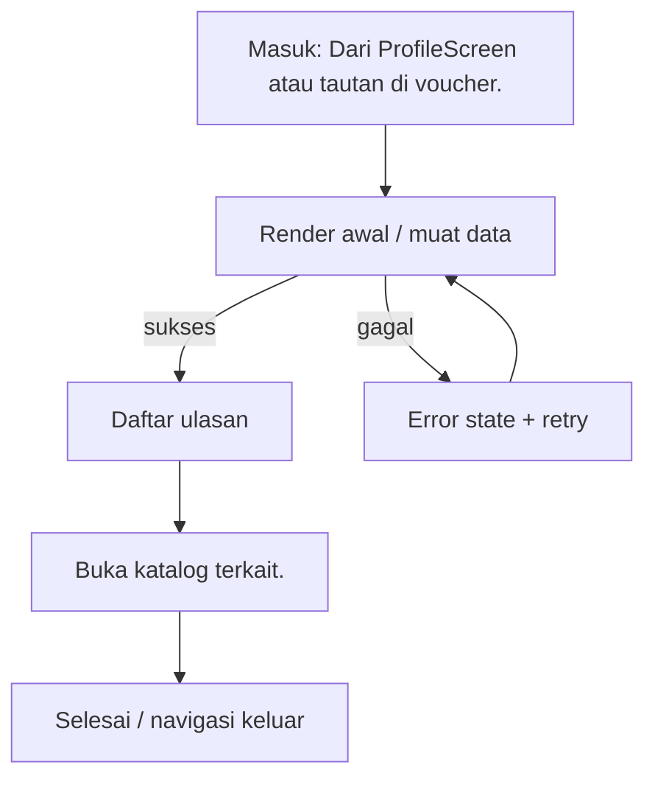

# Ulasan Saya

> **Fitur:** Ulasan · **Route:** `/my-reviews` · **Akses:** Sanctum · **Tipe:** Formulir
> **Implementasi referensi (aplikasi saat ini):** `MyReviewsScreen` · **State:** State management terpusat + state lokal · **Pola:** request-response
> **API:** 4 endpoint · **Tabel:** 5 · **Model:** 1
> Diverifikasi 6 November 2026 dari implementasi aplikasi saat ini, route Laravel, dan skema PostgreSQL. Bagian bertanda **[Usulan]** adalah rekomendasi, bukan perilaku yang sudah diverifikasi.

## 0. Ringkasan Eksekutif

| Aspek | Ringkasan |
|---|---|
| Tujuan | Menampilkan ulasan milik pengguna dan memungkinkan edit/hapus. |
| Aktor | Pelanggan terautentikasi (Sanctum) |
| Nilai pengguna | Menampilkan ulasan milik pengguna dan memungkinkan edit/hapus. |
| Definisi sukses | Data tersimpan dan validasi backend terpetakan ke field. |
| Risiko utama | Tidak ada gap khusus yang terdokumentasi. |
| Status dokumen | Kontrak terdokumentasi |

## 1. Konteks Fitur

### 1.1 Persona & job-to-be-done

| Persona | Kebutuhan | Ukuran keberhasilan |
|---|---|---|
| Pelanggan dekorasi pernikahan | Menampilkan ulasan milik pengguna dan memungkinkan edit/hapus. | Data tersimpan dan validasi backend terpetakan ke field. |

### 1.2 In scope

- Muat `reviews/user`.
- Tampilkan rating, komentar, foto.
- Edit atau hapus ulasan.
- Buka katalog terkait.

### 1.3 Out of scope

- Tidak mengakses database secara langsung; semua data lewat REST/Laravel.
- Tidak menggantikan validasi backend untuk harga, stok, status, atau kepemilikan resource.
- Tidak menambahkan dependensi atau endpoint baru tanpa memperbarui dokumen ini dan peta endpoint.

## 2. Navigasi & Entry Point

| Arah | Detail |
|---|---|
| Masuk dari | Dari `ProfileScreen` atau tautan di voucher. |
| Route | `/my-reviews` |
| Parameter/extra | Tidak ada parameter khusus. |
| Guard | Butuh Bearer token valid. 401 harus membersihkan token dan mengarahkan pengguna ke Landing/login. |
| Keluar ke | `/orders` |
| Perilaku back | Jika ada perubahan belum disimpan, tampilkan konfirmasi sebelum keluar. [Usulan] |

### 2.1 Layar terkait dalam fitur yang sama

| Layar | Route | PRD |
|---|---|---|
| `ReviewListScreen` | `/write-review` | [review-list.md](../review/review-list.md) |

## 3. Alur Pengguna

1. Muat `reviews/user`.
2. Tampilkan rating, komentar, foto.
3. Edit atau hapus ulasan.
4. Buka katalog terkait.

**Decision points yang wajib diuji:**

- `kosong` → Empty state dengan penjelasan dan CTA lanjutan.
- `hapus gagal` → Pesan ramah + retry; pertahankan input pengguna.



## 4. Arsitektur Layar

| Aspek | Nilai |
|---|---|
| Komponen/layar | `MyReviewsScreen` |
| Identifier | `MyReviewsScreen` |
| Tipe komponen | Komponen ber-state |
| Komponen state | Tersedia pada implementasi referensi |
| State management | State management terpusat + state lokal |
| Pola data | request-response |
| State/dependency | `authProvider`, `myReviewsProvider` |
| Data source/repository | Tidak terdeteksi |
| Service | Tidak terdeteksi |
| Komponen UI bersama | `AppShimmer`, `AppEmptyState`, `AppErrorState`, `AppSnackbar`, `GuestAuthPrompt`, `AppBreadcrumbs`, `AppActionSheet`, `MediaViewer` |
| Komponen UI fitur | Tidak terdeteksi |
| Model | `MyReviewModel` |

### 4.1 State lokal yang terdeteksi

| Field | Tipe | Peran |
|---|---|---|
| `_navigationBusy` | `bool` | State lokal layar. |
| `_scrollController` | `ScrollController` | Controller/state input; wajib dibersihkan saat tidak dipakai. |

### 4.2 Metode internal

`_onScroll`, `_refresh`, `_deleteReview`, `_editReview`, `_isFilteredView`, `_clearFilters`, `_buildHeader`, `_buildFilterChips`, `_buildSortMenu`, `_buildReviewCard`, `_badge`, `_buildSellerReply`, `_openOrders`, `_openItemReviews`.

### 4.3 Alur data

```text
UI / State layar
   ↓ baca/tulis
State management / dependency
   ↓
Repository / HTTP client
   ↓ REST
Controller Laravel → PostgreSQL (5 tabel terkait)
```

## 5. Blueprint UI

Wireframe konseptual dari daftar elemen registry. Urutan final mengikuti implementasi aplikasi.

```text
┌────────────────────────────────────────────────────────────────────┐
│ Ulasan Saya                                                       │
├────────────────────────────────────────────────────────────────────┤
│ 1. Daftar ulasan                                                  │
│ 2. Rating bintang                                                 │
│ 3. Foto                                                           │
│ 4. Menu edit/hapus                                                │
│ 5. Empty state                                                    │
└────────────────────────────────────────────────────────────────────┘
```

**Komponen bersama yang terdeteksi:**

- Core: `AppShimmer`, `AppEmptyState`, `AppErrorState`, `AppSnackbar`, `GuestAuthPrompt`, `AppBreadcrumbs`, `AppActionSheet`, `MediaViewer`

## 6. Inventaris Komponen & Interaksi

| # | Elemen | Jenis | Aksi | Feedback |
|---|---|---|---|---|
| 1 | Daftar ulasan | Daftar | Tap item → buka detail; dukung refresh/pagination. | Skeleton saat muat; empty state; retry. |
| 2 | Rating bintang | Visual data | Tampilkan ringkasan; tidak dapat diubah langsung. | Placeholder bila data kosong. |
| 3 | Foto | Lampiran | Pilih file; validasi tipe/ukuran sebelum upload. | Progress upload; error tipe/ukuran. |
| 4 | Menu edit/hapus | Menu | Pilih aksi kontekstual; tutup setelah aksi. | Dismiss aman; aksi destruktif beri konfirmasi. |
| 5 | Empty state | Konten | Tampilkan informasi; tidak ada aksi tulis. | Loading/error state tetap wajib. |

### 6.1 Fakta teknis form & interaksi

| Fakta | Nilai |
|---|---|
| TextEditingController | 2 |
| Field teks/form | 2 |
| Dropdown | 0 |
| Switch/toggle | 0 |
| Validator client | 0 |
| Field password (teks tersamar) | 0 |
| maxLength | 255 |
| Keyboard | Tidak terdeteksi |
| Input formatter | Tidak terdeteksi |
| Upload file | Tidak |
| Kamera | Tidak |
| WebView | Tidak |
| Timer/polling | Tidak |
| Pagination | Ya |
| Pull to refresh | Ya |

## 7. Copywriting & Microcopy

Semua teks di bawah ini adalah **usulan**. Implementasi wajib memakai sistem lokalisasi/i18n yang konsisten dan mengikuti gaya bahasa layar lain.

| Lokasi | Draft copy | Catatan |
|---|---|---|
| Judul/header | Ulasan Saya | Samakan dengan label navigasi. |
| Subjudul | Menampilkan ulasan milik pengguna dan memungkinkan edit/hapus. | Ringkas; jangan mengulang judul. |
| Tombol utama | Kirim Ulasan | [Usulan] Disabled saat proses. |
| Empty state | Belum ada ulasan Saya. | [Usulan] Sertakan CTA lanjutan. |
| Error | Gagal memuat ulasan Saya. Periksa koneksi lalu coba lagi. | [Usulan] Jangan tampilkan stack trace. |
| Retry | Coba lagi | [Usulan] Pertahankan data lama bila ada. |
| Offline | Anda sedang offline. Periksa koneksi internet. | [Usulan] Sediakan retry. |
| Validasi | Periksa kembali data yang Anda isi. | [Usulan] Fokus ke field pertama. |
| Validasi | Periksa kembali data yang Anda isi. | [Usulan] Fokus ke field pertama yang salah. |
| Sukses | Data berhasil disimpan. | [Usulan] Kembali ke layar sebelumnya. |

## 8. Design System & Responsif

### 8.1 Token yang wajib dipakai

| Token | Nilai |
|---|---|
| Font | Instrument Sans (W400/W600), aset lokal |
| Warna primer | `#1E3A5F` (token primer aplikasi) |
| Aksen | `#C9A94E` |
| Background light | `#F8F6F7` |
| Surface light | `#FFFFFF` |
| Background dark | `#121212` |
| Surface dark | `#1E1E1E` |
| Teks primer light | `#1A1A2E`; dark `#E8E8E8` |
| Teks sekunder light | `#8E8E9A`; dark `#A0A0A0` |
| Sukses/error/warning/info | `#10B981` / `#EF4444` / `#F59E0B` / `#3B82F6` |
| Tipografi | `headTitle` 22/w600; `subHeadTitle` 16/w400; `h3` 14/w600; `h4` 12/w400; `description` 14/1.4 |
| Spacing | skala 2, 4, 8, 16, 24, 32, 48, 64 |
| Radius | card 16, button 14, input 14, avatar 28, bottom nav 24 |
| Glass | `AppBlurBackdrop`; `blurSigma` 15; tint light `#32FFFFFF`, night `#32000000` |

### 8.2 Aturan responsif

- Lebar minimum yang wajib diuji: **320 px**; target umum 360/390/412 px.
- Tablet ≥ 600 px: gunakan padding lebih lebar dan grid multi-kolom bila layar berupa koleksi.
- Jangan mengunci tinggi konten; gunakan `SingleChildScrollView`/sliver agar tidak overflow.
- Hormati `SafeArea`, status bar, navigation bar, dan keyboard inset.
- Teks harus tetap terbaca pada text scale 200%; hindari `maxLines: 1` untuk label penting.
- Layout harus aman untuk locale dengan teks lebih panjang (±30%).

### 8.3 Mode gelap & glass

- Tema mengikuti sistem (light/dark) dan dapat di-override `ThemeProvider`.
- Jangan hardcode warna; gunakan token/tema desain aplikasi agar mode gelap bekerja.
- Fallback tanpa blur harus tetap kontras dan terbaca.
- Hormati reduce-motion; animasi 3D/parallax tidak boleh menjadi satu-satunya pembeda state.

## 9. State Machine

| State | Pemicu | UI | Pemulihan |
|---|---|---|---|
| `initial` | Layar dibuka | Kerangka/placeholder awal | Muat data |
| `loading` | Request berjalan | Skeleton/spinner; aksi utama disabled | Tunggu atau retry saat timeout |
| `content` | Data tersedia | Render konten utama | — |
| `empty` | Data kosong | Empty state dengan penjelasan + CTA | Refresh atau aksi lanjutan |
| `error` | Request gagal | Pesan ramah + tombol coba lagi | Retry |
| `unauthorized` | HTTP 401 | Sesi berakhir; arahkan login/Landing | Login ulang |
| `offline` | Koneksi putus | Banner/empty offline | Coba lagi saat online |
| `submitting` | Pengguna menekan aksi utama | Tombol disabled + progress | Selesai atau tampilkan error |
| `refreshing` | Pull to refresh | Spinner di atas konten | Selesai; reset halaman |
| `pagination` | Scroll mendekati akhir | Loader footer | Muat halaman berikutnya |
| `kosong` | Kondisi domain | Empty state dengan penjelasan dan CTA lanjutan. | Ikuti aksi pemulihan pada pesan |
| `hapus gagal` | Kondisi domain | Pesan ramah + retry; pertahankan input pengguna. | Ikuti aksi pemulihan pada pesan |

**Aturan umum:** setiap request harus melewati `idle → loading → success/empty/failure`; jangan merender hasil request langsung di `build()`.

## 10. Kontrak API

### 10.1 Ringkasan endpoint

| # | Method | Path | Controller | Auth | Kegunaan |
|---|---|---|---|---|---|
| 1 | `GET` | `/reviews/user` | `ReviewController@getUserReviews` | Sanctum | Ulasan milik pengguna |
| 2 | `PUT` | `/reviews/{id}` | `ReviewController@update` | Sanctum | Memperbarui/menghapus ulasan |
| 3 | `DELETE` | `/reviews/{id}` | `ReviewController@destroy` | Sanctum | Memperbarui/menghapus ulasan |
| 4 | `GET` | `/catalog/{id}` | `CatalogController@show` | Sanctum | Detail katalog |

### 10.2 Detail per endpoint

#### 10.2.1 `GET /reviews/user`

- **Controller:** `ReviewController@getUserReviews`
- **Auth:** Sanctum
- **Kegunaan:** Ulasan milik pengguna
- **Sumber aturan:** `../Mobile-And-Backend/app/Http/Controllers/Api/User/ReviewController/ReviewController.php`
- **Field request:** tidak ada aturan validasi field yang terdeteksi otomatis (GET, validasi di service, atau `FormRequest` lain). Periksa controller sebelum menulis kode.
- **Response top-level:** `status`, `data`, `summary`, `pagination`, `message`, `error`
- **Pesan error terbaca:** “Gagal mengambil ulasan Anda”

#### 10.2.2 `PUT /reviews/{id}`

- **Controller:** `ReviewController@update`
- **Auth:** Sanctum
- **Kegunaan:** Memperbarui/menghapus ulasan
- **Sumber aturan:** `../Mobile-And-Backend/app/Http/Controllers/Api/User/ReviewController/ReviewController.php`

| Field request | Aturan | Wajib |
|---|---|---|
| `rating` | `sometimes|required|integer|min:1|max:5` | Ya |
| `comment` | `sometimes|nullable|string|max:1000` | Tidak |
| `title` | `sometimes|nullable|string|max:255` | Tidak |
| `is_anonymous` | `sometimes|boolean` | Tidak |
| `photo` | `nullable|file|mimes:jpeg,png,jpg,webp,mp4,mov,m4v,webm,3gp|max:51200` | Tidak |
| `photos` | `nullable|array|max:6` | Tidak |
| `photos.*` | `file|mimes:jpeg,png,jpg,webp,mp4,mov,m4v,webm,3gp|max:51200` | Tidak |
| `removed_photo_urls` | `nullable|array` | Tidak |
| `removed_photo_urls.*` | `string` | Tidak |

- **Response top-level:** `status`, `message`, `data`, `errors`, `error`
- **Pesan error terbaca:** “Ulasan berhasil diperbarui”; “Validasi gagal”; “Ulasan tidak ditemukan atau bukan milik Anda”; “Gagal memperbarui ulasan”

#### 10.2.3 `DELETE /reviews/{id}`

- **Controller:** `ReviewController@destroy`
- **Auth:** Sanctum
- **Kegunaan:** Memperbarui/menghapus ulasan
- **Sumber aturan:** `../Mobile-And-Backend/app/Http/Controllers/Api/User/ReviewController/ReviewController.php`
- **Field request:** tidak ada aturan validasi field yang terdeteksi otomatis (GET, validasi di service, atau `FormRequest` lain). Periksa controller sebelum menulis kode.
- **Response top-level:** `status`, `message`, `error`
- **Pesan error terbaca:** “Ulasan berhasil dihapus”; “Ulasan tidak ditemukan atau bukan milik Anda”; “Gagal menghapus ulasan”

#### 10.2.4 `GET /catalog/{id}`

- **Controller:** `CatalogController@show`
- **Auth:** Sanctum
- **Kegunaan:** Detail katalog
- **Sumber aturan:** `../Mobile-And-Backend/app/Http/Controllers/Api/User/CatalogController/CatalogController.php`
- **Field request:** tidak ada aturan validasi field yang terdeteksi otomatis (GET, validasi di service, atau `FormRequest` lain). Periksa controller sebelum menulis kode.

**Envelope acuan** (periksa controller untuk variasi):

```json
{"status":"success","message":"...","data":{}}
```

### 10.3 Pemetaan error HTTP

| HTTP | Failure | Perilaku UI |
|---|---|---|
| 401 | `AuthFailure` | Hapus token, arahkan ke Landing/login, tampilkan sesi berakhir. |
| 403 | `UnknownFailure` / izin | Pesan akses ditolak; jangan logout otomatis. |
| 404 | `NotFoundFailure` | Tampilkan resource tidak ditemukan + kembali. |
| 409 | `ConflictFailure` / server | Tampilkan konflik status (stok, duplikasi, pembayaran). |
| 422 | `ValidationFailure(errors)` | Tampilkan error per field; pertahankan input. |
| 429 | `UnknownFailure` / rate limit | Minta pengguna menunggu; jangan spam retry. |
| 5xx | `ServerFailure` | Pesan error server + tombol coba lagi. |
| null | `NetworkFailure` | Periksa koneksi + retry; pertahankan data lama. |

### 10.4 Model yang dipakai

| Model | File | Field kunci |
|---|---|---|
| `MyReviewModel` | implementasi referensi aplikasi | `id`, `userId`, `catalogId`, `packageId`, `orderId`, `rating`, `title`, `comment`, `variation`, `specifications` |

## 11. Data & Database

| Tabel | Peran | Akses | Kolom kunci |
|---|---|---|---|
| `reviews` | Ulasan katalog/paket. | Baca/tulis (indikasi) | `id`, `user_id`, `package_id`, `catalog_id`, `rating`, `comment`, `created_at`, `updated_at`, `title`, `photo` … |
| `catalogs` | Item katalog. | Baca/tulis (indikasi) | `id`, `category_id`, `name`, `slug`, `description`, `price`, `discount_price`, `stock`, `is_active`, `created_at` … |
| `packages` | Tier/paket dari katalog. | Baca/tulis (indikasi) | `id`, `category_id`, `name`, `slug`, `description`, `price`, `stock`, `discount_price`, `is_featured`, `features` … |
| `media` | File polymorphic (avatar, dokumen, lampiran). | Baca/tulis (indikasi) | `id`, `model_type`, `model_id`, `uuid`, `collection_name`, `name`, `file_name`, `mime_type`, `disk`, `conversions_disk` … |
| `categories` | Kategori katalog. | Baca/tulis (indikasi) | `id`, `name`, `slug`, `icon`, `color`, `description`, `created_at`, `updated_at`, `name_translations`, `description_translations` … |

Akses tabel di atas adalah **indikasi dari endpoint**; verifikasi controller/service untuk memastikan operasi baca/tulis yang sebenarnya.

### 11.1 Aturan data

- Jangan menampilkan data dari cache setelah logout.
- Nominal, stok, status pesanan, dan kepemilikan resource **wajib** divalidasi backend.
- Jangan mengakses PostgreSQL langsung dari klien; gunakan endpoint Laravel.
- Filter data milik pengguna dilakukan server-side (`user_id` dari token), bukan di client.

## 12. Aturan Bisnis & Validasi

### 12.1 Acceptance dari registry

- Ulasan yang dihapus hilang dari daftar.
- Edit mempertahankan rating dan komentar.

### 12.2 Validasi server yang terbaca dari controller

| Field | Aturan | Endpoint |
|---|---|---|
| `rating` | `sometimes|required|integer|min:1|max:5` | `/reviews/{id}` |
| `comment` | `sometimes|nullable|string|max:1000` | `/reviews/{id}` |
| `title` | `sometimes|nullable|string|max:255` | `/reviews/{id}` |
| `is_anonymous` | `sometimes|boolean` | `/reviews/{id}` |
| `photo` | `nullable|file|mimes:jpeg,png,jpg,webp,mp4,mov,m4v,webm,3gp|max:51200` | `/reviews/{id}` |
| `photos` | `nullable|array|max:6` | `/reviews/{id}` |
| `photos.*` | `file|mimes:jpeg,png,jpg,webp,mp4,mov,m4v,webm,3gp|max:51200` | `/reviews/{id}` |
| `removed_photo_urls` | `nullable|array` | `/reviews/{id}` |
| `removed_photo_urls.*` | `string` | `/reviews/{id}` |

### 12.3 Validasi client yang terdeteksi

- Form memiliki **2 field** dan **0 validator** client.
- Batas panjang input: 255.
- Validasi client hanya untuk UX; hasil final tetap dari backend (`422`).

### 12.4 Aturan bisnis wajib

- Disable tombol submit selama request berjalan untuk mencegah duplikasi.
- Terapkan `Accept-Language` dari `localeProvider` pada setiap request.
- Gunakan HTTP client/data source/repository yang sudah ada; jangan membuat client baru di komponen UI.
- Guest tidak boleh memanggil endpoint privat; tampilkan prompt autentikasi tamu.
- Validasi client untuk UX; validasi final di backend.
- Pertahankan input saat 422/network error.

## 13. Error Handling

Pemetaan status HTTP mengikuti `.docs/02-architecture/STATE-AND-ERRORS.md` (lihat §10.3).

### 13.1 Kegagalan spesifik layar

- Timeout jaringan → tampilkan pesan koneksi dan tombol coba lagi.
- Respons tidak sesuai envelope → tampilkan error umum, catat status code.
- 401 → bersihkan token dan arahkan ke Landing/login.
- 403 → tampilkan akses ditolak tanpa logout otomatis.
- 5xx → error server + retry; jangan menampilkan stack trace.
- 422 → petakan `errors` ke field; fokus ke field pertama.

## 14. Keamanan & Privasi

- Token hanya di secure storage; jangan di penyimpanan lokal atau log.
- Jangan menampilkan stack trace, query database, atau detail internal pada pengguna.
- Jangan mengirim PII ke analytics/crash report.
- Validasi kepemilikan resource di backend; client tidak boleh menentukan `user_id`.
- Data identitas (nama, email, telepon, alamat, KTP, selfie) adalah PII; batasi tampilan dan log.
- Guest tidak boleh mengirim Bearer token kosong atau mengakses resource privat.

## 15. Aksesibilitas

- Semua ikon/tombol non-teks memiliki label semantik.
- Target sentuh minimal 48×48 dp; jangan hanya mengandalkan ikon kecil.
- Kontras teks memenuhi WCAG AA pada mode terang dan gelap.
- Urutan fokus screen reader mengikuti urutan visual.
- Text scale 200% tidak memotong label atau tombol utama.
- Error form diumumkan dan terhubung ke field terkait.
- Hormati reduce-motion; animasi tidak boleh menghalangi interaksi.

## 16. Performa & Offline

- Gunakan `CachedNetworkImage`/cache yang ada untuk gambar jaringan.
- Hindari pekerjaan berat di `build()`; pindahkan parsing/format ke provider/util.
- Dispose controller, timer, dan subscription di `dispose`.
- Muat halaman berikutnya hanya saat mendekati akhir; cegah request paralel.
- Pull-to-refresh mereset halaman dan tidak menumpuk request.
- Tidak ada cache lokal terdeteksi; jangan menambah cache tanpa kebijakan kedaluwarsa.

## 17. Analytics & Observability [Usulan]

Belum diverifikasi apakah event berikut sudah diimplementasikan. Jangan mengirim PII.

| Event | Pemicu | Properti | PII |
|---|---|---|---|
| `screen_view_my_reviews` | Layar dibuka | screen, route, auth | Tidak |
| `my_reviews_cta_tap` | Aksi utama ditekan | cta, state | Tidak |
| `my_reviews_success` | Aksi utama berhasil | duration_ms | Tidak |
| `my_reviews_failure` | Request/aksi gagal | error_code, status | Tidak |
| `my_reviews_validation_failed` | Validasi gagal | field_count | Tidak |

- Catat `request_id`/status code pada log debug, bukan payload sensitif.
- Crashlytics tidak boleh memuat token, password, dokumen identitas, atau isi chat.

## 18. Acceptance Criteria

### 18.1 Fungsional

- [ ] Ulasan yang dihapus hilang dari daftar.
- [ ] Edit mempertahankan rating dan komentar.
- [ ] Tombol utama menjalankan aksi: Kirim Ulasan.

### 18.2 Navigasi

- [ ] Jalur masuk berfungsi: Dari `ProfileScreen` atau tautan di voucher.
- [ ] Route/parameter sesuai: `/my-reviews`.
- [ ] Back tidak meninggalkan state ganda atau mengulang submit.

### 18.3 State & error

- [ ] Loading, content, empty, error, offline, dan unauthorized tertangani.
- [ ] 401 membersihkan token dan mengarahkan ke Landing/login.
- [ ] 422 menampilkan error per field dan mempertahankan input.
- [ ] Tombol tidak dapat ditekan ganda saat request berjalan.

### 18.4 Data & keamanan

- [ ] Semua endpoint yang dipakai terdaftar di backend; tidak ada endpoint karangan.
- [ ] Nominal/stok/status berasal dari respons backend, bukan hitungan lokal.
- [ ] Tidak ada PII/token di log, analytics, atau pesan error.
- [ ] Guest tidak memanggil endpoint privat.

### 18.5 Responsif & aksesibilitas

- [ ] Tidak ada overflow pada lebar 320 px dan orientasi landscape.
- [ ] Mode terang dan gelap terbaca.
- [ ] Text scale 200% tidak memotong label penting.
- [ ] Target sentuh minimal 48×48 dp dan label semantik tersedia.

### 18.6 Kualitas

- [ ] Analisis statis/lint sesuai toolchain target bersih untuk bagian yang diubah.
- [ ] Test happy path dan minimal satu error path ditambahkan/diperbarui.
- [ ] PRD/SKILL diperbarui bila route, endpoint, atau tabel berubah.

## 19. Test Plan

| ID | Jenis | Skenario | Langkah | Hasil yang diharapkan |
|---|---|---|---|---|
| TC-01 | Widget | Happy path | Buka layar melalui: Dari `ProfileScreen` atau tautan di voucher. | Elemen utama tampil; request sukses; tidak ada error. |
| TC-02 | Manual | Route/parameter | Buka /my-reviews dengan parameter sesuai | Parameter terbaca; layar menampilkan data yang benar. |
| TC-03 | Manual | Loading | Buka layar dengan jaringan lambat | Skeleton/spinner tampil; aksi utama disabled. |
| TC-04 | Manual | Empty | Gunakan akun/data tanpa item | Empty state tampil dengan CTA yang sesuai. |
| TC-05 | Manual | Error server | Mock respons 500 | Pesan error + tombol coba lagi; aplikasi tidak crash. |
| TC-06 | Manual | Sesi habis | Gunakan token kedaluwarsa/401 | Token dibersihkan; diarahkan ke Landing/login. |
| TC-07 | Manual | Akses ditolak | Mock respons 403 | Pesan akses ditolak; tidak logout otomatis. |
| TC-08 | Manual | Offline | Matikan jaringan lalu muat/aksi | Pesan offline + retry; data lama (bila ada) tidak hilang. |
| TC-09 | Widget | Double submit | Tekan aksi utama cepat dua kali | Hanya satu request; tombol disabled saat proses. |
| TC-10 | Manual | Layar kecil | Uji lebar 320 px dan landscape | Tidak ada overflow; tombol tetap terjangkau. |
| TC-11 | Manual | Mode gelap | Aktifkan dark mode sistem | Semua teks/komponen terbaca; tidak ada warna hardcode yang pecah. |
| TC-12 | Manual | Aksesibilitas | Aktifkan screen reader dan text scale 200% | Label terbaca; tidak ada teks terpotong. |
| TC-13 | Widget | Validasi kosong | Submit form kosong | Error inline per field; fokus ke field pertama. |
| TC-14 | Manual | Validasi 422 | Mock 422 dengan errors | Error dipetakan ke field; input dipertahankan. |
| TC-15 | Manual | Pagination | Scroll sampai akhir daftar | Halaman berikutnya dimuat sekali; tidak ada duplikasi. |
| TC-16 | Manual | Refresh | Tarik untuk refresh | Daftar/halaman direset dan data terbaru tampil. |
| TC-17 | Manual | Regresi fitur terkait | Buka layar terkait setelah aksi | Navigasi/state tidak rusak dan data konsisten. |

**Otomasi yang disarankan:** widget test untuk state utama, unit test untuk parsing/validasi, dan golden test untuk layar dengan layout kompleks.

## 20. Gap, Risiko & Dependensi

Tidak ada gap khusus untuk layar ini.

### 20.2 Risiko

| Risiko | Peluang | Dampak | Mitigasi |
|---|---|---|---|
| Regresi UI saat refactor | Sedang | Sedang | Widget test + golden test untuk state utama. |

### 20.3 Dependensi

| Jenis | Item | Catatan |
|---|---|---|
| Endpoint | GET /reviews/user | ReviewController@getUserReviews |
| Endpoint | PUT /reviews/{id} | ReviewController@update |
| Endpoint | DELETE /reviews/{id} | ReviewController@destroy |
| Endpoint | GET /catalog/{id} | CatalogController@show |
| Database | reviews | Jangan query langsung dari klien. |
| Database | catalogs | Jangan query langsung dari klien. |
| Database | packages | Jangan query langsung dari klien. |
| Database | media | Jangan query langsung dari klien. |
| Database | categories | Jangan query langsung dari klien. |
| State/dependency | authProvider | Komponen state/dependency terkait |
| State/dependency | myReviewsProvider | Komponen state/dependency terkait |
| Route | /my-reviews | Terdaftar di konfigurasi router aplikasi. |

Rujukan global: [Known Gaps](../../06-reference/KNOWN-GAPS.md).

## 21. Peta Implementasi & Simbol

| Layer | Komponen/Referensi | Catatan |
|---|---|---|
| Layar/UI | `MyReviewsScreen` | Implementasi referensi aplikasi saat ini |
| State/dependency | `authProvider` | Komponen state/dependency terkait |
| State/dependency | `myReviewsProvider` | Komponen state/dependency terkait |
| Model/data | `MyReviewModel` | Struktur data terkait |
| Komponen UI bersama | `AppShimmer` | Komponen UI reusable |
| Komponen UI bersama | `AppEmptyState` | Komponen UI reusable |
| Komponen UI bersama | `AppErrorState` | Komponen UI reusable |
| Komponen UI bersama | `AppSnackbar` | Komponen UI reusable |
| Komponen UI bersama | `GuestAuthPrompt` | Komponen UI reusable |
| Komponen UI bersama | `AppBreadcrumbs` | Komponen UI reusable |
| Komponen UI bersama | `AppActionSheet` | Komponen UI reusable |
| Komponen UI bersama | `MediaViewer` | Komponen UI reusable |
| Test | Sesuai platform target | Tambahkan test sesuai §19 |
| Dokumen | `.docs/screens/review/my-reviews.md` | PRD ini |
| Prompt | `.skills/screens/review/my-reviews/SKILL.md` | Skill layar |

**Metode internal terdeteksi:** `_onScroll`, `_refresh`, `_deleteReview`, `_editReview`, `_isFilteredView`, `_clearFilters`, `_buildHeader`, `_buildFilterChips`, `_buildSortMenu`, `_buildReviewCard`, `_badge`, `_buildSellerReply`, `_openOrders`, `_openItemReviews`.

## 22. Referensi & Riwayat

- [REST API](../../03-api/REST-API.md)
- [State & Error](../../02-architecture/STATE-AND-ERRORS.md)
- [Peta Endpoint](../../06-reference/API-ENDPOINT-MAP.md)
- [Database](../../04-database/DATABASE.md)
- [Arsitektur](../../02-architecture/ARCHITECTURE.md)
- [Skill layar](../../../.skills/screens/review/my-reviews/SKILL.md)

| Tanggal | Perubahan | Sumber |
|---|---|---|
| 6 November 2026 | Regenerasi detail: arsitektur, state machine, kontrak API, validasi, a11y, test plan | Implementasi aplikasi, route Laravel, skema PostgreSQL |
