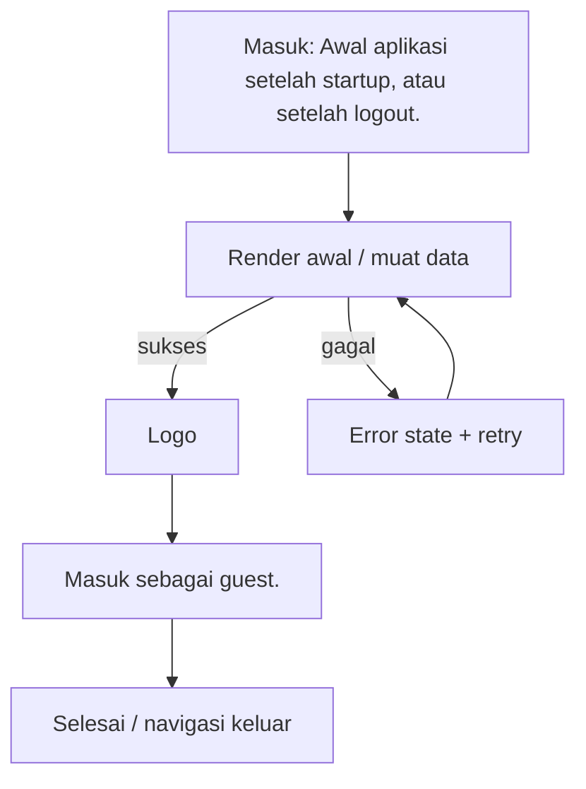

# Landing

> **Fitur:** Splash & Landing · **Route:** `/landing` · **Akses:** Publik · **Tipe:** Konten / navigasi
> **Implementasi:** `lib/Features/Splash/Presentation/Screens/Landing/LandingScreen.dart` — `LandingScreen` (289 baris) · **State:** Riverpod + state lokal (`setState`) · **Pola:** request-response
> **API:** 8 endpoint · **Tabel:** 4 · **Model:** 0
> Diverifikasi 6 November 2026 dari kode Flutter, route Laravel, dan skema PostgreSQL. Bagian bertanda **[Usulan]** adalah rekomendasi, bukan perilaku yang sudah diverifikasi.

## 0. Ringkasan Eksekutif

| Aspek | Ringkasan |
|---|---|
| Tujuan | Gerbang masuk: login, registrasi, login sosial, atau lanjut sebagai guest. |
| Aktor | Pengunjung publik |
| Nilai pengguna | Gerbang masuk: login, registrasi, login sosial, atau lanjut sebagai guest. |
| Definisi sukses | Konten utama tampil dan navigasi lanjutan berfungsi. |
| Risiko utama | `POST /login` dan `/register` tidak tersedia di backend (GAP-01). |
| Status dokumen | Kontrak terdokumentasi; ada gap yang harus ditangani |

## 1. Konteks Fitur

### 1.1 Persona & job-to-be-done

| Persona | Kebutuhan | Ukuran keberhasilan |
|---|---|---|
| Pelanggan dekorasi pernikahan | Gerbang masuk: login, registrasi, login sosial, atau lanjut sebagai guest. | Konten utama tampil dan navigasi lanjutan berfungsi. |

### 1.2 In scope

- Tampilkan branding dan tombol masuk.
- Buka modal login/registrasi.
- Login Google/Facebook/Apple.
- Masuk sebagai guest.

### 1.3 Out of scope

- Tidak mengakses database secara langsung; semua data lewat REST/Laravel.
- Tidak menggantikan validasi backend untuk harga, stok, status, atau kepemilikan resource.
- Tidak menambahkan dependensi atau endpoint baru tanpa memperbarui dokumen ini dan peta endpoint.

## 2. Navigasi & Entry Point

| Arah | Detail |
|---|---|
| Masuk dari | Awal aplikasi setelah startup, atau setelah logout. |
| Route | `/landing` |
| Parameter/extra | Tidak ada parameter khusus. |
| Guard | Tidak membutuhkan token. Tetap tangani 401/403 bila endpoint berubah menjadi privat. |
| Keluar ke | `/app-lock`, `/home`, `/chat-list` |
| Perilaku back | Gunakan tombol back bawaan `go_router`; jangan membuat navigasi manual yang menduplikasi route. |

### 2.1 Layar terkait dalam fitur yang sama

| Layar | Route | PRD |
|---|---|---|
| `StartupScreen` | `/startup` | [startup.md](../splash/startup.md) |

## 3. Alur Pengguna

1. Tampilkan branding dan tombol masuk.
2. Buka modal login/registrasi.
3. Login Google/Facebook/Apple.
4. Masuk sebagai guest.

**Decision points yang wajib diuji:**

- `login gagal` → Pesan ramah + retry; pertahankan input pengguna.



## 4. Arsitektur Layar

| Aspek | Nilai |
|---|---|
| File | `lib/Features/Splash/Presentation/Screens/Landing/LandingScreen.dart` |
| Kelas layar | `LandingScreen` |
| Base widget | `ConsumerStatefulWidget` |
| Kelas state | `_LandingPageState` |
| State management | Riverpod + state lokal (`setState`) |
| Pola data | request-response |
| Provider | `authProvider`, `currentAccountEmailProvider`, `localeProvider` |
| Repository | Tidak terdeteksi |
| Service | Tidak terdeteksi |
| Widget inti | `AppBlurBackdrop` |
| Widget fitur | `SocialLoginButton`, `AuthModals` |
| Model | Tidak terdeteksi |

### 4.1 State lokal yang terdeteksi

| Field | Tipe | Peran |
|---|---|---|
| `_routeScheduled` | `bool` | State lokal layar. |

### 4.2 Metode internal

`_markOnboardingSeen`, `_routeAfterAuth`, `_buildLandingUI`, `_openCs`, `_blob`, `_buildButtons`, `_buildFooter`.

### 4.3 Alur data

```text
Widget / State
   ↓ baca/tulis
Provider Riverpod
   ↓
Repository / DioClient
   ↓ REST
Controller Laravel → PostgreSQL (4 tabel terkait)
```

## 5. Blueprint UI

Wireframe konseptual dari daftar elemen registry. Urutan final mengikuti file implementasi.

```text
┌────────────────────────────────────────────────────────────────────┐
│ Landing                                                           │
├────────────────────────────────────────────────────────────────────┤
│ 1. Logo                                                           │
│ 2. Tombol masuk                                                   │
│ 3. Tombol daftar                                                  │
│ 4. Tombol sosial                                                  │
│ 5. Tombol guest                                                   │
│ 6. Modal auth                                                     │
└────────────────────────────────────────────────────────────────────┘
```

**Komponen bersama yang terdeteksi:**

- Core: `AppBlurBackdrop`
- Fitur: `SocialLoginButton`, `AuthModals`

## 6. Inventaris Komponen & Interaksi

| # | Elemen | Jenis | Aksi | Feedback |
|---|---|---|---|---|
| 1 | Logo | Konten | Tampilkan informasi; tidak ada aksi tulis. | Loading/error state tetap wajib. |
| 2 | Tombol masuk | Aksi | Tap → jalankan aksi utama layar. | Disabled saat loading; error lewat SnackBar/inline. |
| 3 | Tombol daftar | Aksi | Tap → jalankan aksi utama layar. | Disabled saat loading; error lewat SnackBar/inline. |
| 4 | Tombol sosial | Aksi | Tap → jalankan aksi utama layar. | Disabled saat loading; error lewat SnackBar/inline. |
| 5 | Tombol guest | Aksi | Tap → jalankan aksi utama layar. | Disabled saat loading; error lewat SnackBar/inline. |
| 6 | Modal auth | Overlay | Konfirmasi/pilih; tutup dengan back atau aksi batal. | Fokus terperangkap; dismiss aman. |

### 6.1 Fakta teknis form & interaksi

| Fakta | Nilai |
|---|---|
| TextEditingController | 0 |
| Field teks/form | 0 |
| Dropdown | 0 |
| Switch/toggle | 0 |
| Validator client | 0 |
| Field password (`obscureText`) | 0 |
| maxLength | Tidak terdeteksi |
| Keyboard | Tidak terdeteksi |
| Input formatter | Tidak terdeteksi |
| Upload file | Tidak |
| Kamera | Tidak |
| WebView | Tidak |
| Timer/polling | Tidak |
| Pagination | Tidak |
| Pull to refresh | Tidak |

## 7. Copywriting & Microcopy

Semua teks di bawah ini adalah **usulan**. Implementasi wajib memakai `AppLocalizations` dan mengikuti gaya bahasa layar lain.

| Lokasi | Draft copy | Catatan |
|---|---|---|
| Judul/header | Landing | Samakan dengan label navigasi. |
| Subjudul | Gerbang masuk: login, registrasi, login sosial, atau lanjut sebagai guest. | Ringkas; jangan mengulang judul. |
| Tombol utama | Masuk sebagai guest | [Usulan] Disabled saat proses. |
| Empty state | Belum ada landing. | [Usulan] Sertakan CTA lanjutan. |
| Error | Gagal memuat landing. Periksa koneksi lalu coba lagi. | [Usulan] Jangan tampilkan stack trace. |
| Retry | Coba lagi | [Usulan] Pertahankan data lama bila ada. |
| Offline | Anda sedang offline. Periksa koneksi internet. | [Usulan] Sediakan retry. |
| Validasi | Periksa kembali data yang Anda isi. | [Usulan] Fokus ke field pertama. |

## 8. Design System & Responsif

### 8.1 Token yang wajib dipakai

| Token | Nilai |
|---|---|
| Font | Instrument Sans (W400/W600), aset lokal |
| Warna primer | `AppColors.primaryColor` = `#1E3A5F` |
| Aksen | `AppColors.accentColor` = `#C9A94E` |
| Background light | `AppColors.backgroundColor` = `#F8F6F7` |
| Surface light | `AppColors.surfaceColor` = `#FFFFFF` |
| Background dark | `AppColors.darkBackground` = `#121212` |
| Surface dark | `AppColors.darkSurface` = `#1E1E1E` |
| Teks primer light | `#1A1A2E`; dark `#E8E8E8` |
| Teks sekunder light | `#8E8E9A`; dark `#A0A0A0` |
| Sukses/error/warning/info | `#10B981` / `#EF4444` / `#F59E0B` / `#3B82F6` |
| Tipografi | `headTitle` 22/w600; `subHeadTitle` 16/w400; `h3` 14/w600; `h4` 12/w400; `description` 14/1.4 |
| Spacing | `AppSizes` 2, 4, 8, 16, 24, 32, 48, 64 |
| Radius | card 16, button 14, input 14, avatar 28, bottom nav 24 |
| Glass | `AppBlurBackdrop`; `blurSigma` 15; tint light `#32FFFFFF`, night `#32000000` |

### 8.2 Aturan responsif

- Lebar minimum yang wajib diuji: **320 px**; target umum 360/390/412 px.
- Tablet ≥ 600 px: gunakan padding lebih lebar dan grid multi-kolom bila layar berupa koleksi.
- Jangan mengunci tinggi konten; gunakan `SingleChildScrollView`/sliver agar tidak overflow.
- Hormati `SafeArea`, status bar, navigation bar, dan keyboard inset.
- Teks harus tetap terbaca pada text scale 200%; hindari `maxLines: 1` untuk label penting.
- Layout harus aman untuk locale dengan teks lebih panjang (±30%).

### 8.3 Mode gelap & glass

- Tema mengikuti sistem (light/dark) dan dapat di-override `ThemeProvider`.
- Jangan hardcode warna; gunakan `AppColors`/`AppTheme` agar mode gelap bekerja.
- Fallback tanpa blur harus tetap kontras dan terbaca.
- Hormati reduce-motion; animasi 3D/parallax tidak boleh menjadi satu-satunya pembeda state.

## 9. State Machine

| State | Pemicu | UI | Pemulihan |
|---|---|---|---|
| `initial` | Layar dibuka | Kerangka/placeholder awal | Muat data |
| `loading` | Request berjalan | Skeleton/spinner; aksi utama disabled | Tunggu atau retry saat timeout |
| `content` | Data tersedia | Render konten utama | — |
| `empty` | Data kosong | Empty state dengan penjelasan + CTA | Refresh atau aksi lanjutan |
| `error` | Request gagal | Pesan ramah + tombol coba lagi | Retry |
| `offline` | Koneksi putus | Banner/empty offline | Coba lagi saat online |
| `submitting` | Pengguna menekan aksi utama | Tombol disabled + progress | Selesai atau tampilkan error |
| `login gagal` | Kondisi domain | Pesan ramah + retry; pertahankan input pengguna. | Ikuti aksi pemulihan pada pesan |
| `2FA diperlukan` | Kondisi domain | Tampilkan status yang jelas dan aksi pemulihan. | Ikuti aksi pemulihan pada pesan |
| `akun terkunci` | Kondisi domain | Tampilkan countdown/instruksi pemulihan; jangan bocorkan detail. | Ikuti aksi pemulihan pada pesan |
| `guest` | Kondisi domain | Tampilkan `GuestAuthPrompt`; jangan panggil endpoint privat. | Ikuti aksi pemulihan pada pesan |

**Aturan umum:** setiap request harus melewati `idle → loading → success/empty/failure`; jangan merender hasil request langsung di `build()`.

## 10. Kontrak API

### 10.1 Ringkasan endpoint

| # | Method | Path | Controller | Auth | Kegunaan |
|---|---|---|---|---|---|
| 1 | `ANY` | `/login` | `-` | Tidak ada | Masuk dengan email dan password |
| 2 | `ANY` | `/register` | `-` | Tidak ada | Registrasi akun baru |
| 3 | `POST` | `/auth/google` | `AuthController@googleLogin` | Publik | Login Google memakai Firebase ID token |
| 4 | `POST` | `/auth/facebook` | `AuthController@facebookLogin` | Publik | Login Facebook |
| 5 | `POST` | `/auth/apple` | `AuthController@appleLogin` | Publik | Login Apple |
| 6 | `POST` | `/auth/send-otp` | `AuthController@sendOtp` | Publik | Mengirim OTP email/WhatsApp |
| 7 | `POST` | `/auth/verify-otp` | `AuthController@verifyOtp` | Publik | Memverifikasi OTP |
| 8 | `POST` | `/auth/two-factor/verify` | `AuthController@verifyTwoFactor` | Publik | Memverifikasi tantangan 2FA |

### 10.2 Detail per endpoint

#### 10.2.1 `ANY /login`

- **Controller:** `-`
- **Auth:** Tidak ada
- **Kegunaan:** Masuk dengan email dan password
- **Catatan:** Rute belum terdaftar di backend.
- **Field request:** tidak ada aturan validasi field yang terdeteksi otomatis (GET, validasi di service, atau `FormRequest` lain). Periksa controller sebelum menulis kode.
- **Mismatch:** konstanta client belum cocok dengan route backend; lihat [Known Gaps](../../06-reference/KNOWN-GAPS.md).

#### 10.2.2 `ANY /register`

- **Controller:** `-`
- **Auth:** Tidak ada
- **Kegunaan:** Registrasi akun baru
- **Catatan:** Rute belum terdaftar di backend.
- **Field request:** tidak ada aturan validasi field yang terdeteksi otomatis (GET, validasi di service, atau `FormRequest` lain). Periksa controller sebelum menulis kode.
- **Mismatch:** konstanta client belum cocok dengan route backend; lihat [Known Gaps](../../06-reference/KNOWN-GAPS.md).

#### 10.2.3 `POST /auth/google`

- **Controller:** `AuthController@googleLogin`
- **Auth:** Publik
- **Kegunaan:** Login Google memakai Firebase ID token
- **Sumber aturan:** `../Mobile-And-Backend/app/Http/Controllers/Api/User/AuthController/AuthController.php`

| Field request | Aturan | Wajib |
|---|---|---|
| `firebase_id_token` | `required|string` | Ya |

- **Response top-level:** `status`, `message`, `data`, `error_code`
- **Pesan error terbaca:** “Token Firebase tidak valid atau sudah kedaluwarsa”; “Akun Google tidak memiliki email yang dapat digunakan”; “Login berhasil”; “Akun Google kamu sudah terdaftar. Silakan masuk dengan email dan password.”

#### 10.2.4 `POST /auth/facebook`

- **Controller:** `AuthController@facebookLogin`
- **Auth:** Publik
- **Kegunaan:** Login Facebook
- **Sumber aturan:** `../Mobile-And-Backend/app/Http/Controllers/Api/User/AuthController/AuthController.php`

| Field request | Aturan | Wajib |
|---|---|---|
| `access_token` | `required|string` | Ya |
| `fields` | `id,name,email,picture` | Tidak |

- **Response top-level:** `status`, `message`, `error_code`
- **Pesan error terbaca:** “Gagal memverifikasi token Facebook”; “Token Facebook tidak valid”; “Akun Facebook kamu sudah terdaftar. Silakan masuk dengan email dan password.”

#### 10.2.5 `POST /auth/apple`

- **Controller:** `AuthController@appleLogin`
- **Auth:** Publik
- **Kegunaan:** Login Apple
- **Sumber aturan:** `../Mobile-And-Backend/app/Http/Controllers/Api/User/AuthController/AuthController.php`

| Field request | Aturan | Wajib |
|---|---|---|
| `identity_token` | `required|string` | Ya |

- **Response top-level:** `status`, `message`
- **Pesan error terbaca:** “Token Apple tidak valid”

#### 10.2.6 `POST /auth/send-otp`

- **Controller:** `AuthController@sendOtp`
- **Auth:** Publik
- **Kegunaan:** Mengirim OTP email/WhatsApp
- **Sumber aturan:** `../Mobile-And-Backend/app/Http/Controllers/Api/User/AuthController/AuthController.php`

| Field request | Aturan | Wajib |
|---|---|---|
| `email` | `required_without:whatsapp|email` | Ya |
| `whatsapp` | `required_without:email|string` | Ya |
| `purpose` | `required|string|in:google_register,forgot_password,verify_email,reset_app_lock,verify_whatsapp` | Ya |

- **Response top-level:** `status`, `message`
- **Pesan error terbaca:** “Tujuan OTP tidak valid”; “Format nomor WhatsApp tidak valid”; “Kode OTP berhasil dikirim ke WhatsApp”; “User tidak ditemukan”

#### 10.2.7 `POST /auth/verify-otp`

- **Controller:** `AuthController@verifyOtp`
- **Auth:** Publik
- **Kegunaan:** Memverifikasi OTP
- **Sumber aturan:** `../Mobile-And-Backend/app/Http/Controllers/Api/User/AuthController/AuthController.php`

| Field request | Aturan | Wajib |
|---|---|---|
| `email` | `required_without:whatsapp|email` | Ya |
| `whatsapp` | `required_without:email|string` | Ya |
| `otp` | `required|string|size:6` | Ya |
| `purpose` | `required|string|in:google_register,forgot_password,verify_email,reset_app_lock,verify_whatsapp` | Ya |

- **Response top-level:** `status`, `message`, `data`
- **Pesan error terbaca:** “Tujuan OTP tidak valid”; “Kode OTP tidak valid atau sudah kedaluwarsa”; “OTP berhasil diverifikasi”

#### 10.2.8 `POST /auth/two-factor/verify`

- **Controller:** `AuthController@verifyTwoFactor`
- **Auth:** Publik
- **Kegunaan:** Memverifikasi tantangan 2FA
- **Sumber aturan:** `../Mobile-And-Backend/app/Http/Controllers/Api/User/AuthController/AuthController.php`

| Field request | Aturan | Wajib |
|---|---|---|
| `challenge_token` | `required|string` | Ya |
| `code` | `required|string|max:12` | Ya |
| `method` | `nullable|string|in:` | Tidak |

- **Response top-level:** `status`, `message`, `errors`, `error`, `token`, `user`, `data`
- **Pesan error terbaca:** “Validasi gagal”; “Kode yang Anda masukkan tidak cocok atau sudah kadaluarsa.”; “Verifikasi Berhasil”

**Envelope acuan** (periksa controller untuk variasi):

```json
{"status":"success","message":"...","data":{}}
```

### 10.3 Pemetaan error HTTP

| HTTP | Failure | Perilaku UI |
|---|---|---|
| 401 | `AuthFailure` | Hapus token, arahkan ke Landing/login, tampilkan sesi berakhir. |
| 403 | `UnknownFailure` / izin | Pesan akses ditolak; jangan logout otomatis. |
| 404 | `NotFoundFailure` | Tampilkan resource tidak ditemukan + kembali. |
| 409 | `ConflictFailure` / server | Tampilkan konflik status (stok, duplikasi, pembayaran). |
| 422 | `ValidationFailure(errors)` | Tampilkan error per field; pertahankan input. |
| 429 | `UnknownFailure` / rate limit | Minta pengguna menunggu; jangan spam retry. |
| 5xx | `ServerFailure` | Pesan error server + tombol coba lagi. |
| null | `NetworkFailure` | Periksa koneksi + retry; pertahankan data lama. |

## 11. Data & Database

| Tabel | Peran | Akses | Kolom kunci |
|---|---|---|---|
| `users` | Akun, profil, KYC, preferensi, dan pengaturan keamanan. | Baca/tulis (indikasi) | `id`, `full_name`, `first_name`, `mid_name`, `last_name`, `username`, `email`, `balance`, `email_verified_at`, `password` … |
| `personal_access_tokens` | Token Sanctum perangkat. | Baca/tulis (indikasi) | `id`, `tokenable_type`, `tokenable_id`, `name`, `token`, `abilities`, `last_used_at`, `expires_at`, `created_at`, `updated_at` |
| `whatsapp_otps` | Kode OTP dan masa berlaku. | Baca/tulis (indikasi) | `id`, `whatsapp`, `otp_code`, `expires_at`, `verified_at`, `created_at`, `updated_at` |
| `backup_codes` | Kode pemulihan 2FA. | Baca/tulis (indikasi) | `id`, `user_id`, `code`, `used`, `used_at`, `created_at`, `updated_at` |

Akses tabel di atas adalah **indikasi dari endpoint**; verifikasi controller/service untuk memastikan operasi baca/tulis yang sebenarnya.

### 11.1 Aturan data

- Jangan menampilkan data dari cache setelah logout.
- Nominal, stok, status pesanan, dan kepemilikan resource **wajib** divalidasi backend.
- Jangan mengakses PostgreSQL dari Flutter; gunakan endpoint Laravel.
- Filter data milik pengguna dilakukan server-side (`user_id` dari token), bukan di client.
- Preferensi lokal disimpan di `SharedPreferences`; token tetap di `FlutterSecureStorage`.

## 12. Aturan Bisnis & Validasi

### 12.1 Acceptance dari registry

- Login sukses menyimpan token dan membuka Home/AppLock.
- Guest dapat masuk tanpa token.

### 12.2 Validasi server yang terbaca dari controller

| Field | Aturan | Endpoint |
|---|---|---|
| `firebase_id_token` | `required|string` | `/auth/google` |
| `access_token` | `required|string` | `/auth/facebook` |
| `fields` | `id,name,email,picture` | `/auth/facebook` |
| `identity_token` | `required|string` | `/auth/apple` |
| `email` | `required_without:whatsapp|email` | `/auth/send-otp` |
| `whatsapp` | `required_without:email|string` | `/auth/send-otp` |
| `purpose` | `required|string|in:google_register,forgot_password,verify_email,reset_app_lock,verify_whatsapp` | `/auth/send-otp` |
| `email` | `required_without:whatsapp|email` | `/auth/verify-otp` |
| `whatsapp` | `required_without:email|string` | `/auth/verify-otp` |
| `otp` | `required|string|size:6` | `/auth/verify-otp` |
| `purpose` | `required|string|in:google_register,forgot_password,verify_email,reset_app_lock,verify_whatsapp` | `/auth/verify-otp` |
| `challenge_token` | `required|string` | `/auth/two-factor/verify` |
| `code` | `required|string|max:12` | `/auth/two-factor/verify` |
| `method` | `nullable|string|in:` | `/auth/two-factor/verify` |

### 12.3 Validasi client yang terdeteksi

- Tidak ada form input yang terdeteksi pada layar ini.

### 12.4 Aturan bisnis wajib

- Disable tombol submit selama request berjalan untuk mencegah duplikasi.
- Terapkan `Accept-Language` dari `localeProvider` pada setiap request.
- Gunakan `DioClient`/repository yang sudah ada; jangan membuat instance Dio baru.
- Guest tidak boleh memanggil endpoint privat; tampilkan `GuestAuthPrompt`.
- Konten statis tetap harus memiliki loading/error state bila berasal dari API.

## 13. Error Handling

Pemetaan status HTTP mengikuti `.docs/02-architecture/STATE-AND-ERRORS.md` (lihat §10.3).

### 13.1 Kegagalan spesifik layar

- Timeout jaringan → tampilkan pesan koneksi dan tombol coba lagi.
- Respons tidak sesuai envelope → tampilkan error umum, catat status code.
- 401 → bersihkan token dan arahkan ke Landing/login.
- 403 → tampilkan akses ditolak tanpa logout otomatis.
- 5xx → error server + retry; jangan menampilkan stack trace.
- Gap: `POST /login` dan `/register` tidak tersedia di backend (GAP-01).
- Gap: Login Google memakai Firebase ID token, sesi tetap Sanctum.

## 14. Keamanan & Privasi

- Token hanya di `FlutterSecureStorage`; jangan di `SharedPreferences` atau log.
- Jangan menampilkan stack trace, query database, atau detail internal pada pengguna.
- Jangan mengirim PII ke analytics/crash report.
- Validasi kepemilikan resource di backend; client tidak boleh menentukan `user_id`.

## 15. Aksesibilitas

- Semua ikon/tombol non-teks memiliki label semantik.
- Target sentuh minimal 48×48 dp; jangan hanya mengandalkan ikon kecil.
- Kontras teks memenuhi WCAG AA pada mode terang dan gelap.
- Urutan fokus screen reader mengikuti urutan visual.
- Text scale 200% tidak memotong label atau tombol utama.
- Error form diumumkan dan terhubung ke field terkait.
- Hormati reduce-motion; animasi tidak boleh menghalangi interaksi.

## 16. Performa & Offline

- Gunakan `CachedNetworkImage`/cache yang ada untuk gambar jaringan.
- Hindari pekerjaan berat di `build()`; pindahkan parsing/format ke provider/util.
- Dispose controller, timer, dan subscription di `dispose`.

## 17. Analytics & Observability [Usulan]

Belum diverifikasi apakah event berikut sudah diimplementasikan. Jangan mengirim PII.

| Event | Pemicu | Properti | PII |
|---|---|---|---|
| `screen_view_landing` | Layar dibuka | screen, route, auth | Tidak |
| `landing_cta_tap` | Aksi utama ditekan | cta, state | Tidak |
| `landing_success` | Aksi utama berhasil | duration_ms | Tidak |
| `landing_failure` | Request/aksi gagal | error_code, status | Tidak |

- Catat `request_id`/status code pada log debug, bukan payload sensitif.
- Crashlytics tidak boleh memuat token, password, dokumen identitas, atau isi chat.

## 18. Acceptance Criteria

### 18.1 Fungsional

- [ ] Login sukses menyimpan token dan membuka Home/AppLock.
- [ ] Guest dapat masuk tanpa token.
- [ ] Tombol utama menjalankan aksi: Masuk sebagai guest.

### 18.2 Navigasi

- [ ] Jalur masuk berfungsi: Awal aplikasi setelah startup, atau setelah logout.
- [ ] Route/parameter sesuai: `/landing`.
- [ ] Back tidak meninggalkan state ganda atau mengulang submit.

### 18.3 State & error

- [ ] Loading, content, empty, error, offline, dan unauthorized tertangani.
- [ ] 401 membersihkan token dan mengarahkan ke Landing/login.
- [ ] 422 menampilkan error per field dan mempertahankan input.
- [ ] Tombol tidak dapat ditekan ganda saat request berjalan.

### 18.4 Data & keamanan

- [ ] Semua endpoint yang dipakai terdaftar di backend; tidak ada endpoint karangan.
- [ ] Nominal/stok/status berasal dari respons backend, bukan hitungan lokal.
- [ ] Tidak ada PII/token di log, analytics, atau pesan error.
- [ ] Guest tidak memanggil endpoint privat.

### 18.5 Responsif & aksesibilitas

- [ ] Tidak ada overflow pada lebar 320 px dan orientasi landscape.
- [ ] Mode terang dan gelap terbaca.
- [ ] Text scale 200% tidak memotong label penting.
- [ ] Target sentuh minimal 48×48 dp dan label semantik tersedia.

### 18.6 Kualitas

- [ ] `flutter analyze` bersih untuk file yang diubah.
- [ ] Test happy path dan minimal satu error path ditambahkan/diperbarui.
- [ ] PRD/SKILL diperbarui bila route, endpoint, atau tabel berubah.

## 19. Test Plan

| ID | Jenis | Skenario | Langkah | Hasil yang diharapkan |
|---|---|---|---|---|
| TC-01 | Widget | Happy path | Buka layar melalui: Awal aplikasi setelah startup, atau setelah logout. | Elemen utama tampil; request sukses; tidak ada error. |
| TC-02 | Manual | Route/parameter | Buka /landing dengan parameter sesuai | Parameter terbaca; layar menampilkan data yang benar. |
| TC-03 | Manual | Loading | Buka layar dengan jaringan lambat | Skeleton/spinner tampil; aksi utama disabled. |
| TC-04 | Manual | Empty | Gunakan akun/data tanpa item | Empty state tampil dengan CTA yang sesuai. |
| TC-05 | Manual | Error server | Mock respons 500 | Pesan error + tombol coba lagi; aplikasi tidak crash. |
| TC-06 | Manual | Akses ditolak | Mock respons 403 | Pesan akses ditolak; tidak logout otomatis. |
| TC-07 | Manual | Offline | Matikan jaringan lalu muat/aksi | Pesan offline + retry; data lama (bila ada) tidak hilang. |
| TC-08 | Widget | Double submit | Tekan aksi utama cepat dua kali | Hanya satu request; tombol disabled saat proses. |
| TC-09 | Manual | Layar kecil | Uji lebar 320 px dan landscape | Tidak ada overflow; tombol tetap terjangkau. |
| TC-10 | Manual | Mode gelap | Aktifkan dark mode sistem | Semua teks/komponen terbaca; tidak ada warna hardcode yang pecah. |
| TC-11 | Manual | Aksesibilitas | Aktifkan screen reader dan text scale 200% | Label terbaca; tidak ada teks terpotong. |
| TC-12 | Manual | Regresi fitur terkait | Buka layar terkait setelah aksi | Navigasi/state tidak rusak dan data konsisten. |

**Otomasi yang disarankan:** widget test untuk state utama, unit test untuk parsing/validasi, dan golden test untuk layar dengan layout kompleks.

## 20. Gap, Risiko & Dependensi

### 20.1 Gap terdokumentasi

- `POST /login` dan `/register` tidak tersedia di backend (GAP-01).
- Login Google memakai Firebase ID token, sesi tetap Sanctum.

### 20.2 Risiko

| Risiko | Peluang | Dampak | Mitigasi |
|---|---|---|---|
| `POST /login` dan `/register` tidak tersedia di backend (GAP-01). | Sedang | Tinggi | Tangani gap sebelum menganggap layar selesai. |

### 20.3 Dependensi

| Jenis | Item | Catatan |
|---|---|---|
| Endpoint | ANY /login | - |
| Endpoint | ANY /register | - |
| Endpoint | POST /auth/google | AuthController@googleLogin |
| Endpoint | POST /auth/facebook | AuthController@facebookLogin |
| Endpoint | POST /auth/apple | AuthController@appleLogin |
| Endpoint | POST /auth/send-otp | AuthController@sendOtp |
| Endpoint | POST /auth/verify-otp | AuthController@verifyOtp |
| Endpoint | POST /auth/two-factor/verify | AuthController@verifyTwoFactor |
| Database | users | Jangan query langsung dari Flutter. |
| Database | personal_access_tokens | Jangan query langsung dari Flutter. |
| Database | whatsapp_otps | Jangan query langsung dari Flutter. |
| Database | backup_codes | Jangan query langsung dari Flutter. |
| Provider | authProvider | lib/Features/Auth/Presentation/Providers/AuthProvider/AuthProvider.dart |
| Provider | currentAccountEmailProvider | lib/Features/Auth/Presentation/Providers/BiometricSettingsProvider/BiometricSettingsProvider.dart |
| Provider | localeProvider | lib/Core/Providers/LocaleProvider/LocaleProvider.dart |
| Route | /landing | Terdaftar di `AppRouter`. |

Rujukan global: [Known Gaps](../../06-reference/KNOWN-GAPS.md).

## 21. Peta Implementasi & Simbol

| Layer | File/Simbol | Catatan |
|---|---|---|
| Screen | `lib/Features/Splash/Presentation/Screens/Landing/LandingScreen.dart` · `LandingScreen` | 289 baris |
| Provider | `authProvider` | `lib/Features/Auth/Presentation/Providers/AuthProvider/AuthProvider.dart` |
| Provider | `currentAccountEmailProvider` | `lib/Features/Auth/Presentation/Providers/BiometricSettingsProvider/BiometricSettingsProvider.dart` |
| Provider | `localeProvider` | `lib/Core/Providers/LocaleProvider/LocaleProvider.dart` |
| Widget inti | `AppBlurBackdrop` | `lib/Core/Widgets/AppBlurBackdrop/` |
| Widget fitur | `SocialLoginButton` | Berada di `Presentation/Widgets/` fitur terkait |
| Widget fitur | `AuthModals` | Berada di `Presentation/Widgets/` fitur terkait |
| Test | `test/Features/Splash/` | Tambahkan test sesuai §19 |
| Dokumen | `.docs/screens/splash/landing.md` | PRD ini |
| Prompt | `.skills/screens/splash/landing/SKILL.md` | Skill layar |

**Metode internal terdeteksi:** `_markOnboardingSeen`, `_routeAfterAuth`, `_buildLandingUI`, `_openCs`, `_blob`, `_buildButtons`, `_buildFooter`.

## 22. Referensi & Riwayat

- [REST API](../../03-api/REST-API.md)
- [State & Error](../../02-architecture/STATE-AND-ERRORS.md)
- [Peta Endpoint](../../06-reference/API-ENDPOINT-MAP.md)
- [Database](../../04-database/DATABASE.md)
- [Arsitektur](../../02-architecture/ARCHITECTURE.md)
- [Skill layar](../../../.skills/screens/splash/landing/SKILL.md)

| Tanggal | Perubahan | Sumber |
|---|---|---|
| 6 November 2026 | Regenerasi detail: arsitektur, state machine, kontrak API, validasi, a11y, test plan | Kode Flutter, route Laravel, skema PostgreSQL |
